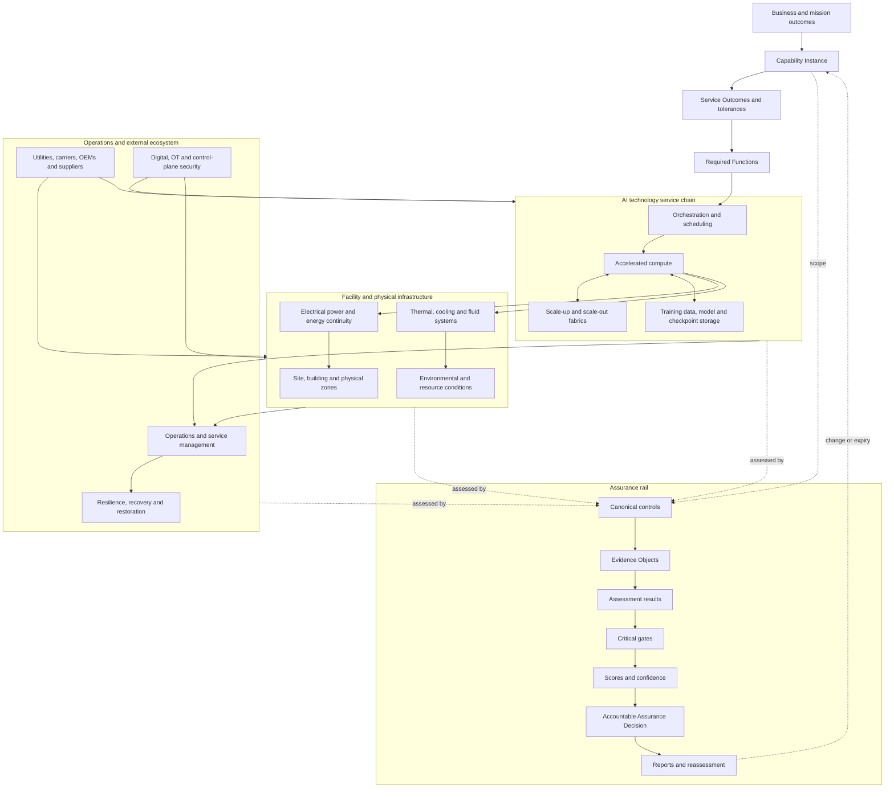

# AIDCF

## AI Data Centre Facilities Assurance Framework

**Capability-centred, evidence-gated and graph-native assurance for AI infrastructure**

> **Repository status:** Validation Candidate for Independent Review  
> **Public framework version:** Whitepaper v3.0  
> **Canonical control baseline:** 15 domains · 90 control families · 360 controls  
> **Current implementation:** Synthetic, non-production reference implementation  
> **External validation:** Not yet completed

---

## Overview

AIDCF is a research framework and controlled assurance methodology for evaluating the facilities and infrastructure that support AI compute.

It connects defined AI service outcomes to the physical, engineered, technical, operational and external systems on which those outcomes depend. It then traces credible failure paths, safeguards, evidence, assessment results, critical gates and accountable decisions.

AIDCF treats an AI data centre as a **capability-supporting system**, not merely a collection of equipment.

The framework is organised around the following assurance chain:

```text
Capability Instance
→ Service Outcome
→ Required Function
→ Architecture
→ Dependency / Fault Domain
→ Threat / Hazard / Failure Scenario
→ Safeguard
→ Control
→ Evidence Requirement
→ Evidence Object
→ Assessment Result
→ Finding / UNKNOWN
→ Critical Gate
→ Score / Recommendation
→ Assurance Decision
→ Report / Reassessment Trigger
```

AIDCF is intended to help infrastructure owners, operators, architects, engineering teams, risk and assurance practitioners, technology providers and researchers form a more defensible view of whether a bounded AI infrastructure capability can achieve its required outcomes under declared operating conditions.

---


## Quick Start

Choose the path that matches your purpose.

### Executive or decision-maker

1. Read the [technical whitepaper](whitepaper/current/AIDCF_Technical_Whitepaper_v3.0_Validation_Candidate.md).
2. Review [The Problem AIDCF Solves](#the-problem-aidcf-solves).
3. Review [Example Use Cases](#example-use-cases).
4. Review the framework's status and limitations before relying on any conclusion.

### Infrastructure, engineering or operations practitioner

1. Read the Manifesto and Core Conceptual Model.
2. Review AIDCF-003 through AIDCF-006 for ontology, failure reasoning, graph integration and assurance principles.
3. Review the AIDCF-007A canonical registry.
4. Use AIDCF-008 through AIDCF-012 for evidence, assessment, scoring, programme governance and reporting.
5. Review AIDCF-013 for the system-of-systems reference architecture.

### Researcher or independent reviewer

1. Read the whitepaper's research problem, contribution, limitations and threats to validity.
2. Review the derivation records and reviewer dispositions in `validation/`.
3. Challenge the domain model, control symmetry, gate model, scoring rules and evidence doctrine.
4. Submit issues using the review taxonomy in [CONTRIBUTING.md](CONTRIBUTING.md).

### Developer or semantic-model implementer

1. Review AIDCF-014 and AIDCF-016.
2. Inspect the CSV registries, JSON Schemas, JSON-LD context, RDF/Turtle and SHACL files.
3. From `implementation/aidcf-015-v1.2/`, run:

```bash
python tools/run_all.py
```

4. Inspect captured validation, graph-query and score re-performance outputs.
5. Do not interpret technical conformance as assurance over a real facility.

### Minimum reading order

```text
Whitepaper
→ Manifesto
→ Core Conceptual Model
→ AIDCF-003 to AIDCF-006
→ AIDCF-007A Registry
→ AIDCF-008 to AIDCF-012
→ AIDCF-013 to AIDCF-016
→ Validation and pilot records
```

---

## The Problem AIDCF Solves

Traditional reviews commonly examine facilities, technology platforms, cybersecurity, operations or AI governance as separate subjects.

AI-service failure can cross all of those boundaries.

A distributed-training or inference outcome may depend simultaneously on electrical continuity, thermal capacity, accelerated compute, checkpoint storage, low-latency fabrics, orchestration, privileged control planes, operational authority, external providers and recovery resources.

AIDCF provides a single reconstructable assurance argument across that system:

```text
What must the AI capability achieve?
→ Which functions and systems enable it?
→ What can fail together?
→ How can failure propagate?
→ Which safeguards matter?
→ What evidence supports each assertion?
→ Which prerequisites are non-compensating?
→ What bounded decision can an accountable authority issue?
```

AIDCF's purpose is not to replace existing engineering, security, management-system or AI-risk standards. It is to connect their relevant outputs to a capability-centred infrastructure assurance decision.

---

## Architecture Diagram



### How to read the diagram

- The vertical path begins with a defined business or mission outcome and a bounded Capability Instance.
- The AI technology chain depends on physical facilities, utilities, providers, people and control authority.
- Controls attach to specific capability, architecture, dependency, failure and safeguard assertions.
- Evidence supports or challenges those assertions.
- Critical gates constrain scores and recommendations.
- Only accountable authority may issue, suspend, withdraw or supersede an Assurance Decision.

---

## Example Use Cases

AIDCF can be considered for the following controlled uses. Each use requires an explicitly defined decision question, scope, evidence profile and competent review.

### AI data-centre readiness

Assess whether a planned or upgraded facility has a coherent capability model, declared operating envelope, mapped dependencies, applicable controls, evidence ownership and commissioning pathway before production use.

### High-density training-cluster assurance

Connect training-job outcomes to accelerator capacity, collective communication, checkpoint storage, electrical and thermal continuity, orchestration, fault domains and recovery dependencies.

### Inference-platform resilience review

Evaluate whether the infrastructure supporting an inference service can maintain required capacity, latency, integrity and recovery outcomes under defined demand, degradation and failure conditions.

### Liquid-cooling assurance

Review coolant distribution, heat-load assumptions, CDUs, loops, sensors, controls, fluid quality, leak management, common controllers, operating states, fail-safe behaviour and recovery interactions with compute workloads.

### Sovereign AI infrastructure

Examine jurisdictional, provider, remote-support, telemetry, administration, supply-chain and recovery dependencies against declared sovereignty and control-boundary outcomes.

### Colocation AI deployment review

Define provider and tenant boundaries, shared services, power and cooling commitments, access restrictions, evidence availability, dependency concentration and responsibility for recovery.

### AI infrastructure resilience and recovery

Analyse fault domains, common-mode dependencies, containment, graceful degradation, alternate capacity, checkpoint integrity, recovery sequencing and outcome restoration.

### OT and control-plane security review

Assess privileged access, remote support, segmentation, monitoring, change control and safe automation across BMS, EPMS, cooling, power and AI management planes.

### Supplier and concentration-risk review

Analyse exposure to utilities, carriers, OEMs, firmware, specialist labour, spares, logistics, cloud services and single-source dependencies.

### AI infrastructure due diligence

Support a bounded review of infrastructure claims, capacity assumptions, material dependencies, evidence quality and unresolved uncertainty for investment, acquisition, outsourcing or major procurement decisions.

### Continuing assurance and change impact

Use event-driven reassessment to identify which evidence, controls, gates, scores, decisions and reports may be affected by architecture, load, provider, incident or configuration changes.

### Research and method evaluation

Test the AIDCF ontology, control structure, evidence rules, critical gates, scoring constraints, graph queries, semantic validation and inter-rater reproducibility.

These examples do not imply that AIDCF is already validated for every use case or jurisdiction.

---

## Audience Matrix

| Audience | Primary interest | Relevant AIDCF outputs | Important boundary |
|---|---|---|---|
| Board and executive leadership | Bounded decision, exposure, residual uncertainty and investment priorities | Executive report, gate summary, Assurance Decision and action roadmap | AIDCF is not a guarantee or statutory opinion |
| CIO, CTO and infrastructure leadership | Capability outcomes, architecture, capacity and dependency risks | Capability profile, architecture views, domain results and change-impact records | Requires competent domain review |
| CISO and OT-security leadership | Privileged authority, segmentation, remote access and control-plane risk | SEC domain results, CG-07, CG-15, evidence and findings | Does not replace specialised cyber testing |
| Data-centre owner or operator | Facility readiness, operations, maintenance, resilience and recovery | POW, THM, PHY, ENV, OPS and RES profiles | Does not replace engineering or safety approval |
| AI/HPC platform owner | Compute, storage, fabric, scheduling and checkpoint outcomes | CMP, STO, NET, CAP and DEP results | Infrastructure assurance is not model assurance |
| Engineering teams | Power, thermal, fluid, physical and system-of-systems integrity | Reference architecture, scenarios, safeguards and evidence requirements | Hazardous testing requires explicit authorisation |
| Internal audit and assurance | Scope, evidence, workpapers, independence and conclusion lineage | Assessment package, gate register, decision record and reports | Does not create certification authority |
| Enterprise risk management | Criticality, concentration, failure consequences and treatment | Risk-linked findings, scenarios, decisions and reassessment triggers | Risk acceptance must remain with accountable authority |
| Procurement and supplier management | Provider dependence, support, lifecycle, contracts and substitution | SUP and DEP mappings, evidence requests and concentration analysis | Contract interpretation remains source-owned |
| Customer assurance teams | Transparent scope, limitations and infrastructure evidence | Bounded customer statement and disclosure package | Must not imply universal safety or resilience |
| Regulators and public-sector users | Traceability, accountability, evidence and material limitations | Regulatory report, control mapping and decision lineage | AIDCF does not determine legal compliance |
| Investors and transaction teams | Capacity credibility, hidden dependencies and evidence quality | Due-diligence profile and bounded findings | Not a valuation or investment recommendation |
| Researchers and standards practitioners | Reproducibility, construct validity and methodological gaps | Whitepaper, derivation records, registry and validation corpus | Current framework remains a validation candidate |
| Developers and ontology engineers | Schemas, identifiers, graphs, validation and interoperability | AIDCF-014, AIDCF-015 and AIDCF-016 | Machine conformance does not establish factual truth |

---

## Relationship to Existing Standards and Frameworks

AIDCF is intended to complement existing standards and methods. It does not claim equivalence, certification, conformity or clause-level coverage unless a separate, reviewed crosswalk explicitly establishes it.

| Standard or framework family | Primary role | Relationship with AIDCF |
|---|---|---|
| ISO/IEC 42001 | AI management-system governance | Can inform organisational AI-governance context, roles, objectives, risk processes and supplier governance around the capability |
| NIST AI RMF | Voluntary AI risk-management framework | Can provide AI-system context through Govern, Map, Measure and Manage; AIDCF focuses more deeply on the supporting infrastructure assurance chain |
| ISO/IEC 27001 | Information-security management system | Can provide organisational security governance and control context; AIDCF applies infrastructure-specific digital and OT assurance logic |
| ISO/IEC 22237 and EN 50600 | Data-centre facilities and infrastructure | Can provide facility and infrastructure requirements or evidence inputs across physical, power, thermal, environmental, operational and resilience domains |
| ANSI/TIA-942 | Data-centre telecommunications and physical infrastructure | Can provide relevant architecture and implementation evidence for physical, power, cooling and network infrastructure |
| Uptime Institute Tier Standard | Site-infrastructure topology and performance expectations | Tier evidence can support relevant design assertions, but a Tier classification is not converted automatically into an AIDCF Assurance Decision |
| BICSI 002 | Data-centre design and implementation guidance | Can provide design and implementation evidence for relevant technical domains where applicable |
| ISA/IEC 62443 | Industrial automation and control-system security | Can inform OT, control-plane, lifecycle, supplier and operational-security evidence |
| NIST SP 800-53 / NIST RMF | Security and privacy controls and risk-management processes | Can provide control and governance inputs where infrastructure systems fall within the selected scope |
| ASHRAE data-centre guidance | Thermal, environmental and energy engineering | Can support thermal, environmental and operating-envelope criteria; source engineering guidance remains authoritative |
| Reliability and safety methods | FMEA/FMECA, fault trees, event trees, bow ties and related analysis | AIDCF can consume structured outputs to model causes, failure modes, propagation, consequences and safeguards |
| W3C PROV-O | Provenance representation | Can support machine-readable evidence lineage and transformation records |
| Assurance-case methods | Structured claims, arguments and evidence | Conceptually compatible with AIDCF's reconstructable assurance chain; a formal mapping requires separate review |
| AI Trust Graph | Trust, authority and exposure reasoning | Interoperates through reference, mapping, shared identity, boundary handoff, scenario composition, evidence reuse and decision federation |

### Important interpretation rule

Existing certifications, classifications or compliance results are treated as bounded evidence. They do not automatically establish:

- control applicability;
- current operating effectiveness;
- absence of common-mode failure;
- capability-level resilience;
- evidence sufficiency;
- a favourable Critical Gate result;
- an AIDCF Assurance Decision.

NIST describes the AI RMF as voluntary and intended to improve organisations' ability to incorporate trustworthiness considerations into AI design, development, use and evaluation. AIDCF therefore treats it as a complementary AI-risk context rather than an infrastructure certification mechanism.

---

## Research Questions

AIDCF is designed to be challenged through explicit research questions.

### RQ1: Subject definition

Can independent assessors consistently define the same bounded Capability Instance, Service Outcomes and operating envelope for a real AI infrastructure service?

### RQ2: Cross-domain completeness

Does the fifteen-domain model capture material facility, technology, operational, supplier, security and assurance conditions without excessive overlap or omission?

### RQ3: Control-universe validity

Does the 15/90/360 catalogue provide adequate coverage without padding less-complex domains or compressing more-complex domains?

### RQ4: Dependency discovery

Does capability-centred graph modelling identify hidden, shared, external and recovery-only dependencies that conventional domain-by-domain reviews miss?

### RQ5: Failure-path usefulness

Does explicit modelling of causes, failure modes, propagation, safeguards and residual paths improve the quality of resilience conclusions?

### RQ6: Evidence quality

Do provenance, freshness, coverage, reliability, traceability, integrity and sufficiency rules improve the defensibility and reproducibility of assessments?

### RQ7: UNKNOWN discipline

Does preserving material uncertainty as a first-class result reduce false confidence compared with approaches that convert missing evidence into a score or maturity weakness?

### RQ8: Critical-gate effectiveness

Do non-compensating Critical Gates prevent high aggregate scores from obscuring decisive infrastructure, evidence, recovery or governance weaknesses?

### RQ9: Scoring validity

Are AIDCF control, family, domain and capability indicators stable, interpretable and appropriately sensitive to evidence quality, coverage and UNKNOWN?

### RQ10: Inter-rater reliability

Do independently trained assessors reach acceptably consistent applicability, control-result, gate and decision recommendations?

### RQ11: Machine traceability

Can a material report statement be reconstructed reliably through decision, gate, finding, assessment, evidence, control, safeguard, failure and architecture records?

### RQ12: Change impact

Can event-driven graph analysis identify the records and decisions affected by architecture, provider, load, configuration, incident or evidence changes?

### RQ13: Decision usefulness

Do named decision users consider AIDCF outputs more relevant, transparent and actionable than existing siloed review outputs?

### RQ14: Economic relevance

Can authorised pilots identify measurable relationships between assurance findings and accelerator availability, workload interruption, recovery effort, evidence friction or delayed programme value?

### RQ15: Scalability

Can the method remain practicable across enterprise, colocation, sovereign, hyperscale and edge AI deployments without losing claim discipline?

### RQ16: AITG interoperability

Can AIDCF infrastructure findings and AI Trust Graph authority or exposure findings be federated without collapsing their native semantics or decisions?

Research outcomes, including negative or null results, should be recorded transparently and used to revise the framework.

---

## Why AIDCF

AI workloads create tightly coupled dependencies across:

- electrical power and energy continuity;
- cooling, thermal and fluid systems;
- accelerated compute infrastructure;
- high-performance storage and checkpoint services;
- high-bandwidth network and interconnect fabrics;
- orchestration, scheduling and control planes;
- building and technology operations;
- resilience, recovery and crisis response;
- OEMs, utilities, carriers and external providers;
- physical, digital and OT security;
- evidence, assessment and accountable decision-making.

A technically available facility does not necessarily mean that a distributed-training, fine-tuning, inference or sovereign-AI capability can achieve its required service outcomes.

AIDCF addresses this integration problem by making dependencies explicit, preserving uncertainty and linking conclusions to evidence and decision authority.

---

## What makes AIDCF different

### Capability-first

The assessed subject is a specific **Capability Instance**, bounded by owner, architecture, location, operating states, service outcomes, demand, criticality and obligations.

### Cross-domain

AIDCF connects facility engineering, configured AI technology, operations, security, providers, evidence and assurance rather than reviewing each area in isolation.

### Evidence-gated

Assertions are not treated as facts unless supported by evidence that is relevant, traceable, current, sufficiently complete and appropriate for the decision.

### UNKNOWN is first-class

Missing, inaccessible, stale, conflicting or insufficient evidence remains visible as `UNKNOWN`. It is not automatically converted to pass, fail, zero, not applicable or accepted risk.

### Critical gates are non-compensating

A favourable average score cannot neutralise a controlling failure or material uncertainty in a critical prerequisite.

### Graph-native

AIDCF supports forward and reverse traceability across capability, architecture, dependency, failure, controls, evidence, assessments, gates, decisions and reports.

### Human accountability is retained

Automation may validate structures, calculate indicators, identify affected records and generate recommendations. It must not independently approve material facts, critical gates or assurance decisions.

---

## Framework status and claim boundary

AIDCF is currently a **Validation Candidate for Independent Review**.

The repository distinguishes five maturity states:

| Status | Meaning |
|---|---|
| Approved AIDCF baseline | AIDCF-internal identity and cardinality decision formally adopted within the framework |
| Controlled-review draft | Substantive methodology awaiting multidisciplinary review |
| Synthetic demonstration | Non-production data and execution used to test the method |
| Proposed research extension | Concept requiring governance, calibration and validation before operational use |
| Externally validated | Independently executed or empirically validated; **not yet achieved** |

### AIDCF is

- a research framework;
- an assurance methodology;
- a control and evidence architecture;
- a capability-centred reference model;
- a machine-readable traceability model;
- a basis for controlled pilots and independent review.

### AIDCF is not

- an accredited standard;
- a certification or accreditation scheme;
- a legal or regulatory determination;
- a licensed engineering opinion;
- a safety approval;
- a substitute for applicable law, codes or professional judgement;
- a vendor endorsement;
- an authorisation for intrusive, destructive or hazardous testing;
- an assurance conclusion about any real facility merely because the framework is used.

The phrases **“AIDCF Certified”** and **“AIDCF Accredited”** are not authorised by this repository.

---

## Canonical control baseline

The authoritative AIDCF control universe is established by AIDCF-007A:

```text
15 control domains
90 control families
360 normative controls
6 families per domain
4 controls per family
```

Any earlier reference to `14 domains / 84 families / 336 controls` is superseded and must not be used for coverage, scoring, reporting or machine execution.

### Fifteen domains

| Code | Domain |
|---|---|
| `GOV` | Governance, Accountability and Assurance Direction |
| `CAP` | AI Capability, Service Outcome and Demand Management |
| `DEP` | Dependency, Concentration and External Reliance Management |
| `PHY` | Physical Site, Building and Security Infrastructure |
| `POW` | Electrical Power Infrastructure and Energy Continuity |
| `THM` | Cooling, Thermal and Fluid Infrastructure |
| `ENV` | Environmental and Resource Performance |
| `CMP` | AI Compute Infrastructure |
| `STO` | AI Storage and Data Infrastructure |
| `NET` | AI Network and Interconnect Architecture |
| `OPS` | Building Operations and Service Management |
| `RES` | Resilience, Continuity and Recovery |
| `SUP` | Supply Chain, OEM and Ecosystem Assurance |
| `SEC` | Digital, OT and Control-Plane Security |
| `EVA` | Evidence, Assessment and Assurance Management |

Stable canonical control identifiers use this pattern:

```text
MCF-<DOMAIN>-<NUMBER>
```

Examples:

```text
MCF-CAP-001
MCF-POW-012
MCF-THM-024
MCF-EVA-024
```

Stable identity does not imply that control wording can never evolve. Meaning-changing revisions require explicit versioning, impact analysis, migration and supersession.

---

## Repository map

```text
AIDCF/
├── README.md, LICENSE, LICENSES/, CITATION.cff, CHANGELOG.md,
│   GOVERNANCE.md, CONTRIBUTING.md, SECURITY.md, CODE_OF_CONDUCT.md
├── docs/            images, diagrams, presentations, publications
├── whitepaper/
│   ├── current/     Technical Whitepaper v3.0 (Markdown, PDF, DOCX)
│   └── archive/     earlier whitepaper versions
├── foundations/
│   ├── manifesto/             AIDCF Manifesto v1.0
│   ├── conceptual-model/      Core Conceptual Model (to be added)
│   ├── ontology-taxonomy/     AIDCF-003
│   ├── threat-model/          AIDCF-004
│   ├── aitg-integration/      AIDCF-005
│   └── assurance-principles/  AIDCF-006
├── standards/
│   ├── aidcf-007a/            amendment/ and registry/ (15-90-360 workbook)
│   ├── aidcf-008-evidence-model/
│   ├── aidcf-009-assessment-methodology/
│   ├── aidcf-010-scoring-framework/
│   ├── aidcf-011-assurance-program/
│   ├── aidcf-012-reporting-standard/
│   ├── aidcf-013-reference-architecture/
│   ├── aidcf-014-traceability-standard/
│   └── aidcf-016-machine-executable-model/  (to be added)
├── registries/      domains, families, controls, gates, states (CSV)
├── schemas/         json-schema, jsonld, rdf, owl, shacl
├── implementation/
│   └── aidcf-015-v1.2/        synthetic reference implementation
├── assurance/       assessment, scoring, decision and report models; statements
├── validation/      validation-report (AIDCF-016 Full Stack Validation Report),
│                    independent review, dispositions, derivations, gate approvals
├── pilots/          framework, authorisation, results, lessons learned
├── crosswalks/      ISO 42001, NIST AI RMF, ISO 27001, EN 50600, TIA-942, Uptime, ISA/IEC 62443
├── research/        review papers, derivations, literature, hypotheses, questions
├── examples/        worked assessment, evidence, report, decision, capability
└── archive/         superseded, duplicates, working drafts, historical releases
```

Folders marked "to be added", and folders holding only a README, are reserved for planned content.

Every document has a Markdown edition (`.md`) next to its PDF and Word source, and the registry workbooks have Markdown renderings. Markdown is the main reading format; Word files are retained as source artifacts, and structured registries and machine-readable files stay in their native formats.

---

## Artifact catalogue

| Artifact | Purpose | Current status |
|---|---|---|
| Manifesto | Identity, mission, scope and assurance philosophy | Foundation |
| Core Conceptual Model | Canonical concepts and capability-centred model | Controlled-review draft |
| AIDCF-003 | Infrastructure ontology and taxonomy | Controlled-review draft |
| AIDCF-004 | Threat, hazard, failure and recovery model | Controlled-review draft |
| AIDCF-005 | Integration boundary with AI Trust Graph | Controlled-review draft |
| AIDCF-006 | Constitutional assurance principles | Controlled-review draft |
| AIDCF-007A Amendment | Authoritative 15/90/360 cardinality decision | Approved AIDCF baseline |
| AIDCF-007A Registry | Canonical domains, families, controls and mappings | Approved AIDCF baseline |
| AIDCF-008 | Evidence model | Controlled-review draft |
| AIDCF-009 | Assessment methodology and practitioner handbook | Controlled-review draft |
| AIDCF-010 | Scoring and decision framework | Controlled-review draft |
| AIDCF-011 | Non-certification assurance programme framework | Controlled-review draft |
| AIDCF-012 | Reporting and assurance-statement standard | Controlled-review draft |
| AIDCF-013 | AI data-centre assurance reference architecture | Controlled-review draft |
| AIDCF-014 | End-to-end traceability and machine-executable data standard | Controlled-review draft |
| AIDCF-015 v1.2 | Canonical-baseline-aligned synthetic reference implementation | Synthetic demonstration |
| AIDCF-016 | Machine-executable data-model standard | Controlled-review draft |
| Whitepaper v3.0 | Consolidated research argument and validation candidate | Independent review pending |

---

## Critical-gate model

AIDCF uses fifteen critical gates, identified as `CG-01` through `CG-15`.

The gate identities and domain mappings are present in the canonical registry. Detailed gate names, evidence floors, applicability rules, state criteria and decision effects remain candidates for formal multidisciplinary approval unless and until a signed canonical gate registry is published.

The controlled gate-state vocabulary is:

```text
PASS
FAIL
UNKNOWN
APPROVED_NA
NOT_ASSESSED
```

Conditions, limitations and remediation commitments are recorded separately. A condition is not a substitute gate state.

A gate evaluation constrains an assurance decision. It does not independently issue one.

---

## Evidence doctrine

Evidence is evaluated for:

- provenance;
- freshness;
- coverage;
- reliability;
- traceability;
- integrity;
- sufficiency;
- conflict;
- applicability to the assertion, boundary, state and period.

Evidence has no universal authority outside its source, method, scope, time and intended assertion.

Examples of evidence classes include:

- documentary evidence;
- configuration evidence;
- operational evidence;
- validation and test evidence;
- independent evidence;
- human evidence;
- derived evidence.

AI-generated extraction or summarisation may support review but does not independently corroborate its source.

---

## Assessment lifecycle

AIDCF defines the following practitioner lifecycle:

```text
Initiate
→ Profile
→ Scope
→ Tailor
→ Plan
→ Collect
→ Validate
→ Assess
→ Analyse
→ Gate
→ Find
→ Review
→ Decide
→ Report
→ Reassess
```

Assessment methods may include document review, configuration inspection, telemetry analysis, interviews, observation, sampling, scenario analysis and authorised testing.

No disruptive, destructive, hazardous or operationally material test is authorised merely because it appears in AIDCF. Testing requires explicit approval, competent engineering governance, defined rules of engagement and safety controls.

---

## Scoring and decision doctrine

AIDCF scoring supports synthesis, prioritisation, comparison and trend analysis.

It does not create assurance.

The governing rule is:

```text
Evidence supports.
Scores summarise.
Critical gates constrain.
Accountable authority decides.
```

The decision vocabulary includes:

```text
REASONABLY_ASSURED
CONDITIONALLY_ASSURED
LIMITED
NOT_ASSURED
UNKNOWN_OR_INCONCLUSIVE
SUSPENDED
WITHDRAWN
SUPERSEDED
```

These are internal AIDCF decision states. They must not be represented as statutory, regulated or accredited assurance levels.

---

## Machine-executable implementation

AIDCF supports technology-neutral implementation using:

- CSV registries;
- JSON Schema;
- JSON-LD;
- RDF and Turtle;
- OWL;
- SHACL;
- property-graph projections;
- validation fixtures;
- manifests and file hashes;
- graph queries;
- score re-performance records;
- change and supersession events.

The common record model preserves:

- stable identity;
- schema, methodology and profile versions;
- provenance;
- classification;
- observed, recorded and valid times;
- review state;
- accountable roles;
- explicit UNKNOWN;
- supersession and migration.

Technical conformance proves only that declared data and rule requirements were met. It does not prove factual truth, engineering adequacy, safety, operational effectiveness or real-facility assurance.

---

## Synthetic reference implementation

AIDCF-015 v1.2 is the current canonical-baseline-aligned synthetic reference implementation.

It includes:

- the complete 15/90/360 registries;
- migration from legacy pilot IDs to canonical `MCF-*` identifiers;
- JSON Schema definitions;
- JSON-LD datasets;
- RDF/Turtle and SHACL artifacts;
- synthetic evidence fixtures with SHA-256 values;
- control assessments;
- gate results;
- score snapshot and deterministic re-performance evidence;
- executive and technical report records;
- graph-query outputs;
- positive, negative and anti-gaming tests;
- release manifest and known-issues register.

### Explicit limitations

- Only 12 representative controls are assessed.
- Coverage equals 3.3333% of the 360-control universe.
- Evidence is synthetic.
- No real facility is assessed.
- No production assurance conclusion is issued.
- Independent T7 execution and signed review remain pending.
- Runtime SHACL validation remains dependent on the available validation environment.

Do not convert the synthetic demonstration into a claim of full implementation, catalogue coverage or real-world assurance.

---

## Relationship with AI Trust Graph

AIDCF and AI Trust Graph are separate but interoperable methods.

AIDCF focuses on infrastructure capability, physical and digital dependencies, failure propagation, safeguards, evidence and bounded infrastructure assurance decisions.

AI Trust Graph focuses on trust, authority and exposure relationships around AI systems.

Supported integration patterns include:

- reference;
- semantic mapping;
- shared identity;
- boundary handoff;
- scenario composition;
- evidence reuse;
- decision federation.

Each method retains its native semantics, findings and decisions. Conclusions must not be automatically merged into a single best-case or worst-case result.

---

## Getting started

### 1. Read the whitepaper

Start with:

```text
whitepaper/current/AIDCF_Technical_Whitepaper_v3.0_Validation_Candidate.md
```

This provides the research problem, framework proposition, status boundaries, limitations and validation roadmap.

### 2. Understand the foundations

Read the Manifesto and Core Conceptual Model, followed by AIDCF-003 through AIDCF-006.

### 3. Inspect the canonical registry

Review:

```text
standards/aidcf-007a/registry/AIDCF-007A_Canonical_Master_Control_Registry_15-90-360_v1.0.xlsx
```

Use only canonical `MCF-*` identifiers for new mappings and assessments.

### 4. Review the practitioner method

Read AIDCF-008 through AIDCF-012 for evidence, assessment, scoring, programme governance and reporting requirements.

### 5. Review the architecture and data standards

Read AIDCF-013, AIDCF-014 and AIDCF-016.

### 6. Run the synthetic package

From `implementation/aidcf-015-v1.2/`:

```bash
python tools/run_all.py
```

Review the captured outputs rather than relying only on terminal success.

### 7. Do not treat the synthetic result as a facility conclusion

The reference implementation demonstrates structure, validation and traceability. It is not a substitute for an authorised, multidisciplinary assessment of a real capability.

---

## How to review AIDCF

Public and expert review should use issue-based feedback.

Recommended issue categories:

| Code | Category |
|---|---|
| `TECH` | Engineering, architecture or AI-infrastructure validity |
| `ASSUR` | Evidence, assurance, scoring, critical gates or decisions |
| `SEM` | Ontology, identifiers, graph semantics or machine validation |
| `SAFE` | Safety, legal, privacy or security-disclosure concerns |
| `ED` | Editorial clarity, terminology or structure |
| `IMPL` | Implementation, interoperability or tooling |
| `PILOT` | Pilot design, feasibility or measures |

Each issue should contain:

```text
Issue ID
Artifact and version
Section, object or identifier
Issue statement
Evidence or reasoning
Severity
Recommended change
Conflict-of-interest disclosure
```

Recommended severity levels:

```text
BLOCKER
MAJOR
MODERATE
EDITORIAL
```

A disposition should be recorded as:

```text
ACCEPT
PARTIAL
REJECT
DEFER
```

with rationale and closure evidence.

---

## Contributing

AIDCF welcomes evidence-based technical, assurance, semantic, implementation and editorial contributions. Review expectations, issue taxonomy, pull-request requirements, conflict disclosure and contributor conduct are defined in [CONTRIBUTING.md](CONTRIBUTING.md).

---

## Independent review needed

The framework specifically seeks independent challenge from:

- electrical-power engineers;
- mechanical and liquid-cooling engineers;
- compute and HPC architects;
- storage and network-fabric specialists;
- data-centre operations and reliability practitioners;
- OT and control-system security specialists;
- evidence and assurance specialists;
- statistics and measurement reviewers;
- safety, legal and privacy reviewers;
- ontology and semantic-web reviewers;
- independent practitioners not involved in the framework's development.

Independent review should challenge the framework, not endorse it by default.

---

## Pilot programme

AIDCF includes a pilot-authorisation and execution package, but no real authorised pilot is claimed by this repository unless signed pilot records are published.

A legitimate pilot requires:

- a named organisational sponsor;
- a defined Capability Instance;
- a capability owner;
- a bounded decision question;
- an approved scope and profile;
- explicit evidence access;
- safety and testing authorisation;
- competent multidisciplinary assessors;
- an independent reviewer;
- information-classification and disclosure decisions;
- accountable decision authority;
- approved public-use terms for any published findings.

Unsigned templates or synthetic cases are not evidence of an authorised pilot.

---

## Security and responsible disclosure

AIDCF materials may expose sensitive infrastructure dependencies, privileged paths, recovery weaknesses or physical routes. Do not publish secrets, credentials, real-site vulnerabilities or unauthorised evidence. Review the classification model and private-reporting expectations in [SECURITY.md](SECURITY.md).

---

## Governance

AIDCF governance covers artifact authority, canonical identifiers, decision rights, change control, reviewer independence, gate ratification, release status and claims. The complete governance model is defined in [GOVERNANCE.md](GOVERNANCE.md).

---

## Release policy

AIDCF must remain labelled **Validation Candidate** or **Public Review Draft** until the applicable release gates are satisfied.

Current major release gates include:

- independent multidisciplinary review;
- ratification of the complete critical-gate registry;
- complete framework-derivation records;
- disclosed and reproducible scoring inputs;
- independent semantic and conformance execution;
- at least one genuinely authorised pilot;
- reviewer dispositions and closure evidence;
- selected licences;
- DOI and publication metadata;
- accessible archival PDF;
- public review channel and governance process.

---

## Citation

Until a DOI is assigned, cite the whitepaper as:

```text
Sethumadhavan, S. AIDCF: AI Data Centre Facilities Assurance Framework.
Technical Whitepaper v3.0, Validation Candidate for Independent Review, 2026.
```

Citation metadata is in [CITATION.cff](CITATION.cff).

---

## Licence

AIDCF uses separate licences for content and code. See [LICENSE](LICENSE) for the full mapping.

| Material | Licence |
|---|---|
| Whitepapers, documentation, standards, registries and data | [CC BY 4.0](LICENSES/CC-BY-4.0.txt) |
| Schemas, validators, software and the AIDCF-015 reference implementation | [Apache 2.0](LICENSES/Apache-2.0.txt) |
| AIDCF name, logos and marks | Not licensed |

No rights to third-party standards or proprietary material are granted by AIDCF.

---

## Author and conflict disclosure

**Author:** Siva Sethumadhavan

The author originated AIDCF and therefore has an inherent intellectual and professional interest in its development and adoption.

The framework mitigates this conflict through explicit limitations, visible UNKNOWN, negative and anti-gaming tests, versioned evidence, open review, reviewer-disposition records and a roadmap for independent challenge.

No external organisational endorsement is claimed unless expressly and verifiably stated in a signed publication record.

---

## Current roadmap

### Immediate priorities

- complete independent multidisciplinary review;
- ratify the canonical critical-gate registry;
- populate and review the full derivation records;
- perform independent T7 execution;
- complete runtime semantic validation;
- approve licences and publication metadata;
- execute one authorised pilot.

### After pilot evidence

- calibrate control and gate wording;
- evaluate inter-rater agreement;
- publish anonymised lessons where authorised;
- update the whitepaper and practitioner artifacts;
- define an implementation backlog from validated evidence;
- assess whether a reference software platform is justified.

---

## Repository integrity checklist

Before each release, confirm:

- [ ] only current authoritative artifacts are in the main branch;
- [ ] superseded drafts are archived or released under historical tags;
- [ ] every artifact has a version, status and owner;
- [ ] registry cardinalities equal 15 domains, 90 families and 360 controls;
- [ ] all live control references use canonical `MCF-*` identifiers;
- [ ] every executable file appears in the release manifest;
- [ ] release hashes are regenerated and verified;
- [ ] positive, negative and anti-gaming tests are executed;
- [ ] graph-query and score re-performance outputs are retained;
- [ ] unresolved UNKNOWN and limitations remain visible;
- [ ] no certification or real-facility assurance claim is introduced;
- [ ] publication classification and redaction checks are complete;
- [ ] licence, citation and DOI metadata are accurate;
- [ ] independent review status is stated truthfully.

---

## Final doctrine

> AIDCF does not create assurance through document volume, control counts or scores. Assurance is bounded by the capability, outcomes, architecture, dependencies, operating states, evidence, critical gates, review quality and accountable decision authority.

Where the evidence chain is incomplete, AIDCF preserves uncertainty and withholds stronger claims rather than manufacturing certainty.
