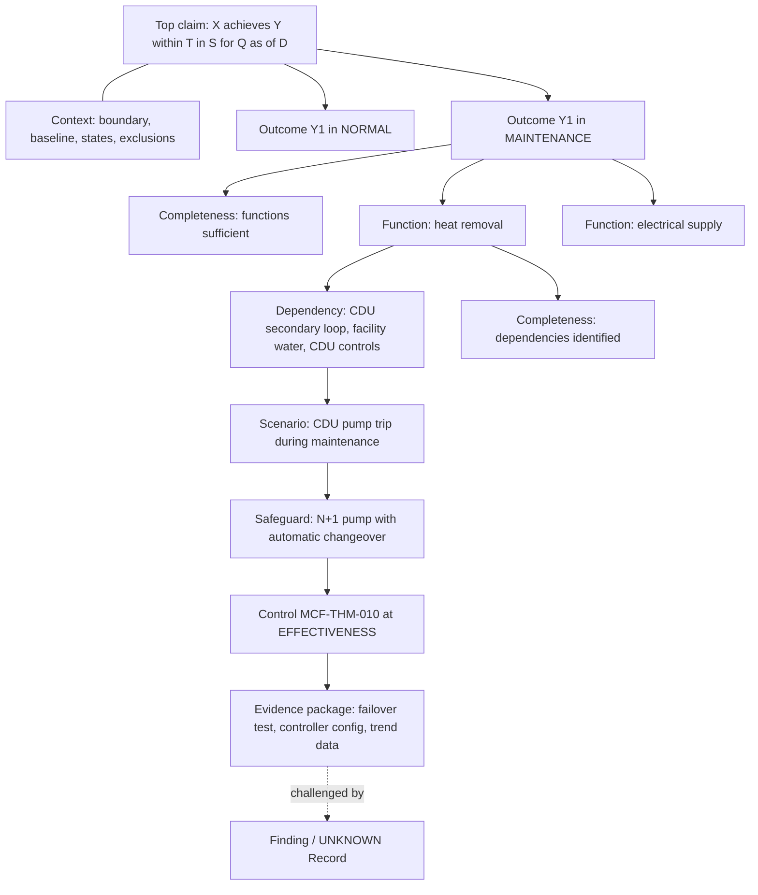
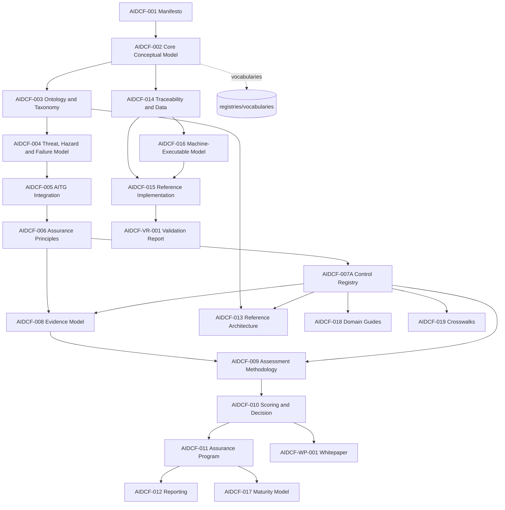

**AIDCF**

# CORE CONCEPTUAL MODEL

*AI Data Centre Facilities Assurance Framework*

Version 1.0

Canonical meanings, reasoning structure and controlled vocabularies for capability-centred AI infrastructure assurance

Artifact ID: AIDCF-002  
Short code: CCM  
Artifact type: Canonical foundation (normative)  
Status: Draft for controlled review  
Author: Siva Sethumadhavan

This document defines what AIDCF means by its core terms, how an AIDCF assurance argument is structured, which controlled codes every AIDCF artifact, dataset and tool shall use, and how the many level scales used across the framework relate to each other. It is second in precedence only to the AIDCF Manifesto (AIDCF-001).

# Document control

| **Field** | **Value** |
|---|---|
| Title | AIDCF Core Conceptual Model |
| Public ID | AIDCF-002 |
| Short code (requirement IDs) | CCM |
| Version | 1.0 |
| Date | 2026-10-10 |
| Status | Draft for controlled review |
| Author | Siva Sethumadhavan |
| Artifact type | Canonical foundation (normative) |
| Depends on | AIDCF-001 AIDCF Manifesto |
| Downstream users | AIDCF-003 to AIDCF-019, AIDCF-VR-001, AIDCF-WP-001, the canonical registries and any conformant tooling |
| Machine-readable companion | `registries/vocabularies/*.csv` (controlled vocabularies defined in Part VI of this document) |
| Intended audience | Methodology owners; AI infrastructure and data-centre architects; electrical, mechanical, controls and network engineers; assessors and reviewers; decision authorities; ontology and tooling engineers |
| Publication boundary | Independent methodology. Not a substitute for law, licensed engineering, safety approval, regulatory certification or vendor design authority. |

## Revision history

| **Version** | **Date** | **Summary** |
|---|---|---|
| 1.0 | 2026-10-10 | First issue of the canonical Core Conceptual Model: assurance chain, 15026-2/GSN mapping, core concept definitions, MATERIAL, control model, controlled vocabularies, gate and score doctrine summaries, ladders crosswalk, artifact register, legacy domain mapping, interpretation rules and glossary. Section 36: an applicable NOT_ASSESSED gate applies its AIDCF-010 UNKNOWN ceiling (aligned with AIDCF-010 and AIDCF-016). |

# Contents

- Part I – Authority, precedence and conformance
- Part II – The assurance problem and design stance
- Part III – The canonical assurance chain and assurance-case structure
- Part IV – Core concepts
- Part V – Materiality and the control model
- Part VI – Controlled vocabularies
- Part VII – Gate, decision and score doctrine (summary)
- Part VIII – Ladders crosswalk
- Part IX – Artifact register and precedence graph
- Part X – Legacy eight-domain to fifteen-domain mapping
- Part XI – Interpretation rules
- Part XII – Conformance requirements index
- Appendix A – Glossary
- Appendix B – AIDCF-014 class coverage

# Part I – Authority, precedence and conformance

## 1. Purpose

AIDCF-001 states what AIDCF is for and what it will not do. This document states what AIDCF's words mean and how its reasoning is assembled. It exists so that an electrical engineer reviewing UPS autonomy, a network architect reviewing a scale-out fabric, an assessor writing a Finding and a developer writing a SHACL shape all use the same object, the same code and the same rule for the same thing.

The Core Conceptual Model (CCM) has five jobs:

1. Fix the **canonical assurance chain**, the single ordered structure from Decision Question to Assurance Decision, and map it to the established assurance-case vocabulary of ISO/IEC/IEEE 15026-2 and Goal Structuring Notation (GSN).
2. Define every **core concept** with its attributes, invariants and the AIDCF-014 object class that carries it.
3. Define **MATERIAL** and the **control model**, the two ideas on which most disagreements in assurance work turn.
4. Publish the **controlled vocabularies**: claim types, Assurance Levels, control results, gate results, decision states, confidence, evidence classes and grades, UNKNOWN type and severity, operating states, methods, control types, lifecycle stages and score bands, with legacy aliases.
5. Provide a **ladders crosswalk** so that the level scales defined across AIDCF artifacts are never confused with each other, and state which of them are normative for decisions.

## 2. Scope and exclusions

In scope: canonical meanings; the structure of the assurance argument; controlled codes and aliases; precedence and identifier rules; interpretation rules that bound every AIDCF conclusion.

Out of scope, and owned elsewhere:

| **Subject** | **Owner** |
|---|---|
| Entity taxonomy, facets, relationship semantics, capacity and redundancy semantics | AIDCF-003 |
| Threat, hazard, failure-mode and scenario taxonomy and analysis method | AIDCF-004 |
| Mapping to AI Trust Graph | AIDCF-005 |
| Constitutional assurance principles (APS-001 to APS-058) | AIDCF-006 |
| The 360 controls, their criteria, evidence profiles and gate mappings | AIDCF-007A |
| Evidence metadata, grading, sufficiency and conflict workflow | AIDCF-008 |
| Assessment procedures and workpapers | AIDCF-009 |
| Gate criteria, roll-up, decision ceilings and score computation | AIDCF-010 |
| Programme models, Assurance Level profiles and stage gates | AIDCF-011 |
| Report classes and statement wording | AIDCF-012 |
| Reference architecture layers | AIDCF-013 |
| Object envelopes, relationship registry, serialisation and validation | AIDCF-014 and AIDCF-016 |
| Maturity model | AIDCF-017 |

## 3. Precedence

AIDCF artifacts are read in the following order of authority. Where two artifacts conflict, the higher one governs until the conflict is resolved through methodology change governance and recorded as an AIDCF-014 BaselineIssue.

1. AIDCF-001 AIDCF Manifesto (purpose, identity, commitments).
2. **AIDCF-002 Core Conceptual Model (this document: meanings, chain, vocabularies).**
3. AIDCF-003 Infrastructure Ontology and Taxonomy.
4. AIDCF-004 Threat, Hazard and Failure Model.
5. AIDCF-005 AIDCF–AI Trust Graph Integration Standard.
6. AIDCF-006 Assurance Principles Standard.
7. Downstream standards AIDCF-007A to AIDCF-019, each authoritative for its own subject (Section 2) and subordinate to items 1–6 for meaning.
8. Validation, whitepaper and reference implementation material (AIDCF-VR-001, AIDCF-WP-001, AIDCF-015): informative unless they quote a normative source.
9. Tooling: declared implementation only, never hidden authority.

Applicable law, licensed engineering judgement and the authority having jurisdiction over life safety prevail over every AIDCF artifact (AIDCF-005 safety-conflict rule; AIDCF-006 non-substitution).

> **CCM-REQ-001 Precedence.** Where an AIDCF artifact, registry or tool uses a term, code or rule defined in this document with a different meaning, the meaning in this document shall govern and the divergence shall be recorded as a BaselineIssue until resolved.
>
> **CCM-REQ-002 Subject ownership.** A downstream artifact may specialise or strengthen a rule owned by a higher artifact but shall not weaken, redefine or silently reinterpret it.

## 4. Normative language

| **Keyword** | **Meaning** |
|---|---|
| **shall** / **shall not** | Requirement. Conformance is not possible without satisfying it. |
| **should** / **should not** | Recommendation. A departure is permitted only with a recorded rationale. |
| **may** | Permission. |
| **can** | Capability or possibility; not a requirement. |

This usage follows ISO/IEC Directives Part 2. Text marked *informative*, notes and examples are not requirements. Tables that list controlled codes are normative unless marked *illustrative*.

The defined term **MATERIAL** (Section 22) is normative wherever it appears in an AIDCF artifact, whether capitalised or not.

## 5. What conformance to this document means

Three kinds of subject can claim conformance to AIDCF-002:

| **Subject** | **Conforms when** |
|---|---|
| An AIDCF artifact | It uses the chain step names, concept names and controlled codes defined here, cites other artifacts by public ID, and contains no conflicting definition. |
| An assessment or assurance dataset | Every record uses canonical codes, every material claim sits in a chain that can be traced from Decision Question to Assurance Decision, and the interpretation rules in Part XI are honoured. |
| A tool or registry | It stores and exchanges canonical codes (or declared aliases mapped on ingest), preserves UNKNOWN, and never computes a decision state without a recorded accountable approval. |

Requirements are numbered CCM-REQ-001 onwards in order of appearance and indexed in Part XII.

> **CCM-REQ-003 Canonical codes.** Artifacts, datasets and tools shall use the canonical codes in Part VI. Legacy codes may be accepted on ingest only through the published alias tables and shall be stored in canonical form with the legacy value retained as provenance.
>
> **CCM-REQ-004 Public identifiers.** Artifacts shall be cross-referenced only by public ID (Part IX), never by ordinal phrases such as "Artifact 4" or by superseded internal IDs.

# Part II – The assurance problem and design stance

## 6. The problem

An AI capability such as a distributed-training cluster or a latency-bound inference service is delivered by a stack that crosses at least four professional boundaries: facility engineering (power, cooling, fire, structure), operational technology (BMS, EPMS, CDU and plant controllers), AI infrastructure (accelerators, scale-up and scale-out fabrics, parallel storage, schedulers) and operations and supply (people, procedures, OEMs, utilities). Each discipline has mature standards, and each can produce a valid review that is silent on the failure paths that matter most, because those paths cross the boundary between disciplines. Typical examples:

- A 2N UPS design whose two paths share one EPMS, one battery-monitoring vendor, one maintenance contractor and one static-switch firmware baseline.
- A direct-to-chip liquid-cooled hall that is adequately rated at steady state but whose ride-through during a chiller restart or CDU pump failover is shorter than the time the scheduler needs to checkpoint and drain jobs.
- A checkpoint tier that survives storage-node loss but sits in the same electrical and thermal fault domain as the compute it protects.
- A management network that is logically segregated but reachable from a remote-support path whose credentials can also operate cooling plant.

Three further properties make the problem hard. **Concentration**: a small physical failure can disable a disproportionately valuable capability. **State dependence**: exposure in maintenance, degraded and recovery states differs from normal operation, and those are precisely the states that evidence rarely covers. **Evidence decay**: high-density AI estates change hardware, firmware, topology and thermal load faster than traditional facility documentation is revised.

## 7. Design stance

AIDCF responds with eight design commitments. Each is binding through the parts of this document noted.

| **Commitment** | **Meaning** | **Where enforced** |
|---|---|---|
| Capability first | The object of assurance is a bounded Capability Instance and its Service Outcomes, not a building or an asset list. | Parts III–IV |
| Argument, not checklist | AIDCF produces an assurance case: a structured argument from evidence to a bounded top claim. Controls are the testable requirements inside that argument. | Part III, Section 23 |
| Claim depth is explicit | Design, implementation, operation, effectiveness and resilience are different claims needing different evidence. | Sections 23.3, 24 |
| Evidence-gated | No positive result without evidence at or above the profile floor; insufficient evidence yields UNKNOWN, never a discounted score. | Sections 26, 30 |
| Non-compensating gates | Fifteen Critical Gates protect prerequisites that averages must not hide. | Part VII |
| UNKNOWN is preserved | Missing, stale, conflicting or inaccessible information is recorded, typed and given a severity with a defined decision effect. | Sections 20.3, 31 |
| Bounded conclusions | Every conclusion is bounded by scope, operating states, time and evidence. | Part XI |
| Human authority | Engines compute and recommend; accountable people decide and approve. | Sections 21.5, 36 |

# Part III – The canonical assurance chain and assurance-case structure

## 8. The top claim

Every AIDCF assurance case has exactly one top claim, written in this form:

> **"Capability Instance X can achieve Service Outcomes Y within tolerances T under declared operating states S, for Decision Question Q, as of date D."**

Each placeholder is mandatory and each narrows the claim:

| **Placeholder** | **Bound** | **Example (illustrative)** |
|---|---|---|
| X | Which deployment | "Training Cluster TC-2, Hall 3, Site A, architecture baseline AB-2026-07" |
| Y | Which results | "Job-progress availability; checkpoint durability; restart within objective" |
| T | How much deviation is tolerable | "No more than one unplanned interruption per quarter; checkpoint loss bounded to the last completed interval; restart within the declared recovery objective" (all values profile parameters) |
| S | In which conditions | NORMAL, MAINTENANCE (one CDU out of service), DEGRADED (one utility feed lost), RECOVERY |
| Q | For what decision | "Is TC-2 ready to accept a production training contract?" |
| D | When | Assessment as-of date and evidence period |

> **CCM-REQ-005 Top claim.** Every assessment shall state a top claim containing a Capability Instance, one or more Service Outcomes with tolerances, the declared operating states, the Decision Question and the as-of date. An assessment without all six elements shall not issue a decision state other than INCONCLUSIVE.

## 9. The sixteen-step chain

The canonical assurance chain is the **only** reasoning chain in AIDCF. Earlier variants (the Manifesto §14 reasoning chain, the AIDCF-003 chain, the AIDCF-014 chain and the README chain) are summaries of it and shall be read as such.

```text
 1 Decision Question
 2 Capability Instance
 3 Service Outcome
 4 Required Function
 5 Architecture (InfrastructureSystem / Asset / Interface)
 6 Dependency and Fault Domain
 7 Threat / Hazard / Failure Scenario
 8 Safeguard
 9 Control
10 Evidence Requirement
11 Evidence Object
12 Control Assessment (result)
13 Finding / UNKNOWN Record
14 Gate Result
15 Score Snapshot and Decision Recommendation
16 Assurance Decision
   └─ Assurance Report and Reassessment Trigger close the loop back to step 2
```

| **Step** | **Name** | **Question answered** | **Primary AIDCF-014 classes** | **Detail owner** | **AIDCF-014 trace link** |
|---|---|---|---|---|---|
| 1 | Decision Question | What decision will rely on this assessment, and who will make it? | Assessment (decisionQuestion), AssuranceProgram | AIDCF-011 | TR-15 |
| 2 | Capability Instance | Which bounded deployment is the subject? | CapabilityInstance | AIDCF-003 | TR-01 |
| 3 | Service Outcome | What must it achieve, within which tolerances? | ServiceOutcome | AIDCF-003 | TR-01, TR-02 |
| 4 | Required Function | Which functions must be delivered for each outcome? | RequiredFunction | AIDCF-003 | TR-02, TR-03 |
| 5 | Architecture | Which systems, assets and interfaces implement each function, as built? | ArchitectureSnapshot, InfrastructureSystem, AssetInstance, Interface, Resource, CapacityAssertion | AIDCF-003, AIDCF-013 | TR-03, TR-04 |
| 6 | Dependency and Fault Domain | What does each element rely on, and what fails together? | Dependency, FaultDomain, OperatingState | AIDCF-003 | TR-04, TR-05 |
| 7 | Threat / Hazard / Failure Scenario | How can the outcome be defeated? | Threat, Hazard, FailureMode, FailureScenario | AIDCF-004 | TR-05, TR-06 |
| 8 | Safeguard | Which real measures prevent, detect, contain or recover? | Safeguard | AIDCF-004 | TR-06, TR-07 |
| 9 | Control | Which AIDCF requirements test those safeguards? | ControlDomain, ControlFamily, Control | AIDCF-007A | TR-07, TR-08 |
| 10 | Evidence Requirement | What evidence would demonstrate each control at the required claim type? | EvidenceRequirement | AIDCF-008 | TR-08, TR-09 |
| 11 | Evidence Object | What evidence was actually obtained? | EvidenceObject, EvidencePackage, Sample, TestRecord | AIDCF-008 | TR-09 |
| 12 | Control Assessment | What result does the evidence support, for which claim type and scope? | Assessment, AssessmentProcedure, ControlAssessment | AIDCF-009 | TR-10 |
| 13 | Finding / UNKNOWN Record | What deficiencies and unresolved uncertainties remain? | Finding, UnknownRecord, Action | AIDCF-008, AIDCF-009 | TR-11 |
| 14 | Gate Result | Are the non-compensating prerequisites met? | CriticalGate, GateResult | AIDCF-010 | TR-12 |
| 15 | Score Snapshot and Decision Recommendation | What do the results summarise to, and what does the engine recommend? | ScoreSnapshot, DecisionRecommendation | AIDCF-010 | TR-13, TR-14 |
| 16 | Assurance Decision | What has accountable authority decided, with which conditions and validity? | ReviewRecord, AssuranceDecision | AIDCF-010, AIDCF-011 | TR-15 |
| Loop | Report and Reassessment Trigger | How is the decision communicated, and what invalidates it? | AssuranceStatement, AssuranceReport, ReassessmentTrigger, Event | AIDCF-012, AIDCF-014 | TR-16, TR-17, TR-18 |

> **CCM-REQ-006 Single chain.** Artifacts shall use the sixteen step names exactly as listed above. Alternative names (for example "Critical Function", "Infrastructure Function", "Assessment Result", "Critical Gate" for step 14, "Score/Recommendation") shall be treated as aliases and replaced on revision.
>
> **CCM-REQ-007 Forward completeness.** Each material element at steps 3 to 8 shall be linked forward to at least one element at the next step, or carry an UNKNOWN Record explaining why the link cannot be established.
>
> **CCM-REQ-008 Reverse traceability.** Every Assurance Decision shall be reconstructable backwards to the Gate Results, Control Assessments, Evidence Objects and UNKNOWN Records on which it relies, using only recorded relationships from the AIDCF-014 registry.

### 9.1 Forward construction and reverse audit

The chain is built forwards (steps 1→16) and audited backwards (16→1). The forward pass is engineering analysis: it discovers what matters. The reverse pass is assurance review: it checks that every element of the decision is supported. The two passes find different defects. A forward pass that stops at step 9 produces a control list with no argument; a reverse pass that starts at a dashboard produces an argument with no discovery. AIDCF requires both.

### 9.2 Closing the loop

An Assurance Decision is valid only for the as-of date, scope and states it declares. Reassessment Triggers (step "Loop") are defined when the decision is issued and are evaluated against Events (changes, incidents, evidence expiry, new information). A fired trigger returns the case to step 2: the Capability Instance and its architecture are re-baselined, the affected sub-claims are re-opened and the decision lifecycle moves to SUSPENDED, SUPERSEDED or EXPIRED as appropriate (Section 28.2).

## 10. Mapping to ISO/IEC/IEEE 15026-2 and GSN

ISO/IEC/IEEE 15026-2 specifies the minimum content and structure of an assurance case: claims, arguments that connect claims to evidence, the evidence itself, and the justifications, assumptions and context within which the argument holds. The Goal Structuring Notation (GSN), maintained as a community standard by the Assurance Case Working Group of the Safety-Critical Systems Club, provides a widely used graphical and structural notation for the same concepts. AIDCF adopts this structure. The mapping below is at concept level; it does not reproduce either standard's text.

| **Assurance-case concept** | **GSN element** | **AIDCF realisation** | **Chain step(s)** | **AIDCF-014 carrier** |
|---|---|---|---|---|
| Top-level claim | Goal (top) | The top claim of Section 8 | 1–3 | AssuranceDecision.subjectRef + scope; Assessment.decisionQuestion |
| Sub-claim | Goal | Outcome, function, dependency, scenario and safeguard claims | 3–8 | ServiceOutcome, RequiredFunction, Dependency, FailureScenario, Safeguard (each with a claim statement) |
| Argument / reasoning step | Strategy | Decomposition by Service Outcome × operating state, then by Required Function, then by Dependency and Fault Domain, then by Failure Scenario | between 3 and 8 | Relationships HAS_OUTCOME, REQUIRES_FUNCTION, IMPLEMENTED_BY, DEPENDS_ON, SHARES_FAULT_DOMAIN_WITH, EXPOSED_TO, PROTECTED_BY |
| Requirement against which a claim is tested | (Goal at leaf level) | Control at a declared claim type | 9 | Control, GOVERNED_BY |
| Evidence | Solution | Evidence Requirement, Evidence Object, Control Assessment result | 10–12 | EvidenceRequirement, EvidenceObject, ControlAssessment; EVIDENCED_BY, SUPPORTS, ASSESSED_BY, RESULTS_IN |
| Context | Context | Assessment boundary, architecture baseline, declared operating states, exclusions, profile | 2, 5, 6 | Assessment.scope, ArchitectureSnapshot, OperatingState |
| Assumption | Assumption | Declared assumptions (for example utility fault level, design ambient conditions) recorded with owner and evidence status | any | Recorded on the relevant object; unsupported material assumptions become UNKNOWN Records |
| Justification | Justification | Rationale for a decomposition strategy, a sampling plan, a non-applicability or an alternative evidence route | any | ReviewRecord; Control.applicability; EvidenceRequirement.acceptableAlternatives |
| Defeater / challenge / counter-evidence | Dialectic elements (challenge, counter-claim) | CHALLENGES relationships from evidence; Findings; UNKNOWN Records | 11–13 | CHALLENGES, HAS_FINDING, HAS_UNKNOWN; Finding, UnknownRecord |
| Undeveloped claim | Undeveloped goal | A sub-claim with no evidence path yet | any | UnknownRecord (type U1 or U5) |
| Away goal / module reference | Away goal | A claim supported in another case: AI Trust Graph, a provider's assurance, a separately assessed site | any | INTEGRATION_HANDOFF; IntegrationHandoff |
| Overall judgement of the case | (outside GSN core) | Gate Results, Score Snapshot, Decision Recommendation and Assurance Decision | 14–16 | GateResult, ScoreSnapshot, DecisionRecommendation, AssuranceDecision |

Two AIDCF features have no direct GSN equivalent and are deliberate additions:

- **Critical Gates** are cross-cutting acceptance conditions over parts of the argument. In GSN terms each gate is a named sub-goal that must be supported regardless of how strongly sibling goals are supported; AIDCF makes that non-compensation explicit and machine-checkable.
- **UNKNOWN severity** gives every undeveloped or defeated element a defined effect on the top claim, so the case cannot be presented as complete while material elements are undeveloped.

> **CCM-REQ-009 Assurance-case form.** An AIDCF assessment shall be expressible as an assurance case in which the top claim is supported through sub-claims, strategies and evidence as mapped above. A tool may render the case in GSN or another notation, but the underlying records shall be the AIDCF-014 objects and relationships.
>
> **CCM-REQ-010 Defeaters are retained.** Challenging evidence, Findings and UNKNOWN Records shall be attached to the claim they defeat or weaken and shall not be deleted when resolved; resolution is recorded by CLOSED_BY, SUPERSEDES or a ReviewRecord.

## 11. How sub-claims decompose

The decomposition strategy is fixed so that two competent teams assessing the same Capability Instance produce arguments that can be compared.

**Level A – Outcome × state.** The top claim is decomposed into one sub-claim per Service Outcome per declared operating state: "Outcome Yi is achieved within Ti in state Sj." States that are declared but not supported by evidence are not dropped; they become undeveloped sub-claims with UNKNOWN Records.

**Level B – Required Function.** Each outcome sub-claim is decomposed into one sub-claim per Required Function: "Function Fk is delivered at the level outcome Yi requires in state Sj." For a training outcome typical functions are electrical supply to accelerator racks, heat removal from accelerators, scale-out fabric transport, checkpoint persistence, job scheduling, and control-plane availability. A **completeness sub-claim** sits beside them: "The set {Fk} is sufficient for Yi." It is supported by the functional decomposition record and architecture reconciliation and is the claim most directly protected by CG-01 and CG-02.

**Level C – Dependency and Fault Domain.** Each function sub-claim is decomposed by the dependencies of the systems implementing it: "Every material dependency of Fk in Sj is available at the required capacity, and no fault domain shared by redundant elements of Fk can defeat Fk beyond tolerance." Common-mode dependencies (shared source, controller, route, firmware, people) are argued here, not assumed away. A completeness sub-claim "All material dependencies of Fk are identified" is supported by discovery coverage evidence and protected by CG-03.

**Level D – Failure Scenario.** Each dependency sub-claim is decomposed by credible Failure Scenarios drawn from AIDCF-004: "Under scenario Ψm, the residual state of Fk remains within tolerance." Scenarios include maintenance-induced, recovery-induced, compound and cross-domain paths.

**Level E – Safeguard.** Each scenario sub-claim is decomposed by the Safeguards positioned on its path: "Safeguard Gn prevents, detects, contains or recovers Ψm as required in Sj." The safeguard claim carries an implied claim type (a design claim for a pre-build decision, an effectiveness or resilience claim for an operational-resilience decision).

**Leaf – Control at claim type.** Each safeguard claim is tested through the AIDCF-007A Controls that govern the safeguard, each assessed at the claim type the Decision Question requires. The Control Assessment result is the leaf solution; its evidence is the Evidence Package.

Because a safeguard may sit on several scenario paths, and a control may govern several safeguards, the argument is a directed acyclic graph rather than a tree. AIDCF-014 relationships preserve the graph; a report may present a tree view per outcome.



*Figure 1 – Illustrative decomposition (control identifier is illustrative of position; the authoritative control-to-safeguard mapping is in AIDCF-007A).*

> **CCM-REQ-011 Decomposition order.** Assessments shall decompose the top claim in the order outcome × state, Required Function, Dependency and Fault Domain, Failure Scenario, Safeguard, Control. A different strategy may be used only with a recorded justification and shall still expose function, dependency and scenario sub-claims.
>
> **CCM-REQ-012 Completeness sub-claims.** Each outcome sub-claim shall carry a function-completeness sub-claim and each function sub-claim a dependency-completeness sub-claim, each supported by evidence of discovery coverage or by an UNKNOWN Record.
>
> **CCM-REQ-013 Undeclared states.** A sub-claim shall not be generalised to an operating state that was not declared and evidenced; declared but unevidenced states shall be carried as undeveloped sub-claims with UNKNOWN Records.

## 12. Assurance-case invariants

1. **One top claim per case.** Several Decision Questions about one Capability Instance are several cases that may share evidence.
2. **No orphan evidence.** Evidence that supports no claim is context, not support.
3. **No orphan controls.** A Control Assessment that cannot be traced to a safeguard claim may be reported, but it does not contribute to Gate Results through the argument; its gate contribution is limited to its declared AIDCF-007A gate mapping.
4. **Claims never exceed their evidence.** A claim's claim type, scope, states and period cannot be wider than those of the Control Assessments supporting it.
5. **Defeaters dominate until disposed.** An undisposed defeater (Finding, CHALLENGES evidence, US3+ UNKNOWN) on a decisive claim prevents that claim from being treated as supported.

> **CCM-REQ-014 Claim bounds.** No claim shall be stated with a wider scope, longer period, more operating states or a higher claim type than the evidence and Control Assessments supporting it.

# Part IV – Core concepts

## 13. Conventions for concept definitions

Each concept below is given as: a **definition** (necessary and distinguishing meaning); **key attributes** (the minimum information that gives the concept assurance meaning; full property schemas are in AIDCF-003 Appendix C and AIDCF-014 object profiles); **invariants** (rules that must hold for every instance); and the **AIDCF-014 class** that carries it. Every instance additionally carries the AIDCF-014 common object envelope (identifier, type, semantic owner, version, status, provenance, effective period, classification, review state).

> **CCM-REQ-015 Concept fidelity.** Records representing a concept defined in this Part shall use the AIDCF-014 class named for it, shall carry the listed key attributes or an explicit UNKNOWN for each, and shall satisfy the listed invariants.

## 14. Decision and subject concepts

### 14.1 Decision Question

**Definition.** The specific decision that an assessment is commissioned to inform, stated with the decision owner, intended users and the consequence of the decision.

**Key attributes.** Question text; decision owner (role); intended users; decision type (for example design progression, commissioning acceptance, operational readiness, contract acceptance, expansion, post-incident reliance); required Assurance Level; required claim types; deadline or validity horizon.

**Invariants.** One Decision Question per assurance case. The Decision Question determines the required Assurance Level and claim types, never the other way round. A question that asks "is the facility safe/secure/resilient" without a capability, outcome and state bound is not a valid Decision Question (AIDCF-006 claim-language rules).

**AIDCF-014 class.** Carried as `Assessment.decisionQuestion` and on `AssuranceProgram`; repeated on `AssuranceDecision.question`.

### 14.2 Capability Instance

**Definition.** A specific, bounded deployment of an AI capability (training, inference, fine-tuning, HPC simulation, shared accelerator service) at defined locations, with a declared owner, architecture baseline, criticality and obligations.

**Key attributes.** capabilityInstanceId; name; capabilityType; owner; locations; lifecycle stage; Service Outcomes; criticality with rationale; assessment boundary (inclusions and explicit exclusions); operating envelope (load, environmental, capacity, duration, state constraints); architecture baseline reference; demand profile; effective period.

**Invariants.** Has at least one Service Outcome. Is an instance, not a type: "large-scale training" is a capability type; "TC-2 in Hall 3" is an instance. Every exclusion from its boundary identifies rationale, owner, residual dependency and effect on confidence (AIDCF-003 boundary model). Dependencies that cross the boundary remain represented.

**AIDCF-014 class.** `CapabilityInstance`.

### 14.3 Service Outcome

**Definition.** A measurable or assessable result that the Capability Instance is required to achieve, in one of the AIDCF-003 outcome families: availability, capacity, performance, integrity, isolation, recoverability, safety, efficiency, sovereignty, observability.

**Key attributes.** Outcome family; metric and unit; target; tolerance (Section 14.4); applicable operating states; measurement method and evidence source; owner; criticality.

**Invariants.** Every outcome has a tolerance. Outcomes are stated at capability level ("checkpoint written within the declared interval at the declared size"), not as component properties ("UPS is 2N"). A component property is an attribute of architecture, not an outcome.

**AIDCF-014 class.** `ServiceOutcome`; linked by `HAS_OUTCOME` from the Capability Instance.

### 14.4 Tolerance

**Definition.** The bounded deviation from a Service Outcome target that the decision owner accepts, expressed in the outcome's metric over a stated period and state, together with the maximum tolerable duration and frequency of breach.

**Key attributes.** Permitted degradation (magnitude); maximum duration; maximum frequency; applicable states; priority among outcomes when tolerance cannot be met for all (graceful-degradation order); approver.

**Invariants.** A tolerance is a decision-owner commitment, not an engineering estimate; engineering evidence demonstrates whether it can be met. Tolerances are capability-profile parameters and shall not be presented as universal values. A tolerance that is UNKNOWN makes the outcome sub-claim untestable (US5: it affects an outcome definition).

**AIDCF-014 class.** Attribute group of `ServiceOutcome` (and of CAP-03 Impact Tolerance control evidence).

## 15. Function and architecture concepts

### 15.1 Required Function

**Definition.** A function whose delivery at a stated level is necessary for a Service Outcome in a stated operating state, defined independently of the product or technology that implements it. Examples: deliver conditioned power to accelerator racks; remove heat from accelerator cold plates; transport collective-communication traffic between nodes; persist checkpoints durably; schedule and place jobs; provide control-plane authority over facility plant.

**Key attributes.** Function statement; required level (capacity, performance, integrity) per state; outcomes served; implementing systems; criticality; acceptable substitutes.

**Invariants.** Always called **Required Function** (not "Critical Function" or "Infrastructure Function"; those are legacy aliases). A Required Function is implemented by one or more systems; a system may implement several functions. Function before product: a function remains even when its implementing technology changes.

**AIDCF-014 class.** `RequiredFunction`; linked by `REQUIRES_FUNCTION` from the outcome and `IMPLEMENTED_BY` to systems.

### 15.2 Architecture

**Definition.** A versioned, as-of-date representation of the systems, assets, interfaces, resources and their relationships that implement the Required Functions of a Capability Instance, in a declared configuration perspective (designed, as-built, commissioned, observed, current approved, temporary or future; AIDCF-003 §48).

**Key attributes.** Capability reference; perspective; snapshot date; systems; assets; interfaces; resources; dependencies; fault domains; operating states; reconciliation status between perspectives.

**Invariants.** Designed, installed, commissioned and observed perspectives are distinct and are reconciled explicitly (AIDCF-006 CI-06). A claim about implementation, operation or effectiveness shall reference an as-built, commissioned or observed snapshot, not only the design.

**AIDCF-014 class.** `ArchitectureSnapshot`.

### 15.3 InfrastructureSystem

**Definition.** A coordinated set of assets and interfaces that together provide one or more Required Functions, for example a UPS system, a CDU and secondary loop, a parallel file system, a scale-out compute fabric, a BMS.

**Key attributes.** Functions implemented; member assets; subsystems; interfaces; redundancy groups; fault-domain memberships; owner and operator; capacity assertions.

**Invariants.** Classifying something as a system type does not establish its capacity, redundancy, condition or effectiveness (AIDCF-003 §29).

**AIDCF-014 class.** `InfrastructureSystem`; `COMPOSED_OF` assets.

### 15.4 Asset

**Definition.** An identifiable real-world item, service, person, procedure or resource relevant to a Required Function. The AIDCF-003 term is Asset Instance; "Asset" is used in prose.

**Key attributes.** assetId; assetClass; system membership; location; owner; operator; maintainer; lifecycle status; criticality (relative to a Capability Instance and outcome); capacity properties; interfaces; dependencies; fault domains; evidence links; validity; confidence.

**Invariants.** Criticality is relative to a capability and outcome, never intrinsic to an asset class (AIDCF-003 IOT-REQ-028). People, procedures and contracts are assets when they are relied upon.

**AIDCF-014 class.** `AssetInstance`.

### 15.5 Interface

**Definition.** A defined point or mechanism of exchange between entities: electrical, thermal, hydraulic, network, mechanical, control, human/procedural or contractual/service (AIDCF-003 §31).

**Key attributes.** Interface class; endpoints; medium or protocol; capacity; direction; protection or isolation; authority (for control interfaces: signal, fail state, authentication).

**Invariants.** An interface enables exchange; a dependency is reliance. The two are never collapsed: a hydraulic interface between CDU and facility water does not, by itself, state whether the CDU depends on that water supply in every state.

**AIDCF-014 class.** `Interface`; `CONNECTS_TO`.

### 15.6 Resource

**Definition.** A consumable or constrained input required for operation: electrical energy, fuel, cooling capacity, water, coolant or refrigerant, space and structural capacity, network bandwidth, storage capacity, compute capacity, human capacity, time, spares (AIDCF-003 §32).

**Key attributes.** Resource type; quantity and unit; quality; source; replenishment; usable duration; constraints.

**Invariants.** Time is a resource: UPS autonomy, fuel autonomy, thermal ride-through and recovery time are resource assertions with units and states, not adjectives.

**AIDCF-014 class.** `Resource`; `CONSUMES_RESOURCE`.

### 15.7 Capacity Assertion

**Definition.** A statement of a capacity value for an entity, qualified by metric, unit, capacity term (nameplate, installed, commissioned, available, committed, resilient, transient, recovery; AIDCF-003 §40), operating state, environmental conditions, duration, derating assumptions, evidence date and confidence.

**Invariants.** Capacity terms are never interchangeable (IOT-REQ-042). A cross-domain capacity claim names its limiting dependency and any stranded capacity. A capacity assertion for a liquid-cooled rack row, for example, is bounded by the lowest of electrical distribution capacity, CDU heat-removal capacity at the declared facility-water supply temperature, and structural floor loading, and states which one limits.

**AIDCF-014 class.** `CapacityAssertion`.

## 16. Dependency, fault-domain and state concepts

### 16.1 Dependency

**Definition.** A directed reliance of one entity (the consumer) on another entity, resource, condition or decision (the provider), material in stated operating states.

**Key attributes.** Consumer; provider (or UNKNOWN); dependency class (electrical, thermal, hydraulic, mechanical/structural, network, control-system, timing/information, human/procedural, supplier/contractual, geographic/environmental, capacity, recovery-only); strength (absolute, material, conditional, supporting, recovery-only, UNKNOWN); applicable states; capacity requirement; substitutability; transfer mechanism and time; shared providers; owner; evidence; confidence; validity.

**Invariants.** Directional; not symmetric. A dependency crossing the assessment boundary remains represented as external or UNKNOWN; it does not disappear because it is out of scope (IOT-REQ-005). Contractual responsibility for a dependency is not evidence that it is reliable.

**AIDCF-014 class.** `Dependency`; `DEPENDS_ON`.

### 16.2 Fault Domain

**Definition.** A set of entities expected to be affected together by a common failure cause: physical (room, fire or flood zone, route), electrical (source, transformer, switchboard, UPS path, protection zone), thermal (air zone, coolant loop, CDU, chiller train), network (switch, plane, fabric, controller), storage (node group, metadata service, protection set), compute (node, tray, rack, scale-up domain, partition), control-system, software/configuration (firmware baseline, image, policy source), human/operational (team, shift, contractor) or external (utility, carrier, water, fuel, vendor, region).

**Key attributes.** Fault-domain type; member entities; common cause(s); containment boundary; evidence of isolation.

**Invariants.** Redundant elements that share a fault domain are not independent for failures of that domain. A firmware baseline shared by every accelerator node is a fault domain even though it has no physical extent.

**AIDCF-014 class.** `FaultDomain`; `SHARES_FAULT_DOMAIN_WITH`.

### 16.3 Operating State

**Definition.** A defined condition of operation of a Capability Instance, system or asset, from the canonical set NORMAL, DEGRADED, MAINTENANCE, EMERGENCY, RECOVERY, TRANSITION, SHUTDOWN, FAILED, UNKNOWN (Section 32).

**Key attributes.** State code; entity; entry trigger; authority; preconditions; required safeguards; expected duration; monitoring; exit criteria; evidence.

**Invariants.** Claims identify the states they cover and are not generalised to uncovered states (IOT-REQ-048). Temporary bypass and maintenance configurations are explicit states or configuration versions. Transitions are themselves assessable (a UPS transfer to static bypass is a TRANSITION).

**AIDCF-014 class.** `OperatingState`.

## 17. Adverse concepts

### 17.1 Threat

**Definition.** A deliberate actor, capability, intent or circumstance capable of adverse infrastructure consequence (AIDCF-004): for example, insider tampering with an EPMS breaker command, theft of accelerator trays in transit, a compromised remote-support session.

**Invariants.** Distinct from Hazard: deliberate sources require adversary assumptions (capability, access, intent) that non-deliberate sources do not.

**AIDCF-014 class.** `Threat`; `EXPOSED_TO`.

### 17.2 Hazard

**Definition.** A non-deliberate source, condition or event with potential for injury, damage, disruption or environmental impact: for example, arc flash at switchgear, lithium-ion battery thermal runaway, coolant leak onto energised equipment, refrigerant release, extreme ambient wet-bulb temperature, flood.

**Invariants.** Life-safety hazards are within CG-04 regardless of their effect on service outcomes.

**AIDCF-014 class.** `Hazard`; `EXPOSED_TO`.

### 17.3 Failure Mode

**Definition.** The manner in which a Required Function, asset, safeguard or dependency is lost, degraded, delayed, incorrect, intermittent or uncontrolled (AIDCF-004).

**Invariants.** Cause, mode, effect and consequence remain distinct. "UPS failed to transfer" is a mode; "static-switch firmware defect" is a cause; "rack PDUs de-energised" is a local effect; "training job lost to last checkpoint" is a consequence.

**AIDCF-014 class.** `FailureMode`.

### 17.4 Failure Scenario

**Definition.** An ordered, state-qualified sequence from an initiating threat, hazard or cause, through failure modes and propagation steps across dependencies and fault domains, past the safeguards that act or fail, to a residual state and its consequence for Service Outcomes.

**Key attributes.** Pre-state; initiating source; predisposing conditions; ordered steps; fault domains traversed; safeguards and their dependencies; residual state; outcome effects; recovery path; evidence; confidence; linked gates; reassessment triggers.

**Invariants.** Every material scenario identifies a Capability Instance and Service Outcome (THF-REQ-001). Unverified path elements remain visible as UNKNOWN. Path types (cascading, common-cause, maintenance-induced, recovery-induced, cross-domain, slow-burn) are recorded, because they drive which safeguards and states must be evidenced.

**AIDCF-014 class.** `FailureScenario`; `INITIATES`, `PROPAGATES_TO`, `RECOVERS_THROUGH`.

## 18. Safeguard and Control

These two concepts are the most frequently confused in assurance practice and are deliberately separated.

### 18.1 Safeguard

**Definition.** A real-world measure (physical, technical, procedural, organisational or contractual) intended to anticipate, prevent, detect, decide, respond, contain, withstand, degrade gracefully, recover or adapt with respect to one or more Failure Scenarios. Examples: an N+1 CDU pump with automatic changeover; a selective-coordination protection scheme; a leak-detection loop with automatic valve isolation; a permit-to-work procedure for switching; a signed-firmware enforcement policy; an immutable checkpoint copy in a separate fault domain.

**Key attributes.** Safeguard function; protected subject; path position (cause, escalation, consequence or recovery side); activation; authority; dependencies (power, sensing, control, people, suppliers); states covered; capacity/duration; failure modes of the safeguard itself; evidence references; governing controls.

**Invariants.** Existence does not imply effectiveness (THF-REQ-005). A safeguard has its own dependencies and failure modes, which are analysed in the same way as any other element; a safeguard sharing a fault domain with what it protects is fragile.

**AIDCF-014 class.** `Safeguard`; `PROTECTED_BY` (protected entity PROTECTED_BY safeguard).

### 18.2 Control

**Definition.** A distinct, topic-specific normative requirement in the AIDCF-007A Canonical Master Control Registry, identified `MCF-<DOM>-NNN`, stating what an accountable role shall achieve with respect to a class of safeguards or assurance conditions, with independently testable assessment criteria and an evidence profile, assessed per claim type and per scope. Section 23 gives the full control model.

**Distinction.** The safeguard is the CDU pump changeover; the control is the requirement that CDU capacity and redundancy be demonstrated sufficient for the declared heat load in the declared states. A control can govern many safeguards; a safeguard can be governed by several controls. A control result says whether the safeguards it governs meet its criteria at the assessed claim type; it is not itself a safeguard.

**AIDCF-014 class.** `Control` within `ControlFamily` within `ControlDomain`; `GOVERNED_BY` (safeguard GOVERNED_BY control).

> **CCM-REQ-016 Safeguard–control separation.** Records shall not represent a safeguard and a control as the same object. Every Control Assessment that supports a safeguard claim shall reference the safeguard(s) assessed.

## 19. Evidence concepts

### 19.1 Evidence Requirement

**Definition.** A claim-specific statement of the evidence needed to support a Control Assessment at a claim type: required and optional evidence classes, quality floor, sufficiency floor, state and period coverage, independence, mandatory items, acceptable alternatives, UNKNOWN effect and reassessment triggers. The default is the control's AIDCF-007A evidence profile; a capability profile, gate or Decision Question may strengthen it, never weaken it.

**AIDCF-014 class.** `EvidenceRequirement`; `HAS_EVIDENCE_REQUIREMENT`.

### 19.2 Evidence Object

**Definition.** The smallest independently identified evidence item used to support, challenge or qualify an assertion (AIDCF-008): a protection-relay settings export, a load-bank test report, a seven-day CDU flow and differential-pressure trend, a fabric topology export, an interview record.

**Key attributes.** evidenceId; evidence class (E1–E7); source; collector; custodian; observation, collection and record times; scope; period; operating states covered; integrity level (I0–I5); quality vector (P F C R T I); restrictions; lifecycle state.

**Invariants.** An Evidence Object has no universal grade; quality and sufficiency are evaluated against a specific assertion (EVM-REQ-003). Derived evidence never exceeds the quality, scope and lineage of its sources.

**AIDCF-014 class.** `EvidenceObject`; `EVIDENCED_BY`, `SUPPORTS`, `CHALLENGES`, `QUALIFIES`.

### 19.3 Evidence Package

**Definition.** A governed collection of Evidence Objects addressing one control (at a claim type), function, system, scenario or gate, with a manifest of included, missing, substituted and restricted items, per-object assessments, package sufficiency (S0–S5), conflicts and UNKNOWNs, review and custody.

**AIDCF-014 class.** `EvidencePackage`.

### 19.4 Assertion

**Definition.** A precise, testable proposition (subject–predicate–object or equivalent) with claim type, scope and conditions, to which evidence is attached and on which a review records a state (CANDIDATE, SUPPORTED, CHALLENGED, QUALIFIED, CONFLICTING, UNKNOWN, SUPERSEDED; AIDCF-014 assertion vocabulary).

**Invariants.** Every sub-claim in the assurance case is an assertion. A management or vendor statement is an assertion with state CANDIDATE until evidence and review support it (AIDCF-006 CI-02).

**AIDCF-014 class.** No dedicated class in the AIDCF-014 v1.0 registry of 48 classes; carried as `assertionRefs` on EvidenceObject and as the target of SUPPORTS / CHALLENGES / QUALIFIES, with the AIDCF-014 assertion vocabulary. AIDCF-016 should introduce an explicit Assertion class.

## 20. Assessment-result concepts

### 20.1 Control Assessment

**Definition.** The recorded evaluation of one Control, at one claim type, for one declared scope (Capability Instance, boundary subset, states, period), producing exactly one control result (Section 26).

**Key attributes.** Control; claim type; scope; states; period; procedure and methods; samples; Evidence Package; result; criteria met/not met; Findings; UNKNOWN Records; assessor; reviewer; lifecycle state (for example SUSPENDED when reliance is withdrawn, with result reverting to UNKNOWN).

**Invariants.** One result per (control, claim type, scope). Results for different claim types of the same control are separate records. A CONFORMING result requires evidence at or above the evidence-requirement floor; otherwise the result is UNKNOWN. Implementation Maturity (IM0–IM5) may be recorded alongside but is never the result.

**AIDCF-014 class.** `ControlAssessment` (within an `Assessment`, using `AssessmentProcedure`, `Sample`, `TestRecord`); `ASSESSED_BY`, `RESULTS_IN`.

### 20.2 Finding

**Definition.** A recorded condition, supported by evidence, in which an assessment criterion, gate criterion or tolerance is not met or is at risk: criterion reference, condition, cause, consequence (to outcomes), classification, gate effect, score effect, owner, status, and required action and retest.

**Invariants.** A Finding changes the underlying control result or gate evaluation; it is not a second, undeclared score deduction (AIDCF-010 no-double-counting). Accepted risk does not convert a nonconformity into conformity. A Finding is closed only by evidence and, where material, reassessment (`CLOSED_BY`).

**AIDCF-014 class.** `Finding`; `HAS_FINDING`, `REQUIRES_ACTION`.

### 20.3 UNKNOWN Record

**Definition.** A first-class record that a material fact, relationship, state, capacity, owner, evidence status or conclusion cannot be determined, stating subject, missing attribute, UNKNOWN type (U1–U10), UNKNOWN severity (US1–US5), reason, potential consequence, evidence needed, owner for resolution, status, decision and gate effect, and trigger for re-evaluation.

**Invariants.** UNKNOWN is never converted into pass, zero, fail, not applicable or accepted risk (IOT-REQ-006, EVM-REQ-006). Severity is assigned by the top-down test of Section 31 and carries a fixed decision effect. An UNKNOWN Record is closed only by evidence or by a reviewed disposition that does not assume a favourable value.

**AIDCF-014 class.** `UnknownRecord`; `HAS_UNKNOWN`.

## 21. Gate, score and decision concepts

### 21.1 Critical Gate

**Definition.** One of fifteen named, non-compensating prerequisites (CG-01 to CG-15; Section 35) protecting a condition without which no favourable decision is defensible, whatever the average performance.

**AIDCF-014 class.** `CriticalGate`; controls relate to gates through their AIDCF-007A gate mappings with role CRITICAL or SUPPORTING.

### 21.2 Gate Result

**Definition.** The evaluated status of one Critical Gate for one assessment scope: PASS, FAIL, UNKNOWN, APPROVED_NA or NOT_ASSESSED, with criterion, applicability, evidence references, state coverage, findings, UNKNOWNs, decision effect and review.

**Invariants.** Computed by the roll-up rule (Section 35.3); there is no conditional gate result. PARTIAL never yields PASS.

**AIDCF-014 class.** `GateResult`; `EVALUATES_GATE`, `CONSTRAINS`.

### 21.3 Score Snapshot

**Definition.** An immutable record of score inputs (control results), profile and weights, computed family/domain/capability indicators, coverage, band (or "Band withheld"), and gate and UNKNOWN overlays, with lineage.

**Invariants.** Scores never override gates and never create assurance. A snapshot is immutable; recalculation creates a new snapshot that SUPERSEDES the prior one.

**AIDCF-014 class.** `ScoreSnapshot`; `SUMMARISED_BY`.

### 21.4 Decision Recommendation

**Definition.** The engine- or assessor-produced proposed decision state, with the ceilings applied (gate, UNKNOWN, evidence, claim type) and the proposed conditions and limitations, before accountable review.

**AIDCF-014 class.** `DecisionRecommendation`; `RECOMMENDS`.

### 21.5 Assurance Decision

**Definition.** The bounded conclusion issued by an accountable decision authority, after review, answering the Decision Question with one decision state (REASONABLY_ASSURED, CONDITIONALLY_ASSURED, LIMITED, NOT_ASSURED, INCONCLUSIVE), conditions, limitations, ceilings, validity period, reassessment triggers and a decision lifecycle state.

**Invariants.** Never higher than the Decision Recommendation's ceiling; may be lower. Requires a named authority (`APPROVED_BY`) and review (`REVIEWED_BY`). "NOT ASSESSED" is not a decision state; where nothing was assessed, no decision is issued.

**AIDCF-014 class.** `AssuranceDecision` with `ReviewRecord`.

### 21.6 Assurance Statement and Assurance Report

**Definition.** The **Assurance Statement** is the short, controlled-wording communication of an Assurance Decision to named relying parties; the **Assurance Report** is the fuller record (one of the AIDCF-012 report classes) presenting the case, results, gates, scores, UNKNOWNs, limitations and actions.

**Invariants.** A report or statement shall not state or imply more than the decision it reports (AIDCF-014 BR-007).

**AIDCF-014 class.** `AssuranceStatement`, `AssuranceReport`; `REPORTED_IN`.

### 21.7 Reassessment Trigger

**Definition.** A declared condition that, when an Event satisfies it, invalidates or suspends reliance on identified claims, evidence or decisions and requires reassessment: material change, incident, failed test, evidence expiry, new dependency, supplier change, change in demand or density, new information.

**AIDCF-014 class.** `ReassessmentTrigger` with `Event`; `TRIGGERS_REASSESSMENT`, `INVALIDATED_BY`.

> **CCM-REQ-017 Decision authority.** No Assurance Decision shall be recorded without an approving accountable authority and a review record; a Decision Recommendation produced by a tool shall not be presented as an Assurance Decision.

# Part V – Materiality and the control model

## 22. MATERIAL

> **Definition.** A fact, dependency, condition, deficiency or UNKNOWN is **material** if, had it been known or resolved differently, a competent assessor would reasonably expect it to change (a) a control result, (b) a gate result, (c) the decision state, or (d) a condition, limitation or ceiling attached to the decision, for the declared Capability Instance, Service Outcomes and operating states.

### 22.1 How to apply the definition

Materiality is a counterfactual test against the decision chain, not a judgement of size or cost. Apply it in four steps:

1. **Fix the reference frame.** Materiality is relative to the declared Capability Instance, Service Outcomes, tolerances and operating states. The same fact can be material to a training-readiness decision and immaterial to a colocation-capacity decision.
2. **Vary the item.** Consider the credible alternative values or resolutions of the item (it is true / false; the dependency exists / does not; the capacity is the asserted value / the lower bound of the evidence).
3. **Trace the effect.** Ask whether any alternative would change a result at steps 12, 14 or 16 of the chain, or a condition or ceiling on the decision.
4. **Record the answer.** If yes, the item is material and shall be represented (as a record, a Finding or an UNKNOWN Record). If no, it may be recorded as context but does not need decision treatment.

### 22.2 Worked tests (illustrative)

| **Item** | **Test** | **Material?** |
|---|---|---|
| Generator fuel delivery contract names a single supplier whose depot is in the same flood zone as the site | A shared external fault domain could defeat the fuel-autonomy safeguard in a flood scenario; it could change the result of a generation-and-fuel control and the CG-05 evaluation. | Yes |
| A CRAH unit in an air-cooled hall that hosts no in-scope accelerators is overdue for filter replacement | No in-scope Required Function depends on it in any declared state. | No (context only) |
| Commissioning records for one of two CDU pumps cannot be located | Changes the evidence available for the CDU redundancy claim; could change a control result from CONFORMING to UNKNOWN and, if that control is CRITICAL for CG-06, the gate. | Yes |
| The out-of-band management network's console servers share an upstream switch with the in-band management network | Could defeat recovery of the control plane during an in-band failure; could change CG-10 and CG-15 evaluations. | Yes |
| Rack-PDU firmware version differs from the documented baseline but the vendor confirms no functional change, and the protection and metering behaviour has been tested on the installed version | The difference does not change any criterion outcome; it is a configuration-record Finding under change control only if CG-14 criteria require baseline currency. | Depends on CG-14 criteria; record and test against them |

> **CCM-REQ-018 Materiality test.** Every decision to omit, exclude, defer or treat as context a fact, dependency, condition, deficiency or UNKNOWN shall be justified against the MATERIAL definition, with the reference frame stated.
>
> **CCM-REQ-019 No size proxy.** Materiality shall not be determined solely by cost, physical size, asset count or the number of affected records.

## 23. What a control is

### 23.1 The control model

A **control** in AIDCF is a distinct, topic-specific normative requirement, assessed per claim type and per scope. Concretely:

- **Distinct.** Each of the 360 controls addresses a different topic. MCF-POW-006 *Start Reliability* and MCF-POW-007 *Fuel Autonomy* are different requirements about different safeguards, not two depths of the same requirement.
- **Topic-specific.** The requirement names the accountable role and states what shall be achieved, in terms specific to its subject ("The facility owner shall…"), with 3–7 independently testable assessment criteria.
- **Normative.** It is a requirement (shall), not guidance; non-applicability requires approved rationale.
- **Assessed per claim type.** The same control can be assessed for DESIGN, IMPLEMENTATION, OPERATION, EFFECTIVENESS or RESILIENCE claims. Each assessment is a separate Control Assessment record with its own evidence and result.
- **Assessed per scope.** A control assessed for Hall 3 in NORMAL and MAINTENANCE states says nothing about Hall 4 or the RECOVERY state.

**A control is not a lifecycle stage and not an assurance depth.** Earlier registry drafts placed the four controls of each family at successive assurance depths (first control A2, second A3, third A4, fourth A5) so that, for example, "Governance Charter" could only ever be a design control and "Methodology Ownership" only an effectiveness control. That pattern is withdrawn. The claim type at which a control is assessed is selected by the Decision Question; the registry records, per control, the **required claim type** and **required Assurance Level** at which the control must be demonstrated to contribute positively to gates and decisions at that level.

### 23.2 Anatomy of a control record

The AIDCF-007A registry carries, for every control, the following fields (full schema in AIDCF-007A and AIDCF-014):

| **Field group** | **Content** |
|---|---|
| Identity | controlId (`MCF-<DOM>-NNN`), familyId (`<DOM>-nn`), title |
| Requirement | objective; one or more specific "shall" statements naming the accountable role |
| Testability | assessmentCriteria (3–7, each independently testable); parameters (name, unit, illustrative default, basis); assessmentProcedure (ordered steps); assessmentMethods (Section 33.1) |
| Evidence | minimumEvidence; evidenceProfile (claim type, profile tier CP-1..CP-5, required and optional classes, quality floor, sufficiency floor, state and period coverage, independence, mandatory items, acceptable alternatives, UNKNOWN effect, reassessment triggers) |
| Classification | controlType (one primary type, Section 33.2); requiredAssuranceLevel (AL2–AL5, consistent with claim type); lifecycleStages; operatingStates |
| Applicability | when the control applies and when it does not |
| Gate linkage | gateMappings: list of {gateId, role CRITICAL or SUPPORTING} |
| Analysis linkage | failureModes addressed; ontologyClasses; relatedControls |
| Safety and UNKNOWN | testingSafety (authorisation needs for hazardous tests); unknownRule |
| References | informativeReferences (document-level only) |

### 23.3 Control results and claim-type ordering

Claim types form an ordered ladder for each control, with one branch:

```text
DESIGN → IMPLEMENTATION → OPERATION → EFFECTIVENESS
                                    ↘ RESILIENCE
```

A CONFORMING result at a claim type presupposes that each lower claim type on its path has been assessed CONFORMING for the same scope, in the same or an earlier still-valid assessment. If a lower claim type is PARTIAL, NONCONFORMING, UNKNOWN or NOT_ASSESSED, the higher claim type's result cannot be CONFORMING; it is recorded with the result its own evidence supports, capped as follows: a NONCONFORMING lower claim caps the higher at NONCONFORMING; PARTIAL caps at PARTIAL; UNKNOWN or NOT_ASSESSED caps at UNKNOWN. (Effectiveness demonstrated by test does not cure a design that does not meet its criteria; it shows that the deficient design happened to perform under the tested conditions.)

> **CCM-REQ-020 Control identity.** A control shall be a distinct topic-specific requirement. Registries shall not encode assurance depth or lifecycle stage through a control's position within its family.
>
> **CCM-REQ-021 Per-claim-type assessment.** Each Control Assessment shall record exactly one claim type and one scope. A result for one claim type shall not be reported as, or inferred to be, a result for another.
>
> **CCM-REQ-022 Claim-type presupposition.** A CONFORMING result at a claim type shall require CONFORMING results at each lower claim type on its path for the same scope; otherwise the cap in Section 23.3 applies.

### 23.4 Domains and families

The control universe is fixed at 15 domains, 90 families and 360 controls: six families per domain (`<DOM>-01` to `<DOM>-06`) and four controls per family, numbered `MCF-<DOM>-001` to `MCF-<DOM>-024`, where family *n* holds controls 4*n*−3 to 4*n*. Domain codes are fixed:

| **Code** | **Domain** |
|---|---|
| GOV | Governance, Accountability and Assurance Direction |
| CAP | AI Capability, Service Outcome and Demand Management |
| DEP | Dependency, Concentration and External Reliance Management |
| PHY | Physical Site, Building and Security Infrastructure |
| POW | Electrical Power Infrastructure and Energy Continuity |
| THM | Cooling, Thermal and Fluid Infrastructure |
| ENV | Environmental and Resource Performance |
| CMP | AI Compute Infrastructure |
| STO | AI Storage and Data Infrastructure |
| NET | AI Network and Interconnect Architecture |
| OPS | Building Operations and Service Management |
| RES | Resilience, Continuity and Recovery |
| SUP | Supply Chain, OEM and Ecosystem Assurance |
| SEC | Digital, OT and Control-Plane Security |
| EVA | Evidence, Assessment and Assurance Management |

Domains organise assessment work and ownership; they do not partition the argument. A single Failure Scenario routinely traverses POW, THM, CMP, STO, NET, OPS and SEC.

# Part VI – Controlled vocabularies

The tables in this Part are canonical. Their machine-readable encodings are the CSV files in `registries/vocabularies/`, which shall be kept identical in content to this Part. Legacy aliases are accepted on ingest only through the alias tables given here.

> **CCM-REQ-023 Vocabulary registry parity.** The CSV files in `registries/vocabularies/` shall encode exactly the codes, names and rules of Part VI; a change to either requires the same change to the other in the same release.

## 24. Claim types

| **Claim type** | **Meaning** | **Minimum Assurance Level** |
|---|---|---|
| DESIGN | Requirement and design are adequate | AL2 |
| IMPLEMENTATION | As-built/configured state reconciles to approved design | AL3 |
| OPERATION | Operates as intended over a representative period and states | AL4 |
| EFFECTIVENESS | Achieves its objective under tested/observed adverse conditions | AL5 |
| RESILIENCE | Contains failure and supports recovery within tolerance | AL5 |

**Legacy aliases.** AIDCF-010 v1.0 "assurance dimensions" D1 Design, D2 Implementation, D3 Operation, D4 Effectiveness, D5 Resilience map 1:1 to the claim types above; the D-prefix shall not be used for claim types because it collides with the legacy domain codes D1–D8. AIDCF-008 §28 assertion claim types "intent/governance" map to DESIGN where the assertion concerns an approved requirement or design, and otherwise remain assertion types outside the control-result model ("absence", "compliance mapping", "decision").

## 25. Assurance Levels

Assurance Levels describe the depth of an assurance programme (AIDCF-011), and therefore the highest claim type a programme can support. They are not certification grades.

| **Level** | **Name** | **Permitted conclusion** |
|---|---|---|
| AL0 | Discovery | Inventory and decision discovery; no assurance conclusion |
| AL1 | Readiness | Scope, ownership, applicability and evidence readiness; readiness conclusion only |
| AL2 | Design | Requirements, architecture and safeguard design (DESIGN claims) |
| AL3 | Implementation | Reconciliation to implemented/as-built state (up to IMPLEMENTATION claims) |
| AL4 | Operational | Representative operation, monitoring, maintenance and incidents (up to OPERATION claims) |
| AL5 | Effectiveness and resilience | Safeguard effectiveness, failure containment and recovery (up to EFFECTIVENESS and RESILIENCE claims) |
| AL6 | Continuing | Refresh of previously approved claims, evidence, gates and triggers; claims no higher than those already established at AL2–AL5 |

The registry field "Required Assurance Level" uses AL2–AL5 only.

| **Legacy code** | **Source** | **Canonical** | **Note** |
|---|---|---|---|
| A2, A3, A4, A5 | AIDCF-007A registry v1.0 | AL2, AL3, AL4, AL5 | 1:1 |
| A0 No assurance | AIDCF-006 §6 | AL0 (programme) / INCONCLUSIVE (decision) | AIDCF-006 levels mixed programme depth and conclusion; use AL for depth and decision state for conclusion |
| A1 Descriptive | AIDCF-006 §6 | AL0 or AL1 | Descriptive inventory is AL0; readiness is AL1 |
| A2 Design … A4 Operating | AIDCF-006 §6 | AL2 … AL4 | 1:1 |
| A5 Resilience | AIDCF-006 §6 | AL5 | AL5 covers effectiveness and resilience |

## 26. Control result

Per control, per claim type, per scope.

| **Code** | **Meaning** | **Score value** | **Coverage treatment** |
|---|---|---|---|
| CONFORMING | All assessment criteria met for the claim type, evidence ≥ profile floor | 100 | Scored |
| PARTIAL | Some criteria met; specific deficiencies recorded as Findings | 50 | Scored |
| NONCONFORMING | Criteria materially not met, or a safeguard demonstrated ineffective | 0 | Scored |
| UNKNOWN | Result cannot be determined (evidence below floor, conflict, inaccessible, etc.) | No value; excluded from mean | Counted in coverage denominator and in the UNKNOWN register |
| NOT_APPLICABLE | Approved non-applicability with rationale and approver | Excluded | Excluded from denominator |
| NOT_ASSESSED | In scope but not yet assessed | Excluded | Counted as coverage gap |

**Legacy aliases.**

| **Legacy code** | **Canonical** | **Condition** |
|---|---|---|
| NOT_IMPLEMENTED / "Not implemented" | NONCONFORMING | Always |
| INEFFECTIVE | NONCONFORMING | Always |
| IMPLEMENTED | CONFORMING | Valid only for DESIGN or IMPLEMENTATION claims; for higher claim types the legacy value maps to UNKNOWN pending reassessment |
| OPERATING_EFFECTIVELY / "Operating effectively" | CONFORMING | For OPERATION or EFFECTIVENESS claims |
| STRONGLY_EFFECTIVE | CONFORMING | For OPERATION or EFFECTIVENESS claims |
| N/A, NA | NOT_APPLICABLE | Only where approved rationale and approver exist; otherwise NOT_ASSESSED |
| SUSPENDED | (lifecycle) | Set lifecycle state SUSPENDED on the ControlAssessment; result reverts to UNKNOWN |
| NOT ASSESSED, "Not Assessed" | NOT_ASSESSED | Always |
| PARTIAL (legacy score 25) | PARTIAL | Score value is now 50 |

**Implementation Maturity (diagnostic only).** IM0 Absent, IM1 Initial, IM2 Defined, IM3 Implemented, IM4 Operating, IM5 Optimised. IM levels describe how institutionalised a practice is (AIDCF-017). They are never a control result, never a score input and never a gate input.

> **CCM-REQ-024 Evidence floor governs result.** Where evidence for a Control Assessment is below the profile floor, the result shall be UNKNOWN; it shall not be recorded as PARTIAL, discounted or scored.

## 27. Gate result

| **Code** | **Meaning** |
|---|---|
| PASS | All CRITICAL controls CONFORMING at required claim type, all gate criteria met with evidence ≥ floor, NONCONFORMING SUPPORTING controls evaluated with no defeat |
| FAIL | An in-scope CRITICAL control is NONCONFORMING or PARTIAL, or a gate criterion is demonstrated not met |
| UNKNOWN | No FAIL condition, but a CRITICAL control is UNKNOWN or NOT_ASSESSED, gate evidence is below floor, or a US4 UNKNOWN is attached |
| APPROVED_NA | Gate not applicable to the declared scope, with approved boundary rationale |
| NOT_ASSESSED | Applicable gate not yet evaluated |

There is no conditional gate state. Legacy "APPROVED N/A" and "APPROVED_N/A" map to APPROVED_NA; legacy "CONDITIONAL" or "PASS WITH CONDITIONS" at gate level map to UNKNOWN or FAIL according to the roll-up rule, with any conditions moved to decision level.

## 28. Decision state and decision lifecycle

### 28.1 Decision state

| **Code** | **Meaning** |
|---|---|
| REASONABLY_ASSURED | Sufficient appropriate evidence supports the bounded top claim; all applicable gates PASS or APPROVED_NA; no US3+ UNKNOWN undisposed |
| CONDITIONALLY_ASSURED | The bounded top claim is supported subject to named, owned, time-bound conditions; no gate FAIL or UNKNOWN |
| LIMITED | Some sub-claims supported; material limitations, a gate UNKNOWN or a gate FAIL whose AIDCF-010 ceiling is LIMITED prevent a broader conclusion |
| NOT_ASSURED | Evidence demonstrates that the top claim, or a controlling gate, is not met |
| INCONCLUSIVE | Evidence, method, boundary or definition cannot support any determination |

### 28.2 Decision lifecycle

DRAFT → RECOMMENDED → APPROVED → ACTIVE, then one of SUSPENDED, WITHDRAWN, SUPERSEDED, EXPIRED.

| **Code** | **Meaning** |
|---|---|
| DRAFT | Being prepared; no reliance |
| RECOMMENDED | Decision Recommendation issued for review |
| APPROVED | Approved by the accountable authority, not yet in effect |
| ACTIVE | In effect within its validity period |
| SUSPENDED | Reliance withdrawn pending reassessment (trigger fired, gate failed, evidence expired) |
| WITHDRAWN | Removed by the decision authority for integrity or governance reasons |
| SUPERSEDED | Replaced by a newer approved decision |
| EXPIRED | Validity period ended without renewal |

Decision state and lifecycle are separate fields. A decision can be LIMITED and ACTIVE, or REASONABLY_ASSURED and SUSPENDED.

### 28.3 Aliases

| **Legacy** | **Canonical** |
|---|---|
| ADVERSE; ADVERSE_NOT_ASSURED; "Adverse / Not assured" | NOT_ASSURED |
| UNKNOWN; UNKNOWN_INCONCLUSIVE; UNKNOWN_OR_INCONCLUSIVE; Withheld | INCONCLUSIVE |
| CONDITIONAL | CONDITIONALLY_ASSURED |
| "REASONABLY ASSURED" (with space) | REASONABLY_ASSURED |
| SUSPENDED, WITHDRAWN, SUPERSEDED (as decision states) | Decision lifecycle state of the same name; the decision state is retained |
| NOT ASSESSED | Not a decision state; no decision is issued |

## 29. Confidence

| **Code** | **Name** | **Meaning** |
|---|---|---|
| CONF-0 | UNKNOWN | No defensible confidence state |
| CONF-1 | LOW | Weak or limited evidence; high sensitivity to assumptions |
| CONF-2 | MODERATE | Reasonable support with material limitations |
| CONF-3 | HIGH | Strong support with no unresolved material conflict within scope |
| CONF-4 | VERY_HIGH | Highly defensible, independently corroborated and representative support for the bounded claim |
| Flag CONFLICTING | — | Material evidence supports incompatible propositions |
| Flag STALE | — | Previously supported but no longer sufficiently current |

Confidence is professional judgement with recorded rationale, not a computed probability (EVM-REQ-027) and never exceeds the ceiling set by the weakest mandatory evidence requirement or by an UNKNOWN (US2 caps at CONF-2).

**Relationship to AIDCF-003 entity evidence status.** AIDCF-003 §53 records an evidence status per entity or relationship (CONFIRMED, PARTIALLY_CONFIRMED, ASSERTED, INFERRED, CONFLICTING, STALE, UNKNOWN). That status is retained as a facet of records, and constrains confidence in claims relying on the record: ASSERTED or INFERRED (unreviewed) caps at CONF-1; PARTIALLY_CONFIRMED caps at CONF-2; CONFIRMED imposes no cap; CONFLICTING and STALE set the corresponding flags; UNKNOWN yields CONF-0. AIDCF-010 v1.0 confidence labels UNKNOWN, LOW, MODERATE, HIGH, VERY HIGH map to CONF-0 to CONF-4.

## 30. Evidence vocabularies

### 30.1 Evidence classes

| **Class** | **Name** | **Primary claim supported** |
|---|---|---|
| E1 | Documentary and declarative | Intent, governance, approved design |
| E2 | Configuration and technical state | Implementation and technical state |
| E3 | Operational and observational | Operation, performance, incidents over a period |
| E4 | Validation and test | Effectiveness and resilience under stated conditions |
| E5 | Independent and third-party | Independent corroboration |
| E6 | Human and experiential | Practice, competence and context |
| E7 | Derived and analytical | Analysis and relationship synthesis |

### 30.2 Quality dimensions, bands, sufficiency and integrity

Each Evidence Object is rated 0–5 on six quality dimensions **for a specific assertion**: P provenance, F fitness/relevance, C coverage, R reliability, T timeliness/currentness, I integrity. The vector remains visible (for example `E4-P4-F4-C3-R4-T4-I3`).

*Note: AIDCF-008 v1.0 labelled F as "Freshness" and T as "Traceability". The canonical assignment is F = fitness/relevance and T = timeliness/currentness. End-to-end traceability is enforced structurally by AIDCF-014 trace links TR-01 to TR-18 rather than rated per object.*

| **Band** | **Name** | **Permitted use** |
|---|---|---|
| Q0 | Unusable | Context only; no positive assertion |
| Q1 | Weak | Candidate/UNKNOWN; remediation priority |
| Q2 | Limited | Descriptive or limited implementation claim |
| Q3 | Adequate | Design/implementation claim where appropriate |
| Q4 | Strong | Operating effectiveness with sufficient package coverage |
| Q5 | Highly defensible | High-consequence gate or resilience claim, subject to method and sufficiency |

| **Level** | **Name** | **Package supports** |
|---|---|---|
| S0 | None | No usable evidence |
| S1 | Insufficient | Cannot support the claim |
| S2 | Minimum descriptive | Bounded description or design intent |
| S3 | Reasonable | Design or implementation within declared scope |
| S4 | Strong | Operating effectiveness for representative conditions |
| S5 | Highly defensible | High-consequence gate/resilience claim with diverse, current, traceable, appropriately independent evidence |

| **Level** | **Name** | **Anchor** |
|---|---|---|
| I0 | Unknown | Integrity method absent or unverified |
| I1 | Basic controlled | Repository permissions and version history |
| I2 | Verified copy | Source comparison or controlled export metadata |
| I3 | Hashed | Cryptographic digest recorded in manifest |
| I4 | Signed / trusted timestamp | Digital signature or trusted timestamp validated |
| I5 | Tamper-evident custody | End-to-end signed custody, immutable storage or equivalent |

### 30.3 Control profile tiers and evidence-system conformance

| **Tier** | **Name** | **Use** | **Minimum pattern** |
|---|---|---|---|
| CP-1 | Foundational | Governance, inventory, design intent | E1 plus accountable source; S2/S3 |
| CP-2 | Technical state | Configuration, topology, implementation | E1+E2 with observation/reconciliation; S3 |
| CP-3 | Operational | Operation, monitoring, maintenance | E2+E3 across representative period; S3/S4 |
| CP-4 | Effectiveness | Controls tested under defined conditions | E2+E3+E4; S4 |
| CP-5 | Critical/resilience | Critical gate, compound scenario, high-consequence outcome | Diverse E1–E4 and appropriate E5; S5 or profile-defined strong floor |

Evidence-system conformance levels (how well an organisation's evidence system implements AIDCF-008; not a property of any single item of evidence) are **EC0–EC5**: EC0 Vocabulary aligned, EC1 Metadata complete, EC2 Provenance controlled, EC3 Assertion linked, EC4 Decision ready, EC5 Machine conformant. They were labelled E0–E5 in AIDCF-008 v1.0 and are renamed to avoid collision with evidence classes E1–E7.

The "evidence grade E0–E5" of AIDCF-005 §37 and AIDCF-006 §11 is replaced by quality bands Q0–Q5 (E0→Q0, E1→Q1, E2→Q2, E3→Q3, E4→Q4, E5→Q5, read as indicative; re-grade against the assertion where practicable).

## 31. UNKNOWN type and severity

### 31.1 Type (why it is unknown)

| **Code** | **Name** | **Definition** |
|---|---|---|
| U1 | Missing | Expected evidence not produced |
| U2 | Inaccessible | Evidence exists but access is restricted or unavailable |
| U3 | Stale | Evidence does not represent current state |
| U4 | Conflicting | Material sources disagree |
| U5 | Coverage gap | Required population, state, period or scenario not represented |
| U6 | Source unverified | Origin or authority cannot be established |
| U7 | Integrity uncertain | Alteration or custody cannot be ruled out |
| U8 | Method uncertain | Collection or test method insufficiently defined |
| U9 | Interpretation unresolved | Competent reviewers cannot yet determine meaning |
| U10 | Dependency unknown | Evidence cannot establish a material external or shared dependency |

### 31.2 Severity (what it does to the decision)

Apply the tests top-down; the first that applies sets the severity.

| **Code** | **Name** | **Test** | **Decision effect** |
|---|---|---|---|
| US5 | Systemic | Affects the boundary, a Capability or Outcome definition, or two or more gates | Decision ≤ INCONCLUSIVE |
| US4 | Critical | Affects a gate-critical control or a gate criterion (CG-12 trigger) | Gate → UNKNOWN; decision ≤ LIMITED or INCONCLUSIVE per gate ceiling |
| US3 | Material | Could change a control result or a decision condition, but no gate | Decision ≤ CONDITIONALLY_ASSURED; condition recorded |
| US2 | Moderate | Affects confidence but not any result | Confidence ceiling CONF-2 for affected claims |
| US1 | Low | No plausible effect on any result or condition | Record only |

Type and severity are independent: a U3 (stale) UNKNOWN can be US1 or US5 depending on what it touches. Legacy AIDCF-010 v1.0 UNKNOWN materiality labels (Low, Moderate, Material, Critical, Systemic) map by name to US1–US5, with the canonical decision effects above replacing the v1.0 effects.

### 31.3 Worked severity tests (illustrative)

| **UNKNOWN** | **Type** | **Top-down test** | **Severity** |
|---|---|---|---|
| The assessment boundary excludes the utility substation, but whether the site's two "diverse" feeds share a single upstream grid substation cannot be established | U10 | Affects the boundary and two gates (CG-03 dependency visibility, CG-05 electrical supply) | US5 |
| Integrated failover test records for the CDU pump changeover are missing; the relevant THM control is CRITICAL for CG-06 | U1 | Not boundary or definition; affects one gate-critical control | US4 |
| Battery string impedance trend for one of four UPS modules is twelve months old; the UPS runtime control is SUPPORTING (not CRITICAL) for CG-05 and its result depends on that module | U3 | No gate-critical control or gate criterion; could change a control result | US3 |
| Interview evidence about shift handover conflicts with the handover log on wording, but both show handover occurred on every sampled shift | U4 | Does not change any result; affects confidence in the operating-practice claim | US2 |
| The model number of a non-critical environmental sensor in an office area inside the boundary is unrecorded | U1 | No plausible effect on any result or condition | US1 |

> **CCM-REQ-025 UNKNOWN classification.** Every UNKNOWN Record shall carry one type (U1–U10) and one severity (US1–US5) assigned by the top-down test, and the decision effect of its severity shall be applied.

## 32. Operating states

| **Code** | **Definition** |
|---|---|
| NORMAL | Approved architecture operates within declared envelope; no material planned impairment |
| DEGRADED | One or more functions, safeguards, paths or reserves are impaired while some capability remains |
| MAINTENANCE | A planned intervention changes availability, configuration, staffing or safeguards |
| EMERGENCY | Exceptional condition requiring urgent protective action |
| RECOVERY | Controlled restoration and validation after disruption |
| TRANSITION | Movement between architectures, states, locations or control regimes |
| SHUTDOWN | Intentional cessation with controlled residual dependencies |
| FAILED | Required function is not delivered |
| UNKNOWN | Current operating state cannot be determined |

AIDCF-014 v1.0 omitted SHUTDOWN and FAILED; they are canonical.

## 33. Methods, control types, lifecycle stages, score bands

### 33.1 Assessment methods

| **Code** | **Meaning** |
|---|---|
| INQUIRY | Questioning competent persons; corroboration required for technical claims |
| DOCUMENT_REVIEW | Examination of approved documents, drawings, studies and records |
| INSPECTION | Physical or logical examination of an asset, configuration or installation |
| OBSERVATION | Watching a process or activity being performed |
| RECONCILIATION | Comparing two representations (design vs as-built, register vs discovered state) and resolving differences |
| ANALYSIS | Engineering or data analysis (calculation, trend, model, dependency graph) |
| SAMPLING | Selecting a documented subset of a population for examination |
| TEST | Performing or witnessing a controlled test with defined initial state, method and expected result |
| REPERFORMANCE | Independently re-executing a procedure or calculation to confirm its result |
| SCENARIO_EXERCISE | Tabletop, simulation or live exercise of a defined scenario under authorisation |

### 33.2 Control types

| **Code** | **Meaning** |
|---|---|
| DIRECTIVE | Establishes required intent, authority, policy or criteria |
| PREVENTIVE | Stops an adverse event or condition from occurring |
| DETECTIVE | Identifies an adverse event or condition when it occurs |
| CORRECTIVE | Limits, contains or corrects the effect of an event or condition |
| RECOVERY | Restores the function or outcome after disruption |

A control has one primary type.

### 33.3 Lifecycle stages

| **Code** | **AIDCF-003 §17 legacy stage(s)** |
|---|---|
| PLAN | Concept |
| DESIGN | Design |
| BUILD | Construction |
| COMMISSION | Commissioning; Operational readiness (acceptance and handover) |
| OPERATE | Operation |
| CHANGE | Change |
| DECOMMISSION | Decommissioning |

Lifecycle stage (where in the asset or capability life) is independent of claim type (what is being claimed) and of object lifecycle status (DRAFT, CANDIDATE, REVIEWED, APPROVED, ACTIVE, SUSPENDED, WITHDRAWN, SUPERSEDED, RETIRED in AIDCF-014).

### 33.4 Score bands

| **Band** | **Name** | **Indicator range** |
|---|---|---|
| B5 | Strong | ≥ 90 |
| B4 | Substantial | 75 – 89.99 |
| B3 | Moderate | 50 – 74.99 |
| B2 | Weak | 25 – 49.99 |
| B1 | Very weak | < 25 |
| WITHHELD | Band withheld (coverage/UNKNOWN) | Coverage < 80% or a US4/US5 UNKNOWN in scope |

AIDCF-010 v1.0 bands (B5 90–100 Strong, B4 80–89 Established, B3 65–79 Developing, B2 45–64 Weak, B1 0–44 Critical weakness, BN) are superseded; scores computed under the old bands are not comparable and start a new trend series.

## 34. Relationship vocabulary

The 41 relationship types of AIDCF-014 §9 are canonical: HAS_OUTCOME, REQUIRES_FUNCTION, IMPLEMENTED_BY, COMPOSED_OF, CONNECTS_TO, CONSUMES_RESOURCE, DEPENDS_ON, SHARES_FAULT_DOMAIN_WITH, LOCATED_IN, OPERATED_BY, CONTROLLED_BY, MONITORED_BY, PROTECTED_BY, EXPOSED_TO, INITIATES, PROPAGATES_TO, RECOVERS_THROUGH, GOVERNED_BY, HAS_EVIDENCE_REQUIREMENT, EVIDENCED_BY, SUPPORTS, CHALLENGES, QUALIFIES, ASSESSED_BY, RESULTS_IN, HAS_FINDING, HAS_UNKNOWN, EVALUATES_GATE, CONSTRAINS, SUMMARISED_BY, RECOMMENDS, REVIEWED_BY, APPROVED_BY, REPORTED_IN, REQUIRES_ACTION, CLOSED_BY, INVALIDATED_BY, TRIGGERS_REASSESSMENT, SUPERSEDES, MIGRATED_FROM, INTEGRATION_HANDOFF.

| **Legacy** | **Canonical** | **Rule** |
|---|---|---|
| SUPPORTS_OUTCOME | IMPLEMENTED_BY (inverse) | Function IMPLEMENTED_BY System; for outcome links use HAS_OUTCOME / REQUIRES_FUNCTION |
| IMPLEMENTS | IMPLEMENTED_BY (inverse) | Swap subject and object |
| CONSTRAINS_GATE; LIMITS_DECISION | CONSTRAINS | — |
| PROTECTS | PROTECTED_BY (inverse) | Swap subject and object |
| DISPUTES | CHALLENGES | — |
| EVALUATES | ASSESSED_BY (inverse) | ControlAssessment EVALUATES Control becomes Control ASSESSED_BY ControlAssessment |
| TESTED_BY | EVIDENCED_BY | Target is a TestRecord-derived Evidence Object |
| RECOVERED_BY | RECOVERS_THROUGH | — |

AIDCF-003 finer-grained predicates (POWERED_BY, COOLED_BY, SUPPLIED_BY, AUTHENTICATED_BY, TIMED_BY and the common-mode predicates) remain valid as AIDCF-003 specialisations; on exchange they are carried as DEPENDS_ON or SHARES_FAULT_DOMAIN_WITH with the specific predicate recorded as the dependency class or a qualifier. Namespace: `https://w3id.org/aidcf/ontology#` (prefix `aidcf:`), version IRI `https://w3id.org/aidcf/ontology/1.3`. Registration of the w3id namespace is pending.

# Part VII – Gate, decision and score doctrine (summary)

This Part states the doctrine that every artifact shall respect. Gate criteria, per-gate decision ceilings, evaluation procedures and score computation are specified in AIDCF-010; where AIDCF-010 adds detail, it does so within these rules.

## 35. Critical Gates

### 35.1 The fifteen gates

| **Gate** | **Name** | **Protects** | **Evidence floor** |
|---|---|---|---|
| CG-01 | Capability and outcome definition | Capability Instance, Service Outcomes, tolerances, criticality and Decision Question are defined, owned and approved | S3 |
| CG-02 | Boundary and architecture integrity | Assessment boundary, current architecture, as-built reconciliation, exclusions | S3 |
| CG-03 | Critical dependency visibility | Material internal and external dependencies, common-mode and concentration identified and owned | S4 |
| CG-04 | Life safety and hazardous energy | Fire, electrical arc flash and shock, hazardous fluids and chemicals, confined space, refrigerants, battery thermal runaway, safe work | S4 |
| CG-05 | Resilient electrical supply | Utility, distribution, UPS/BESS, generation, fuel, protection and power quality sufficient for the outcome across states | S5 |
| CG-06 | Thermal continuity | Heat-removal path (air, liquid, facility water, heat rejection) sufficient across states including transients | S5 |
| CG-07 | Critical control-system integrity | BMS, EPMS, CDU, PLC, SCADA and automation function safely, fail safe, are configured and governed | S4 |
| CG-08 | Compute, storage and network functional integrity | Accelerators, storage and fabrics deliver required function, performance and integrity | S4 |
| CG-09 | Failure containment | Fault domains, isolation and blast-radius limits prevent propagation beyond tolerance | S4 |
| CG-10 | Recovery readiness | Restoration of the outcome (power, cooling, compute, data/checkpoint, network, control plane) within tolerance is planned and tested | S5 |
| CG-11 | Evidence sufficiency | Evidence for decisive claims meets floors | S4 |
| CG-12 | Critical UNKNOWN | No unresolved US4/US5 UNKNOWN without disposition | S3 |
| CG-13 | Responsibility and authority | Every critical function and dependency has an accountable owner and decision authority | S3 |
| CG-14 | Change control | Material changes are controlled, impact-assessed and validated | S4 |
| CG-15 | Integrated digital authority over infrastructure | Identity, privilege, remote access and control-plane reach over facility and AI infrastructure is bounded, monitored and recoverable | S4 |

Gate evidence profiles (classes and mandatory items per gate) are in AIDCF-008 Part XIII.

### 35.2 Control-to-gate mapping

Each control lists its gate mappings individually, each with a role:

- **CRITICAL** – the gate cannot PASS unless this control is CONFORMING at its required claim type, when in scope. Used only where failure of the control directly defeats the gate's protected condition.
- **SUPPORTING** – the control informs the gate evaluation; a NONCONFORMING result requires a documented gate-level evaluation but does not automatically fail the gate.

A control may map to zero or more gates. The meta-gates CG-11 and CG-12 are evaluated across all controls and are not mapped per control. Every other gate has at least three CRITICAL controls across the registry, mapped by meaning across domains (for example, CG-04 draws on POW, THM, PHY and battery or refrigerant controls in ENV and STO; CG-10 on POW, THM, CMP, STO, NET and RES recovery controls). Whole-domain mapping, in which every control in a domain was mapped to the same gates, is withdrawn.

### 35.3 Gate roll-up rule

For a gate in scope, evaluate in order:

1. **FAIL** if any in-scope CRITICAL control is NONCONFORMING or PARTIAL, or a gate criterion is demonstrated not met.
2. Otherwise **UNKNOWN** if any in-scope CRITICAL control is UNKNOWN or NOT_ASSESSED, or gate evidence is below the floor, or a US4 UNKNOWN is attached to the gate.
3. Otherwise **PASS** if all CRITICAL controls are CONFORMING at the required claim type, all gate criteria are met with evidence at or above the floor, and every SUPPORTING control that is NONCONFORMING has a documented gate-level evaluation concluding no defeat.
4. **APPROVED_NA** only with approved boundary rationale.

PARTIAL never yields PASS. There is no conditional gate result.

> **CCM-REQ-026 Gate non-compensation.** No score, weighting, maturity level, accepted risk or volume of conforming results elsewhere shall change a Gate Result.
>
> **CCM-REQ-027 Gate roll-up.** Gate Results shall be computed by the roll-up rule of Section 35.3; any criterion-level judgement shall be recorded with evidence and reviewer.

## 36. From results to decision

The Decision Recommendation is the most favourable decision state that no applicable ceiling forbids. Ceilings come from four sources, and the lowest applies:

| **Source** | **Ceiling** |
|---|---|
| Gate FAIL | No higher than LIMITED; AIDCF-010 assigns per gate whether FAIL yields LIMITED or NOT_ASSURED |
| Gate UNKNOWN (including via US4) | No higher than LIMITED, or INCONCLUSIVE where the AIDCF-010 gate ceiling so specifies |
| Applicable gate NOT_ASSESSED | The gate's AIDCF-010 UNKNOWN ceiling, as for Gate UNKNOWN; NOT_ASSESSED is never treated as PASS or APPROVED_NA, so no favourable decision on the top claim |
| UNKNOWN severity | US5 → INCONCLUSIVE; US4 → per gate; US3 → CONDITIONALLY_ASSURED with condition recorded; US2 → confidence ≤ CONF-2 |
| Claim type and Assurance Level | The decision cannot assert a claim type above the programme's Assurance Level or above the claim types assessed |
| Top-claim completeness | Missing top-claim element (Section 8) → INCONCLUSIVE |

CONDITIONALLY_ASSURED requires that every condition be specific, owned, time-bound and verifiable, and that no gate is FAIL or UNKNOWN. A decision authority may issue a lower state than recommended, never a higher one; departures are recorded with rationale.

> **CCM-REQ-028 Ceiling discipline.** An Assurance Decision shall not exceed the lowest applicable ceiling; overrides upward are prohibited, and overrides downward shall record rationale and authority.
>
> **CCM-REQ-029 Conditions.** Every condition attached to a CONDITIONALLY_ASSURED decision shall name an owner, a completion date or trigger, and the evidence that will demonstrate it is met.

## 37. Score doctrine

1. **Control score** = the control result's score value (CONFORMING 100, PARTIAL 50, NONCONFORMING 0). UNKNOWN, NOT_APPLICABLE and NOT_ASSESSED have no value.
2. **Family and domain score** = mean of scored controls, unweighted unless an approved capability profile sets weights before results are known.
3. **Coverage** = scored ÷ (in-scope − NOT_APPLICABLE), reported with every score. UNKNOWN and NOT_ASSESSED controls are in the denominator.
4. **Bands** (Section 33.4) are reported only if coverage ≥ 80% and there is no US4/US5 UNKNOWN in that scope; otherwise "Band withheld (coverage/UNKNOWN)".
5. **Evidence does not multiply the score.** Insufficient evidence makes the result UNKNOWN. The AIDCF-010 v1.0 evidence-confidence factor (S-factor multiplier) is withdrawn.
6. **Scores never override gates** and never raise a decision; they summarise, prioritise and trend.
7. **Comparability** requires the same profile version, scope, claim types and states; a change to any starts a new series.

> **CCM-REQ-030 Score presentation.** A score shall not be published without its coverage, its band or "Band withheld" status, the applicable Gate Results and the count of UNKNOWN Records by severity for the same scope.

# Part VIII – Ladders crosswalk

## 38. Every level scale used in AIDCF

AIDCF artifacts define many ordinal scales. They measure different things, and several share letters. The table below lists every scale, its owner, what it is about and whether it is normative for assurance decisions.

**Key to "Decision role":** *Decisive* – directly determines results, gates or decision state. *Constraining* – sets floors or ceilings on decisive values. *Descriptive* – informs planning or presentation; never changes a result. *Conformance* – describes how well an artifact, dataset, tool or organisation implements AIDCF; says nothing about the facility.

| **Scale** | **Values** | **What it measures** | **Owner** | **Decision role** | **Relationship / notes** |
|---|---|---|---|---|---|
| Control result | CONFORMING, PARTIAL, NONCONFORMING, UNKNOWN, NOT_APPLICABLE, NOT_ASSESSED | Outcome of one Control Assessment | AIDCF-002 / AIDCF-010 | Decisive | Input to gates and scores |
| Gate result | PASS, FAIL, UNKNOWN, APPROVED_NA, NOT_ASSESSED | Status of one Critical Gate | AIDCF-002 / AIDCF-010 | Decisive | Sets decision ceilings |
| Decision state | REASONABLY_ASSURED … INCONCLUSIVE | Answer to the Decision Question | AIDCF-002 / AIDCF-010 | Decisive | Bounded by ceilings |
| Decision lifecycle | DRAFT … EXPIRED | Status of a decision record | AIDCF-002 / AIDCF-014 | Constraining | SUSPENDED/EXPIRED remove reliance |
| Claim type | DESIGN, IMPLEMENTATION, OPERATION, EFFECTIVENESS, RESILIENCE | What a Control Assessment asserts | AIDCF-002 | Decisive | Ordered (Section 23.3); minimum AL per type |
| Assurance Level | AL0–AL6 | Programme depth | AIDCF-011 | Constraining | Caps the highest claim type a programme can support |
| Legacy APS assurance level | A0–A5 | Mixed depth/conclusion | AIDCF-006 v1.0 | Superseded | Map to AL (Section 25) |
| Legacy assurance dimension | D1–D5 | Claim depth | AIDCF-010 v1.0 | Superseded | Map to claim types (Section 24) |
| UNKNOWN severity | US1–US5 | Decision effect of an UNKNOWN | AIDCF-002 | Decisive | Top-down test (Section 31.2) |
| UNKNOWN type | U1–U10 | Reason for an UNKNOWN | AIDCF-008 | Descriptive | Drives resolution action, not effect |
| Confidence | CONF-0–CONF-4 + CONFLICTING, STALE | Reviewer confidence in a claim | AIDCF-008 | Constraining | REASONABLY_ASSURED expects CONF-3 or higher on decisive claims (AIDCF-010) |
| Entity evidence status | CONFIRMED … UNKNOWN | Evidence status of a record | AIDCF-003 | Constraining | Caps confidence (Section 29) |
| Evidence class | E1–E7 | Kind of evidence | AIDCF-008 | Constraining | Required classes per profile |
| Quality dimension ratings | P, F, C, R, T, I each 0–5 | Fitness of one object for one assertion | AIDCF-008 | Constraining | Quality floor per profile |
| Coverage rating | C0–C5 | Anchor scale for the C dimension | AIDCF-008 §24 | Constraining | Same scale as dimension C |
| Quality band | Q0–Q5 | Overall usability of one object for one assertion | AIDCF-008 | Constraining | Replaces evidence grade E0–E5 |
| Legacy evidence grade | E0–E5 | Evidence strength | AIDCF-005 §37, AIDCF-006 §11 | Superseded | Map to Q0–Q5 |
| Sufficiency | S0–S5 | Whether a package supports a claim | AIDCF-008 | Constraining | Floors per control profile and per gate |
| Integrity | I0–I5 | Protection against alteration | AIDCF-008 | Constraining | Feeds dimension I |
| Control profile tier | CP-1–CP-5 | Evidence pattern of a control profile | AIDCF-008 | Constraining | Sets default classes and S floor |
| Evidence-system conformance | EC0–EC5 | Maturity of an evidence system's implementation of AIDCF-008 | AIDCF-008 | Conformance | Formerly E0–E5 in AIDCF-008 §4 |
| Score band | B1–B5, Band withheld | Presentation of a score | AIDCF-010 | Descriptive | Never changes a result or gate |
| Implementation Maturity | IM0–IM5 | Institutionalisation of a practice | AIDCF-017 | Descriptive | Diagnostic only |
| Consequence severity | S0–S5 (Negligible … Catastrophic) | Severity of scenario consequence | AIDCF-004 Part XI | Constraining (scenario prioritisation) | Letter collides with sufficiency; cite as THF-S0–THF-S5 |
| Safe validation hierarchy | V0–V7 | Intrusiveness of a validation method | AIDCF-004 | Descriptive (method selection) | Higher is more intrusive, not "better"; selection governed by safety and authority |
| Ontology conformance | C0–C4 | Implementation of AIDCF-003 | AIDCF-003 | Conformance | Collides with coverage C0–C5; cite as IOT-C0–IOT-C4 |
| Threat-model conformance | F0–F4 | Implementation of AIDCF-004 | AIDCF-004 | Conformance | Collides with dimension F; cite as THF-F0–THF-F4 |
| Integration conformance | I0–I5 | Implementation of AIDCF-005 | AIDCF-005 | Conformance | Collides with integrity I0–I5; cite as INT-I0–INT-I5 |
| Principles conformance | P0–P5 | Implementation of AIDCF-006 | AIDCF-006 | Conformance | Collides with dimension P and AIDCF-011 P0–P9; cite as APS-P0–APS-P5 |
| Traceability conformance | T0–T7 | Implementation of AIDCF-014 | AIDCF-014 | Conformance | Collides with dimension T; cite as TDS-T0–TDS-T7 |
| Architecture conformance | AR0–AR6 | Implementation of AIDCF-013 | AIDCF-013 | Conformance | — |
| Architecture layers | L0–L9 | Reference-architecture layer | AIDCF-013 | Descriptive | Not a level; a classification |
| Programme lifecycle | P0–P9 | Stage of an assurance programme | AIDCF-011 | Descriptive | Cite as APF-P0–APF-P9 |
| Programme stage gates | PG-0–PG-9 | Programme progression checkpoints | AIDCF-011 | Constraining (programme) | Not Critical Gates |
| Assessor competence | AC-0–AC-6 | Role competence level | AIDCF-009 v1.1 | Constraining (who may sign) | — |
| Report class | R1–R10 | Report type | AIDCF-012 | Descriptive | A class, not a level |
| Canonical queries | Q01–Q12 | Graph query families | AIDCF-014 | Descriptive | Two-digit codes; not quality bands |
| Critical Gate identifiers | CG-01–CG-15 | Gate identity | AIDCF-002 / AIDCF-010 | — | Identifiers, not a scale |

## 39. Which ladders govern decisions

1. **Normative for the decision:** control result (per claim type), Gate Result, UNKNOWN severity and decision state. These four, combined by the rules of Part VII, determine the Assurance Decision.
2. **Normative as constraints:** Assurance Level and claim type (what may be claimed); sufficiency, quality floors, evidence classes and CP tiers (when a result can be other than UNKNOWN); confidence (whether REASONABLY_ASSURED is supportable); AC levels (who may sign).
3. **Informative only:** score bands, IM levels, AIDCF-004 V-levels, report classes, architecture layers.
4. **Not about the facility at all:** every artifact conformance scale (IOT-C, THF-F, INT-I, APS-P, EC, TDS-T, AR). A dataset can be TDS-T5 conformant and describe a facility whose decision is NOT_ASSURED.

> **CCM-REQ-031 Ladder qualification.** Where a level code could be confused with another scale (C, F, I, P, S, T, E, Q, D prefixes), it shall be written with its owning artifact's short code (for example THF-S3, IOT-C2, INT-I3, APS-P2, TDS-T5) or with the scale named in full.
>
> **CCM-REQ-032 No ladder substitution.** No conformance, maturity, score or validation-method level shall be presented as, converted into, or used in place of a control result, Gate Result or decision state.

# Part IX – Artifact register and precedence graph

## 40. Artifact identifier register

Public ID (`AIDCF-NNN`) is used in filenames and cross-references. The short code is used only to form requirement IDs (`<SHORT>-REQ-NNN`).

| **Public ID** | **Title** | **Short code** | **Location** |
|---|---|---|---|
| AIDCF-001 | AIDCF Manifesto | MAN | foundations/manifesto/ |
| AIDCF-002 | Core Conceptual Model | CCM | foundations/conceptual-model/ |
| AIDCF-003 | Infrastructure Ontology and Taxonomy | IOT | foundations/ontology-taxonomy/ |
| AIDCF-004 | Threat, Hazard and Failure Model | THF | foundations/threat-model/ |
| AIDCF-005 | AIDCF–AI Trust Graph Integration Standard | INT | foundations/aitg-integration/ |
| AIDCF-006 | Assurance Principles Standard | APS | foundations/assurance-principles/ |
| AIDCF-007A | Control Universe Constitutional Amendment and Canonical Master Control Registry | CTL | standards/aidcf-007a/ |
| AIDCF-008 | Evidence Model | EVM | standards/aidcf-008-evidence-model/ |
| AIDCF-009 | Assessment Methodology Practitioner Handbook (v1.0 core and v1.1 enhanced companion) | AMH | standards/aidcf-009-assessment-methodology/ |
| AIDCF-010 | Scoring and Decision Framework | SDF | standards/aidcf-010-scoring-framework/ |
| AIDCF-011 | Assurance Program Framework | APF | standards/aidcf-011-assurance-program/ |
| AIDCF-012 | Reporting and Assurance Statement Standard | RAS | standards/aidcf-012-reporting-standard/ |
| AIDCF-013 | AI Data Centre Assurance Reference Architecture | ARA | standards/aidcf-013-reference-architecture/ |
| AIDCF-014 | End-to-End Traceability and Machine-Executable Data Standard | TDS | standards/aidcf-014-traceability-standard/ |
| AIDCF-015 | Reference Implementation, Synthetic Dataset and Conformance Pilot | RIM | implementation/ |
| AIDCF-016 | Machine-Executable Data Model Standard | MDM | standards/aidcf-016-machine-executable-model/ |
| AIDCF-017 | Capability Assurance Maturity Model | CMM | standards/aidcf-017-maturity-model/ |
| AIDCF-018 | Domain Guides (one per domain, AIDCF-018-<DOM>) | DG | standards/aidcf-018-domain-guides/ |
| AIDCF-019 | Standards Crosswalks | XW | crosswalks/ |
| AIDCF-VR-001 | Full-Stack Validation Report (formerly mislabelled AIDCF-016) | VR | validation/validation-report/ |
| AIDCF-WP-001 | Technical Whitepaper | WP | whitepaper/current/ |

"AIDCF-007" without suffix refers only to the superseded v1.0 control catalogue. All live references use AIDCF-007A.

## 41. Legacy identifiers

| **Legacy identifier** | **Canonical public ID** |
|---|---|
| AIDCF-MAN-001 | AIDCF-001 |
| AIDCF-IOT-001 | AIDCF-003 |
| AIDCF-THF-001 | AIDCF-004 |
| AIDCF-INT-001 | AIDCF-005 |
| AIDCF-APS-001 | AIDCF-006 |
| AIDCF-MCF-001; "AIDCF-007" (as a live reference) | AIDCF-007A |
| AIDCF-EVM-001 | AIDCF-008 |
| AIDCF-AM-001 | AIDCF-009 |
| AIDCF-SDF-001 | AIDCF-010 |
| AIDCF-APF-001 | AIDCF-011 |
| AIDCF-RAS-001 | AIDCF-012 |
| AIDCF-ARA-001 | AIDCF-013 |
| AIDCF-TDS-001 | AIDCF-014 |
| AIDCF-RIP-001 | AIDCF-015 |
| "AIDCF-016" applied to the Full-Stack Validation Report | AIDCF-VR-001 |
| "Artifact 003" … "Artifact 016" ordinal references | The corresponding AIDCF-NNN |

## 42. Dependency and precedence graph

Arrows point from an artifact to the artifacts that depend on it for meaning. Precedence follows the arrows downwards.



AIDCF-002 has a direct semantic link to every downstream artifact (omitted from the figure for legibility) through the controlled vocabularies.

# Part X – Legacy eight-domain to fifteen-domain mapping

## 43. Purpose and status

AIDCF-001 Part V and AIDCF-003/AIDCF-004 v1.0 organised the framework into eight domains (D1–D8). The eight-domain model is superseded by the fifteen domains of Section 23.4. This mapping is retained only so that legacy material can be traced; new material shall use the fifteen domains.

The eight legacy domains split facility engineering, power and cooling in ways that hid their dependencies, and left governance, capability definition, dependency management, resilience, supply chain, digital and OT security, and evidence management as cross-cutting themes without owners. The fifteen-domain model gives each of those an owning domain.

## 44. Mapping table

| **Legacy domain** | **Legacy concern (AIDCF-001)** | **Primary 15-domain family** | **Secondary** |
|---|---|---|---|
| **D1 Physical Data Centre Controls** | Site and perimeter security | PHY-01, PHY-04 | — |
| | Vehicle, loading and delivery | PHY-05, PHY-01 | — |
| | Identity and physical access | PHY-04 | SEC-01 |
| | Security zoning and critical areas | PHY-03 | — |
| | Surveillance and intrusion detection | PHY-04 | — |
| | Visitor and contractor management | PHY-04 | SUP-06 |
| | Asset movement and chain of custody | PHY-05 | SUP-03 |
| | Insider-risk safeguards | PHY-04 | SEC-01, GOV-02 |
| | Security operations, response, reconstruction | PHY-04 | SEC-05, OPS-04 |
| **D2 Facilities Engineering** | Design basis and engineering authority | GOV-03 | CAP-05 |
| | Structural and rack loading | PHY-02 | — |
| | Space planning and maintainability | PHY-02 | OPS-03 |
| | Electrical and mechanical architecture | POW-04, THM-01 | POW-01, THM-04 |
| | Fire detection and suppression | PHY-06 | PHY-03 |
| | Water and leak management | THM-05 | PHY-03 |
| | BMS, EPMS and operational technology | SEC-02 | POW-06, THM-06 |
| | Commissioning and engineering change | CAP-06, OPS-05 | RES-05 |
| **D3 Power and Cooling Resilience** | Utility capacity and diversity | POW-01 | DEP-03 |
| | Distribution, UPS and batteries | POW-03, POW-04 | ENV-05 |
| | Standby generation and fuel | POW-02 | DEP-03 |
| | Rack power | POW-04 | POW-05 |
| | Air and liquid cooling | THM-02, THM-03 | — |
| | CDUs, pumps and heat exchangers | THM-03 | THM-04 |
| | Leak and thermal detection | THM-05 | THM-02 |
| | Capacity reserve, failover and restoration | THM-01, POW-06 | RES-04, CAP-04 |
| | Integrated resilience testing | RES-05 | — |
| **D4 Environmental Standards and Resource Performance** | Obligations register | GOV-05 | ENV-04 |
| | Energy management and PUE | ENV-02 | — |
| | Water use and WUE | ENV-03 | THM-04 |
| | Carbon and green-energy claims | ENV-04 | — |
| | Equipment efficiency and compute utilisation | ENV-02 | CMP-03 |
| | Higher-temperature operation | ENV-01, ENV-02 | THM-01 |
| | Refrigerants and hazardous materials | ENV-05 | PHY-06 |
| | Waste, lifecycle and reporting integrity | ENV-05, ENV-04 | — |
| **D5 Building Operations** | Accountability and procedures | OPS-01, OPS-02 | GOV-02 |
| | Shift management and handover | OPS-01 | — |
| | Competency and authorisation | OPS-01 | GOV-06 |
| | Permit to work | OPS-02 | — |
| | Change and configuration management | OPS-05 | — |
| | Preventive and predictive maintenance | OPS-03 | POW-06 |
| | Spares and obsolescence | SUP-05 | — |
| | Vendor governance | SUP-01, SUP-02 | — |
| | Incident, crisis and exercise management | OPS-04, RES-06 | RES-05 |
| **D6 AI Compute Infrastructure** | Compute architecture | CMP-01 | — |
| | GPU and accelerator inventory; ownership and criticality | CMP-01 | CAP-01, CAP-03 |
| | Hardware provenance and platform integrity | SUP-03 | CMP-04 |
| | Firmware and management controllers | CMP-04 | SEC-02, SUP-04 |
| | Cluster configuration and isolation | CMP-02 | SEC-03 |
| | Scheduling and fault containment | CMP-03, CMP-02 | RES-02 |
| | Capacity and telemetry | CMP-03, CMP-05 | — |
| | Lifecycle and decommissioning | CMP-06 | PHY-05 |
| **D7 AI Storage and Data Infrastructure** | Architecture, inventory and ownership | STO-01 | CAP-01 |
| | Capacity, performance and throughput | STO-02 | — |
| | Fault domains and replication | STO-04 | RES-02 |
| | Backup and recovery | STO-04, STO-05 | RES-04 |
| | Checkpoint and model-artifact storage | STO-05, STO-01 | — |
| | Corruption detection and integrity validation | STO-03 | — |
| | Media handling and sanitisation | STO-06 | PHY-05 |
| | Storage telemetry | STO-06 | — |
| **D8 AI Network and Interconnect Architecture** | Reference topology; compute and storage fabrics; InfiniBand and RoCE | NET-01, NET-03 | — |
| | Management and out-of-band networks | NET-04 | SEC-03 |
| | Segmentation and cluster isolation | NET-03 | SEC-03 |
| | East-west visibility | NET-06 | SEC-05 |
| | Redundancy and congestion management | NET-01, NET-02 | — |
| | Time synchronisation | NET-06 | — |
| | Inter-site and external connectivity | NET-03 | DEP-03 |
| | Failure and recovery testing | RES-05 | NET-04 |

## 45. Domains with no legacy equivalent

Seven of the fifteen domains have no single legacy parent. GOV draws on AIDCF-001 Part X and the D2 engineering-authority and D4 obligations concerns; CAP on AIDCF-001 §15; DEP on AIDCF-001 §17 and §47; RES on AIDCF-001 §19 and §54 and the D3 restoration and testing concerns; SUP on the D5 vendor and spares concerns and D6 provenance; SEC on D2 OT, D6 firmware and management controllers, D8 segmentation and the AIDCF-001 §57–§59 boundary with AI Trust Graph; EVA on AIDCF-001 Part VII.

> **CCM-REQ-033 Domain model.** New and revised artifacts shall organise content by the fifteen domain codes. D1–D8 shall appear only in legacy-traceability tables.

# Part XI – Interpretation rules

## 46. Rules that bound every AIDCF conclusion

| **ID** | **Rule** |
|---|---|
| IR-01 Scope | A conclusion applies only to the declared Capability Instance and assessment boundary. Nothing outside the boundary is assured, and dependencies crossing it are reported with their evidence status. |
| IR-02 States | A conclusion applies only to the declared and evidenced operating states. Silence about a state is not a claim about it. |
| IR-03 Time | A conclusion is as of its date and covers the evidence period. It is presumed current only within its validity period and while no Reassessment Trigger has fired. |
| IR-04 Evidence | A conclusion cannot assert a claim type, scope, population or state wider than its evidence. Sampled results do not extrapolate beyond the sampled population and conditions. |
| IR-05 Claim type | A conclusion about design adequacy is not a conclusion about implementation, operation, effectiveness or resilience. |
| IR-06 Non-inheritance | Certificates, third-party reports, vendor attestations and prior assessments are evidence (usually E5 or E1) to be evaluated against the assertion; they do not transfer assurance. |
| IR-07 UNKNOWN | UNKNOWN is non-favourable and never read as "probably fine" or "probably failed"; its effect is the severity effect, no more and no less. |
| IR-08 Absence | A claim that something is absent ("no single point of failure", "all dependencies identified") is supported only by documented discovery coverage, method sensitivity and residual UNKNOWN, and is worded as "none identified within documented coverage". |
| IR-09 Scores | A score is a summary of control results for a stated scope and coverage. It is not a probability, a rating of the facility, or a decision. |
| IR-10 Maturity | A maturity level describes institutionalisation of practice. It does not indicate that any control is CONFORMING or that any gate PASSes. |
| IR-11 Conditions | A condition attached to a decision is part of the decision; reliance on the decision without the condition being met is reliance outside its terms. |
| IR-12 Engineering authority | An AIDCF conclusion does not certify engineering compliance, life safety or legal compliance; those remain with the competent authority. |

> **CCM-REQ-034 Interpretation rules.** Reports, statements and tools shall apply interpretation rules IR-01 to IR-12 and shall not word, display or export a conclusion in a way that implies a wider scope, more states, a longer period, a higher claim type or a different authority than the decision supports.

# Part XII – Conformance requirements index

## 47. Index

Requirements are listed in order of appearance. Each is normative where it appears; this index is informative.

| **ID** | **Title** | **Section** |
|---|---|---|
| CCM-REQ-001 | Precedence | 3 |
| CCM-REQ-002 | Subject ownership | 3 |
| CCM-REQ-003 | Canonical codes | 5 |
| CCM-REQ-004 | Public identifiers | 5 |
| CCM-REQ-005 | Top claim | 8 |
| CCM-REQ-006 | Single chain | 9 |
| CCM-REQ-007 | Forward completeness | 9 |
| CCM-REQ-008 | Reverse traceability | 9 |
| CCM-REQ-009 | Assurance-case form | 10 |
| CCM-REQ-010 | Defeaters are retained | 10 |
| CCM-REQ-011 | Decomposition order | 11 |
| CCM-REQ-012 | Completeness sub-claims | 11 |
| CCM-REQ-013 | Undeclared states | 11 |
| CCM-REQ-014 | Claim bounds | 12 |
| CCM-REQ-015 | Concept fidelity | 13 |
| CCM-REQ-016 | Safeguard–control separation | 18.2 |
| CCM-REQ-017 | Decision authority | 21.7 |
| CCM-REQ-018 | Materiality test | 22.2 |
| CCM-REQ-019 | No size proxy | 22.2 |
| CCM-REQ-020 | Control identity | 23.3 |
| CCM-REQ-021 | Per-claim-type assessment | 23.3 |
| CCM-REQ-022 | Claim-type presupposition | 23.3 |
| CCM-REQ-023 | Vocabulary registry parity | Part VI |
| CCM-REQ-024 | Evidence floor governs result | 26 |
| CCM-REQ-025 | UNKNOWN classification | 31.3 |
| CCM-REQ-026 | Gate non-compensation | 35.3 |
| CCM-REQ-027 | Gate roll-up | 35.3 |
| CCM-REQ-028 | Ceiling discipline | 36 |
| CCM-REQ-029 | Conditions | 36 |
| CCM-REQ-030 | Score presentation | 37 |
| CCM-REQ-031 | Ladder qualification | 39 |
| CCM-REQ-032 | No ladder substitution | 39 |
| CCM-REQ-033 | Domain model | 45 |
| CCM-REQ-034 | Interpretation rules | 46 |

The series runs consecutively from CCM-REQ-001 to CCM-REQ-034.

# Appendix A – Glossary

Terms are listed alphabetically. Where a term is defined in the body, the section is given.

| **Term** | **Definition** |
|---|---|
| Absence claim | A claim that something does not exist (for example no single point of failure); supported only by documented discovery coverage and residual UNKNOWN (IR-08). |
| Accepted risk | A decision-owner acceptance of residual exposure; it never converts NONCONFORMING into CONFORMING. |
| Action | A recorded remediation or follow-up task with owner, due date and closure evidence (AIDCF-014 `Action`). |
| AL (Assurance Level) | Programme depth AL0–AL6 (Section 25). |
| APPROVED_NA | Gate result for a gate not applicable to the declared scope, with approved boundary rationale. |
| Architecture | Versioned representation of systems, assets, interfaces and resources implementing the Required Functions (Section 15.2). |
| Assertion | A precise testable proposition to which evidence is attached (Section 19.4). |
| Assessment | A bounded engagement that evaluates controls and gates for a Decision Question (AIDCF-014 `Assessment`). |
| Assessment boundary | The declared inclusion perimeter for direct assessment, with explicit exclusions. |
| Assessment method | One of the ten canonical methods (Section 33.1). |
| Asset | An identifiable item, service, person, procedure or resource relevant to a Required Function (Section 15.4). |
| Assumption | A proposition accepted without evidence for the purpose of the argument; material unsupported assumptions become UNKNOWN Records. |
| Assurance | A reasoned and reviewable level of confidence, for a defined decision, that specified claims are supported by sufficient appropriate evidence within declared scope, states, period and limitations (AIDCF-006). |
| Assurance case | A structured argument from evidence to a bounded top claim (Section 10). |
| Assurance Decision | Bounded conclusion issued by accountable authority (Section 21.5). |
| Assurance Report | Full record of the case and its outcome (Section 21.6). |
| Assurance Statement | Controlled-wording communication of an Assurance Decision (Section 21.6). |
| Band withheld | Score presentation when coverage is below 80% or a US4/US5 UNKNOWN exists in scope. |
| Barrier | A safeguard positioned on a defined failure path (AIDCF-004). |
| Capability | An intended operational ability supported by infrastructure, as distinct from its instance. |
| Capability Instance | A specific bounded deployment of an AI capability (Section 14.2). |
| Capacity Assertion | A qualified statement of a capacity value (Section 15.7). |
| Claim type | What a Control Assessment asserts: DESIGN, IMPLEMENTATION, OPERATION, EFFECTIVENESS or RESILIENCE (Section 24). |
| Common-cause failure | Multiple failures arising from one shared cause. |
| Common-mode failure | Nominal alternatives failing similarly or through a shared dependency. |
| Completeness sub-claim | A sub-claim that the set of functions or dependencies identified is sufficient (Section 11). |
| CONDITIONALLY_ASSURED | Decision state: supported subject to named, owned, time-bound conditions. |
| Confidence | Reviewer confidence in a claim, CONF-0 to CONF-4 with flags (Section 29). |
| CONFORMING | Control result: all criteria met for the claim type with evidence at or above floor. |
| Context | Information within which the argument holds: boundary, baseline, states, exclusions. |
| Control | A distinct topic-specific normative requirement in AIDCF-007A, assessed per claim type and scope (Sections 18.2, 23). |
| Control Assessment | Evaluation of one control at one claim type for one scope (Section 20.1). |
| Control profile tier | Evidence pattern CP-1 to CP-5 (Section 30.3). |
| Control type | DIRECTIVE, PREVENTIVE, DETECTIVE, CORRECTIVE or RECOVERY (Section 33.2). |
| Coverage (score) | Scored controls ÷ (in-scope − NOT_APPLICABLE). |
| Coverage (evidence) | Extent to which evidence represents the required population, period, states and scenarios (dimension C). |
| CRITICAL (gate role) | A control without whose CONFORMING result at required claim type a gate cannot PASS. |
| Critical Gate | One of fifteen non-compensating prerequisites CG-01 to CG-15 (Section 35). |
| Decision lifecycle | DRAFT, RECOMMENDED, APPROVED, ACTIVE, SUSPENDED, WITHDRAWN, SUPERSEDED, EXPIRED (Section 28.2). |
| Decision Question | The decision an assessment informs (Section 14.1). |
| Decision Recommendation | Proposed decision state with ceilings, before review (Section 21.4). |
| Decision state | REASONABLY_ASSURED, CONDITIONALLY_ASSURED, LIMITED, NOT_ASSURED, INCONCLUSIVE (Section 28.1). |
| Defeater | Evidence, Finding or UNKNOWN that challenges or undermines a claim. |
| Dependency | Directed reliance of a consumer on a provider (Section 16.1). |
| Domain | One of fifteen organising areas of the control universe (Section 23.4). |
| EC level | Evidence-system conformance EC0–EC5 (Section 30.3). |
| Event | A recorded occurrence (change, incident, test, expiry) evaluated against Reassessment Triggers. |
| Evidence class | E1–E7 (Section 30.1). |
| Evidence floor | The minimum evidence (classes, quality, sufficiency) for a result or gate. |
| Evidence Object | Smallest identified evidence item (Section 19.2). |
| Evidence Package | Governed collection of Evidence Objects (Section 19.3). |
| Evidence Requirement | Claim-specific statement of required evidence (Section 19.1). |
| FAIL | Gate result where a CRITICAL control is NONCONFORMING/PARTIAL or a criterion is demonstrated not met. |
| Failure Mode | Manner in which a function or element fails (Section 17.3). |
| Failure Scenario | Ordered, state-qualified path from initiator to consequence (Section 17.4). |
| Fault Domain | Set of entities affected together by a common cause (Section 16.2). |
| Finding | Evidence-supported condition in which a criterion or tolerance is not met or at risk (Section 20.2). |
| Gate Result | Evaluated status of a Critical Gate (Section 21.2). |
| GSN | Goal Structuring Notation, a notation for assurance cases. |
| Hazard | Non-deliberate source of harm or disruption (Section 17.2). |
| IM level | Implementation Maturity IM0–IM5, diagnostic only (AIDCF-017). |
| INCONCLUSIVE | Decision state where no determination can be supported. |
| InfrastructureSystem | Coordinated assets and interfaces providing Required Functions (Section 15.3). |
| Interface | Defined point of exchange between entities (Section 15.5). |
| LIMITED | Decision state: some claims supported with material limitations. |
| MATERIAL | Defined in Section 22. |
| NONCONFORMING | Control result: criteria materially not met or safeguard demonstrated ineffective. |
| NOT_APPLICABLE | Control result with approved non-applicability rationale and approver. |
| NOT_ASSESSED | Control or gate in scope but not yet assessed; not a decision state. |
| NOT_ASSURED | Decision state where evidence demonstrates the claim or a controlling gate is not met. |
| Operating envelope | Bounded load, environmental, capacity, duration and state conditions of intended operation. |
| Operating State | Defined condition of operation (Sections 16.3, 32). |
| PARTIAL | Control result: some criteria met with deficiencies recorded as Findings. |
| PASS | Gate result where all CRITICAL controls conform and criteria are met with evidence at floor. |
| Propagation path | Sequence through which effects move across entities and dependencies. |
| Quality band | Q0–Q5 overall usability of an Evidence Object for an assertion (Section 30.2). |
| REASONABLY_ASSURED | Decision state: bounded top claim supported, gates pass, no undisposed US3+ UNKNOWN. |
| Reassessment Trigger | Declared condition that invalidates reliance and requires reassessment (Section 21.7). |
| Redundancy | Additional capacity or paths; not by itself evidence of resilience. |
| Required Function | Function whose delivery is necessary for a Service Outcome in a state (Section 15.1). |
| Residual state | The state remaining after the safeguards on a path have acted. |
| Resilience | Demonstrated ability to continue, contain, adapt and recover within tolerance. |
| Resource | Consumable or constrained input, including time (Section 15.6). |
| Safeguard | Real-world measure acting on a failure path (Section 18.1). |
| Score Snapshot | Immutable record of score inputs, outputs and lineage (Section 21.3). |
| Service Outcome | Required measurable result of a Capability Instance (Section 14.3). |
| Sufficiency | S0–S5 judgement of whether a package supports a claim (Section 30.2). |
| SUPPORTING (gate role) | A control that informs but does not automatically decide a gate. |
| Threat | Deliberate source of adverse consequence (Section 17.1). |
| Tolerance | Accepted bounded deviation from an outcome target (Section 14.4). |
| Top claim | The single root claim of an assurance case (Section 8). |
| UNKNOWN (control/gate result) | Result that cannot be determined from available evidence. |
| UNKNOWN Record | First-class record of an unresolved material uncertainty (Section 20.3). |
| UNKNOWN severity | US1–US5 decision effect of an UNKNOWN (Section 31.2). |
| UNKNOWN type | U1–U10 reason for an UNKNOWN (Section 31.1). |

# Appendix B – AIDCF-014 class coverage

Every one of the 48 canonical AIDCF-014 classes is anchored to a concept in this document.

| **AIDCF-014 class** | **Concept / section** |
|---|---|
| ReleaseManifest | Release control of registries and artifacts (Part IX) |
| CapabilityInstance | Section 14.2 |
| ServiceOutcome | Sections 14.3–14.4 |
| RequiredFunction | Section 15.1 |
| ArchitectureSnapshot | Section 15.2 |
| InfrastructureSystem | Section 15.3 |
| AssetInstance | Section 15.4 |
| Interface | Section 15.5 |
| Resource | Section 15.6 |
| Dependency | Section 16.1 |
| FaultDomain | Section 16.2 |
| OperatingState | Sections 16.3, 32 |
| CapacityAssertion | Section 15.7 |
| Threat | Section 17.1 |
| Hazard | Section 17.2 |
| FailureMode | Section 17.3 |
| FailureScenario | Section 17.4 |
| Safeguard | Section 18.1 |
| ControlDomain | Section 23.4 |
| ControlFamily | Section 23.4 |
| Control | Sections 18.2, 23 |
| EvidenceRequirement | Section 19.1 |
| EvidenceObject | Section 19.2 |
| EvidencePackage | Section 19.3 |
| AssuranceProgram | Section 14.1 (Decision Question); AIDCF-011 |
| Assessment | Sections 14.1, 20.1 |
| AssessmentProcedure | Section 20.1 |
| Sample | Section 20.1 |
| TestRecord | Section 20.1 |
| ControlAssessment | Section 20.1 |
| Finding | Section 20.2 |
| UnknownRecord | Sections 20.3, 31 |
| CriticalGate | Sections 21.1, 35 |
| GateResult | Sections 21.2, 35.3 |
| ScoreSnapshot | Sections 21.3, 37 |
| DecisionRecommendation | Sections 21.4, 36 |
| ReviewRecord | Section 21.5 |
| AssuranceDecision | Sections 21.5, 28 |
| AssuranceStatement | Section 21.6 |
| AssuranceReport | Section 21.6 |
| Action | Section 20.2 |
| ReassessmentTrigger | Section 21.7 |
| Event | Sections 9.2, 21.7 |
| IntegrationHandoff | Section 10 (away goals); AIDCF-005 |
| ValidationResult | Conformance of datasets (Section 5); AIDCF-014 |
| MigrationRecord | Legacy alias migration (Part VI, Section 41) |
| DistributionControl | Disclosure of reports and sensitive paths; AIDCF-012, AIDCF-014 |

*Final doctrine.* One chain, one vocabulary, one meaning per word. Claims are bounded; evidence is specific; gates do not average; UNKNOWN does not disappear; people decide.
