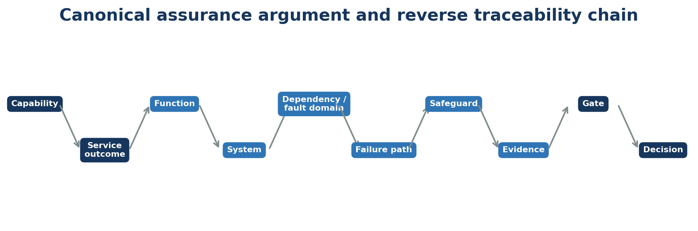
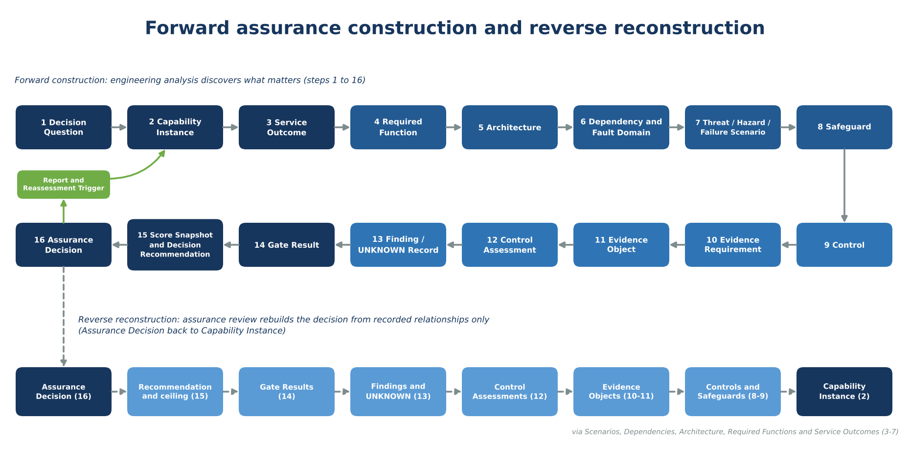
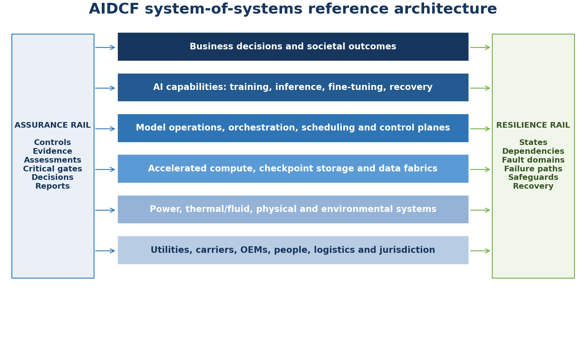
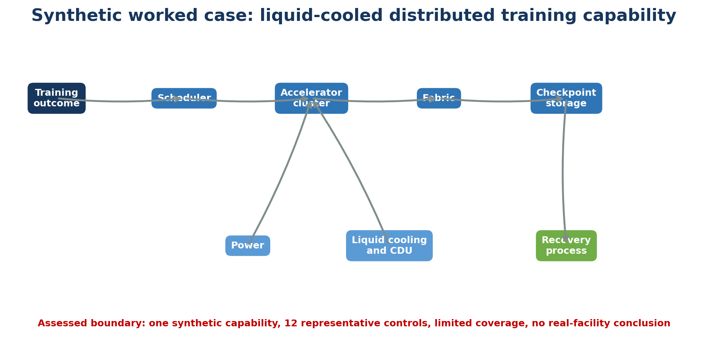
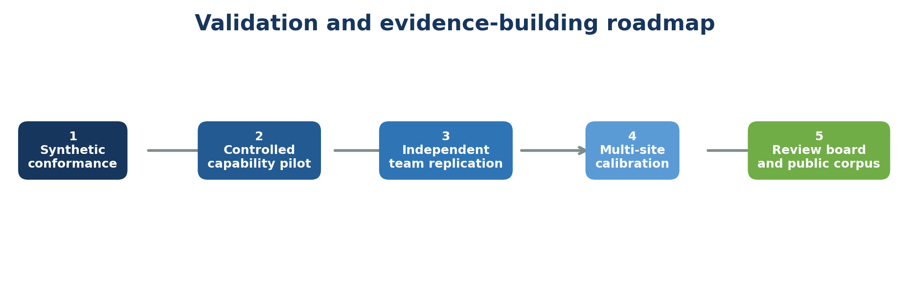

> Markdown edition (source of truth). PDF edition, generated from this file: [AIDCF_Technical_Whitepaper_v3.1_Validation_Candidate.pdf](AIDCF_Technical_Whitepaper_v3.1_Validation_Candidate.pdf). Earlier editions are in [`../archive/`](../archive/README.md).

**AIDCF**

**AI Data Centre Facilities Assurance Framework**

*Capability-centred, evidence-gated and graph-native assurance for AI infrastructure*



*Figure 1. AIDCF canonical assurance argument (simplified; the full sixteen-step chain is shown in Figure 2).*

| **Field**             | **Value**                                                                                                       |
|-----------------------|-----------------------------------------------------------------------------------------------------------------|
| Artifact              | AIDCF-WP-001                                                                                                    |
| Version               | 3.1                                                                                                             |
| Date                  | 2026-10-10                                                                                                      |
| Status                | Validation Candidate for Independent Review                                                                     |
| Author                | Siva Sethumadhavan                                                                                              |
| Canonical baseline    | AIDCF-007A: 15 domains, 90 families and 360 controls (identity and cardinality, AMD-001); control content, evidence profiles and gate mappings in registry v1.1 (AMD-002, Proposed) |
| Conceptual basis      | AIDCF-002 Core Conceptual Model v1.0: sixteen-step canonical assurance chain on the ISO/IEC/IEEE 15026-2 assurance-case structure |
| Implementation status | Synthetic, non-production reference implementation (AIDCF-015 v1.3, release AIDCF-REL-2026.10.1), self-validated only |
| Publication boundary  | Research framework; not law, certification, accreditation, engineering approval or hazardous-test authorisation |
| Revision history      | Appendix E                                                                                                      |

<table>
<colgroup>
<col style="width: 100%" />
</colgroup>
<thead>
<tr class="header">
<th><strong>How to cite<br />
</strong>Sethumadhavan, S. AIDCF: AI Data Centre Facilities Assurance Framework. Technical Whitepaper v3.1, Validation Candidate for Independent Review, 2026-10-10. DOI to be assigned on public deposit.</th>
</tr>
</thead>
<tbody>
</tbody>
</table>

# Abstract

Artificial intelligence workloads create a capability system that couples dense electrical demand, heat rejection, liquid and air cooling, accelerated compute, checkpoint storage, high-bandwidth fabrics, orchestration, control planes, operational teams and external providers. Established facility, technology, cybersecurity and AI-governance approaches address important parts of this landscape, but do not necessarily provide one end-to-end argument from a specific AI service outcome to infrastructure reality, credible failure, implemented safeguards, evidence and decision. AIDCF addresses this perceived integration gap.

The framework defines a Capability Instance as the bounded subject of assurance and traces required Service Outcomes through Required Functions, systems, assets, interfaces, dependencies, fault domains, operating states, failure scenarios, safeguards, controls, evidence, Control Assessments, Gate Results and accountable Assurance Decisions. The chain is formalised in sixteen canonical steps and mapped to the ISO/IEC/IEEE 15026-2 assurance-case structure and the Goal Structuring Notation. The control baseline contains fifteen domains, ninety control families and 360 controls, each with control-specific criteria, evidence profile and CRITICAL or SUPPORTING mappings to fifteen non-compensating critical gates. The method preserves UNKNOWN, separates intended, designed, installed, commissioned, observed and tested states, and prevents unrelated strengths or aggregate scores from overriding a controlling gate.

Version 3.1 aligns the paper with the current AIDCF release: the Core Conceptual Model (AIDCF-002), registry v1.1 with per-control content and gate roles, the canonical gate roll-up rule and decision derivation (AIDCF-010), the canonical controlled vocabularies, the Machine-Executable Data Model Standard and its JSON Schema, JSON-LD, OWL and SHACL package (AIDCF-016), the Capability Assurance Maturity Model (AIDCF-017), fifteen domain guides (AIDCF-018) and eight standards crosswalks including a Singapore baseline (AIDCF-019). The synthetic worked case is now reproduced exactly from the AIDCF-015 v1.3 dataset. AIDCF remains a proposed research framework: its evidence is synthetic, it has not been independently reviewed, no authorised pilot has been completed, and registry v1.1 is Proposed.

# Executive summary

| **Problem pattern**                               | **AIDCF response**                                                                                          | **Decision value**                                          |
|---------------------------------------------------|-------------------------------------------------------------------------------------------------------------|-------------------------------------------------------------|
| Facility and AI-platform reviews are disconnected | One capability chain links outcomes to power, thermal, compute, storage, network, operations and providers. | Exposes cross-domain dependencies and failure propagation.  |
| Design intent is confused with operating reality  | Claim types (DESIGN, IMPLEMENTATION, OPERATION, EFFECTIVENESS, RESILIENCE) are explicit and evidence is assertion-specific. | Restricts reliance to what was actually observed or tested. |
| Redundancy masks common mode                      | Dependencies, routes, controls, people and recovery resources are first-class.                              | Challenges superficial diversity claims.                    |
| Missing evidence is forced into a score           | UNKNOWN is a result with a severity (US1–US5) and a defined decision effect.                                 | Prevents false certainty.                                   |
| Aggregate scores overwhelm critical failure       | Critical gates are non-compensating and evaluated from per-control CRITICAL roles.                           | Protects decision prerequisites.                            |
| Automation silently exercises authority           | Tools validate and recommend a ceiling; accountable people decide at or below it.                           | Preserves governance and professional responsibility.       |

The paper does not claim that no adjacent method exists. It claims that the compared approaches leave a practical integration problem when a decision requires simultaneous reasoning across facility engineering, AI technology, operations, evidence and accountable assurance. This claim is a research proposition to be tested, not a settled conclusion.

The synthetic worked case (§22) shows the doctrine operating as intended. Twelve of 360 controls are assessed: six are CONFORMING, five PARTIAL and one UNKNOWN, so eleven are scored and coverage is 11/360 = 3.0556%. The mean of the scored controls is 77.2727, but the band is withheld. Three gates FAIL because CRITICAL inputs are PARTIAL, five are UNKNOWN and seven are NOT_ASSESSED. The CG-07 failure on critical control-system integrity carries a NOT_ASSURED ceiling, and the decision is NOT_ASSURED; the systemic UNKNOWN on the shared facility water plant and the incomplete capability gate cap it at INCONCLUSIVE, which does not soften a demonstrated gate failure. The score, Gate Results and decision ceiling are reproducible with `python tools/run_all.py` in the AIDCF-015 v1.3 package.

<table>
<colgroup>
<col style="width: 100%" />
</colgroup>
<thead>
<tr class="header">
<th><strong>Publication posture<br />
</strong>Validation candidate for independent review. Suitable for expert critique, independent re-performance of the synthetic package, pilot recruitment and research timestamping. Not suitable for certification, accreditation, universal conformance claims or real-facility assurance.</th>
</tr>
</thead>
<tbody>
</tbody>
</table>

# 1. Formal research problem

The research problem is to determine whether a repeatable assurance method can reconstruct a bounded conclusion about a defined AI infrastructure capability from: service outcomes; architecture and dependencies; credible adverse conditions; effective safeguards; sufficient evidence; non-compensating prerequisites; competent review; and accountable decision authority.

| **Research question**                                     | **Proposition**                                               | **Empirical test**                                    |
|-----------------------------------------------------------|---------------------------------------------------------------|-------------------------------------------------------|
| Can assessors define the same bounded subject?            | Capability-first scoping reduces ambiguity.                   | Independent scoping and inter-rater agreement.        |
| Can facility and AI-platform layers be traced end to end? | Canonical objects and relationships enable reconstruction.    | Graph completeness and reverse-trace tests.           |
| Can hidden common modes be surfaced?                      | Dependency and fault-domain analysis improves discovery.      | Compare findings against conventional domain reviews. |
| Can score gaming be constrained?                          | UNKNOWN and gates resist favourable denominator manipulation. | Adversarial fixtures and re-performance.              |
| Can decisions remain explainable after change?            | Versioned identities and event impact support supersession.   | Change-event and affected-decision tests.             |

# 2. Claimed contribution and novelty

AIDCF does not claim novelty in power engineering, thermal engineering, systems reliability, cybersecurity, AI risk management, evidence management or assurance individually. Its claimed contribution is the disciplined integration of those elements around a bounded AI Capability Instance, with explicit graph traceability and decision constraints.

| **Contribution**               | **Distinctive element**                                                | **Current evidence status**                               |
|--------------------------------|------------------------------------------------------------------------|-----------------------------------------------------------|
| Capability-centred assurance   | Service Outcomes precede components and controls; one top claim per case. | Conceptual model (AIDCF-002) and synthetic demonstration. |
| Cross-domain failure reasoning | Facility, technology, people and providers share one dependency graph. | Scenario and architecture artifacts; real pilots pending. |
| Evidence-gated conclusion      | Evidence quality and UNKNOWN are first-class objects with defined decision effects. | Synthetic evidence fixtures.                     |
| Gate-dominant decision         | Critical prerequisites remain separate from scores; per-control CRITICAL roles drive gate roll-up. | Synthetic Gate Results recomputed by the reference rule engine. |
| Machine-executable lineage     | Stable IDs, JSON Schema, JSON-LD, OWL, SHACL, SPARQL queries and manifests. | AIDCF-016 package and AIDCF-015 v1.3 self-validation; independent runtime review pending. |

# 3. Release status and evidence boundary

## 3.1 Status taxonomy

| **Status**                  | **Meaning**                                                         | **Use in this whitepaper**                             |
|-----------------------------|---------------------------------------------------------------------|--------------------------------------------------------|
| Author-approved baseline    | Identity and cardinality fixed by the baseline owner; independent ratification pending. | AIDCF-007A AMD-001: 15/90/360 and canonical identifiers only. |
| Proposed                    | Substantive content submitted for controlled methodology review; may be used for review, calibration and pilots with disclosure. | AIDCF-007A registry v1.1 (AMD-002): per-control content, evidence profiles, gate roles and assurance levels. |
| Draft for controlled review | Substantive methodology awaiting multidisciplinary review.          | AIDCF-002, AIDCF-010, AIDCF-016 to AIDCF-019 and the other AIDCF standards and handbooks. |
| Synthetic demonstration     | Non-production data and execution for method testing.               | AIDCF-015 v1.3.                                        |
| Proposed research extension | Concept requiring governance and validation before operational use. | Descriptive claim patterns and economic measures.      |
| Externally validated        | Independent execution or empirical validation completed.            | Not yet achieved.                                      |

This taxonomy prevents the whitepaper from presenting every component as equally mature. Canonical identity can be fixed while substantive control adequacy, gate calibration and real-world effectiveness remain open for review. Registry v1.0 remains the identity and cardinality baseline until AMD-002 is approved; any assessment that uses v1.1 content discloses the registry version [23].

## 3.2 Release posture

Version 3.1 is a validation candidate, not a final validated standard. It consolidates the technical, editorial and governance recommendations raised during the v1.1 and v2.0 adversarial reviews and aligns the paper with the artifacts released on 2026-10-10. It includes author dispositions (§28.1), a gate governance record and sign-off matrix (§19.3, §19.4), a derivation-record structure (§4.3), an independent-review protocol (§28.2) and an authorised-pilot package (§29). It does not claim that independent reviewer acceptance, canonical gate ratification or a real authorised pilot has occurred: no signed evidence of any of these exists.

<table>
<colgroup>
<col style="width: 100%" />
</colgroup>
<thead>
<tr class="header">
<th><strong>Non-fabrication boundary<br />
</strong>No reviewer name, approval signature, pilot sponsor, site, result or authorisation is asserted without a signed source record. The registers in this paper distinguish author-resolved items from evidence still pending. Review and approval records inside the synthetic dataset were generated by its build tooling and record no human act.</th>
</tr>
</thead>
<tbody>
</tbody>
</table>

| **Component**                       | **v3.1 state**                                              | **Permitted interpretation**                                         |
|-------------------------------------|-------------------------------------------------------------|----------------------------------------------------------------------|
| Narrative and technical corrections | Author-resolved                                             | Whitepaper text incorporates the identified corrections.             |
| Conceptual model and vocabularies   | AIDCF-002 v1.0 and 25 vocabulary registries, Draft for controlled review | Single canonical chain and code lists; not independently reviewed. |
| Control registry                    | Registry v1.1 Proposed (AMD-002)                            | Per-control content usable for review, calibration and pilots with disclosure. |
| Critical gates                      | Canonical names restored; criteria, floors and ceilings in AIDCF-010 v1.1 | Ready for governance review; not independently ratified.  |
| Reviewer dispositions               | Author disposition recorded; independent acceptance pending | Issues have proposed resolutions, not third-party endorsement.       |
| Derivation records                  | Register structure and current evidence assembled           | Partially populated; retrospective source coding remains incomplete. |
| Pilot package                       | Authorisation and execution templates complete              | No authorised pilot has been completed.                              |
| Synthetic implementation            | AIDCF-015 v1.3, all thirteen validation layers pass (self-validation) | Technical demonstration only: twelve controls assessed, coverage 11/360 = 3.0556%, decision NOT_ASSURED. |

# 4. Framework-development protocol and derivation records

The protocol below makes the construction process explicit. It is a retrospective methodological specification for future reproducible maintenance. A public source log, coding register and reviewer record remain required before the derivation can be considered independently reproducible.

| **Stage**              | **Procedure**                                                                                                 | **Required record**                           |
|------------------------|---------------------------------------------------------------------------------------------------------------|-----------------------------------------------|
| Corpus definition      | List included standards, methods, reference architectures and AIDCF source artifacts by edition and scope.    | Source register and inclusion rationale.      |
| Concept extraction     | Capture terms, objects, relationships, states, evidence and decision concepts.                                | Extraction matrix with source reference.      |
| Semantic normalisation | Separate overloaded concepts such as hazard, cause, failure mode, effect, consequence, safeguard and control. | Terminology decision log.                     |
| Domain clustering      | Group concepts using coverage, separability and traceability tests.                                           | Cluster matrix and rejected alternatives.     |
| Control synthesis      | Express outcome-linked, assessable requirements with evidence and failure mappings.                           | Control design record and duplicate review.   |
| Assurance design       | Define assessment states, UNKNOWN, gates, scores, decisions and reporting.                                    | Rule register and test cases.                 |
| Machine formalisation  | Assign identifiers, schemas, graph shapes and conformance fixtures.                                           | Release manifest and validation results.      |
| Challenge and approval | Multidisciplinary peer review, disagreement resolution and independent challenge.                             | Reviewer register, comments and dispositions. |

## 4.1 Search and inclusion protocol

- Prioritise official standards bodies, public institutional guidance, peer-reviewed or established assurance literature and authoritative vendor-neutral technical bodies.

- Record exact search terms, date executed, source URL or DOI, edition, access restriction and reviewer.

- Include sources relevant to facilities, AI technology, OT/control systems, reliability, evidence, assurance arguments, provenance and machine validation.

- Exclude unsupported marketing claims, unattributed summaries and sources whose scope cannot be established.

- Treat paywalled normative standards through their accessible abstracts unless licensed full text is available. Do not imply clause-level comparison from public abstracts.

## 4.2 Comparative analysis criteria

| **Criterion**        | **Question**                                                         |
|----------------------|----------------------------------------------------------------------|
| Subject              | What system or proposition is assessed?                              |
| Facility coverage    | Are power, thermal, physical and environmental systems included?     |
| AI technology        | Are configured compute, storage, fabrics and orchestration included? |
| Operations           | Are operating states, change and recovery addressed?                 |
| Failure reasoning    | Are common modes and propagation explicit?                           |
| Evidence             | Are provenance, freshness, coverage and sufficiency explicit?        |
| Uncertainty          | Can missing or conflicting evidence remain UNKNOWN?                  |
| Decision restraint   | Can critical prerequisites override aggregate scores?                |
| Machine traceability | Can conclusions be reconstructed and validated?                      |
| Authority            | Who may issue, rely on, suspend or withdraw a conclusion?            |

## 4.3 Derivation-record package

The derivation package is the evidence needed to show how AIDCF was constructed. The table distinguishes records present conceptually from records that still require retrospective population or independent verification. The repository reserves `validation/derivation-records/` for these records; it is not yet populated.

| **Record**                        | **Required contents**                                                                    | **v3.1 state**                                                  |
|-----------------------------------|------------------------------------------------------------------------------------------|-----------------------------------------------------------------|
| DR-01 Source register             | Title, publisher, edition, scope, access basis, inclusion rationale and extraction date. | Partially populated in references and AIDCF-019 §2.4; full register pending. |
| DR-02 Search protocol             | Databases/sites, search strings, dates, inclusion/exclusion criteria and reviewer.       | Specified in §4.1; execution log pending.                       |
| DR-03 Concept extraction matrix   | Source passage, concept, class, property, relationship and analyst note.                 | Template complete; population pending.                          |
| DR-04 Terminology log             | Ambiguous term, alternatives, adopted meaning and rationale.                             | Canonical terms and aliases fixed in AIDCF-002; per-decision log pending. |
| DR-05 Domain cluster matrix       | Concept-to-domain mapping, rejected clusters and coverage test.                          | High-level cluster rationale complete (§8); legacy eight-domain to fifteen-domain mapping in AIDCF-002 Part X; detailed matrix pending. |
| DR-06 Control derivation register | Source need, objective, canonical control, duplicate review and evidence mapping.        | Registry v1.1 holds per-control content and failure modes; derivation evidence pending. |
| DR-07 Gate derivation register    | Failure consequence, prerequisite, evidence floor and decision effect.                   | Gate specifications and criteria in AIDCF-010 v1.1; approval pending. |
| DR-08 Reviewer register           | Reviewer competence, independence, comments and dispositions.                            | Author dispositions complete; independent register pending.     |
| DR-09 Change and supersession log | Changed object, reason, impact, version and migration.                                   | AIDCF-007A AMD-001/AMD-002 and AIDCF-015 MIG-001/MIG-002 migration records exist. |
| DR-10 Validation corpus           | Positive, negative, anti-gaming and benchmark cases.                                     | 59 synthetic fixtures in AIDCF-015 v1.3; public benchmark corpus pending. |

# 5. Related work and comparative gap

The comparison is directional and limited to cited public scope statements. It is not a clause-by-clause equivalence analysis. ISO/IEC 22237-1 describes general principles, common aspects, facilities and infrastructure classification, and operation and management references, while excluding selection and configuration of IT and network equipment [1]; the ISO/IEC 22237 and EN 50600 series develop those concepts part by part [7]. The Uptime Tier Standard provides an objective basis for comparing site-infrastructure topology and differentiates four classifications [4]. ANSI/TIA-942-C specifies data-centre and computer-room infrastructure requirements and includes telecommunications, power, cooling, architecture, fire protection, safety and physical security [5]. NIST AI RMF 1.0 provides a voluntary AI risk-management framework organised around Govern, Map, Measure and Manage [2][3]. ISO/IEC 42001 and ISO/IEC 27001 specify management-system requirements for AI and information security respectively [14][15], and the ISA/IEC 62443 series addresses security of industrial automation and control systems [8].

| **Approach**         | **Primary public scope**                                                             | **Integration gap AIDCF addresses**                                               | **No equivalence claim**                              |
|----------------------|--------------------------------------------------------------------------------------|-----------------------------------------------------------------------------------|-------------------------------------------------------|
| ISO/IEC 22237        | Data-centre facility and infrastructure concepts, classes and management references. | Connection to configured AI compute, storage, fabrics and service outcomes.       | AIDCF does not claim ISO conformity.                  |
| Uptime Tier topology | Site-infrastructure functionality, capacity and expected availability by topology.   | Capability-specific workload, data, fabric, control-plane and evidence reasoning. | Tier evidence is bounded design evidence.             |
| ANSI/TIA-942-C       | Physical infrastructure requirements across multiple disciplines.                    | One assurance argument from AI outcome to operational evidence and decision.      | AIDCF does not certify TIA-942.                       |
| NIST AI RMF          | Voluntary management of AI risk and trustworthiness.                                 | Physical and infrastructure assurance below the AI system.                        | AIDCF is complementary, not a profile of NIST AI RMF. |
| AITG                 | Trust, authority and exposure reasoning.                                             | Infrastructure reality and physical failure paths.                                | Federate decisions; do not merge methods.             |

## 5.1 Expanded related-work map

| **Source family**                         | **Explicit public scope used**                                                                         | **AIDCF interface**                           | **Review caveat**                                           |
|-------------------------------------------|--------------------------------------------------------------------------------------------------------|-----------------------------------------------|-------------------------------------------------------------|
| ISO/IEC 22237 and EN 50600 [1][7]         | Data-centre facilities, infrastructure, availability, security, efficiency and management concepts.    | PHY, POW, THM, ENV, OPS and RES.              | No clause-level equivalence claimed.                        |
| ANSI/TIA-942-C [5]                        | Telecommunications, power, cooling, architecture, fire protection, safety and physical security.       | PHY, POW, THM and NET.                        | No TIA certification claim.                                 |
| Uptime Tier Topology [4]                  | Site-infrastructure capacity components and distribution paths across Tier classifications.            | POW, THM, PHY and OPS design evidence.        | Tier is not converted to capability assurance.              |
| ISA/IEC 62443 [8]                         | Requirements and processes for electronically secure IACS across lifecycle, operations and technology. | SEC, OPS and SUP.                             | Cybersecurity proof does not establish facility resilience. |
| ISO/IEC 27001 and ISO/IEC 42001 [14][15]  | Information security and AI management-system requirements at organisation level.                      | GOV, SUP, SEC and EVA.                        | Management-system certification is bounded evidence only.  |
| NIST AI RMF [2][3]                        | Voluntary AI risk-management and trustworthiness functions.                                            | GOV, CAP, SEC and EVA linkage.                | AIDCF is complementary, not a NIST profile.                 |
| ASHRAE TC 9.9 thermal guidelines [9]      | Environmental envelopes and guidance for data-processing environments.                                 | THM and ENV evidence.                         | Engineering criteria remain source-owned.                   |
| Reliability and safety techniques [12][13] | FMEA/FMECA, fault trees, event trees, bow ties and structured hazard analysis.                        | DEP, RES and engineering domains.             | Competent method use required.                              |
| Assurance-case methods [10][11]           | Structured claim, argument and evidence patterns.                                                      | AIDCF assurance chain, gates and reporting.   | Concept-level GSN mapping in AIDCF-002 §10; notation-level tooling is future work. |
| W3C PROV-O and semantic standards [6][16]–[18] | Provenance and graph representation and validation.                                               | Evidence lineage and machine exchange.        | Semantic conformance does not prove truth.                  |
| OCP and vendor AI reference architectures | Open or validated implementation patterns for AI infrastructure.                                       | Architecture evidence and interface patterns. | Reference design does not prove site operation.             |

The operational use of these frameworks as evidence sources is set out in the AIDCF-019 crosswalks (§26).

# 6. Assurance theory and the canonical assurance chain

AIDCF defines assurance as bounded confidence in a proposition about a specific capability, for identified users and intended use, within a declared boundary, operating states and period. Assurance is not the inventory of controls, a maturity score or a topology label. AIDCF-002 makes this precise as one assurance case per decision, with exactly one top claim [21].

## 6.1 Top claim

Every AIDCF assurance case states one top claim: "Capability Instance X can achieve Service Outcomes Y within tolerances T under declared operating states S, for Decision Question Q, as of date D." Each element is mandatory. An assessment that lacks any of them cannot issue a decision state other than INCONCLUSIVE (AIDCF-002 CCM-REQ-005).

## 6.2 The sixteen-step chain

The canonical chain is the only reasoning chain in AIDCF; earlier variants in other artifacts are summaries of it. It is built forwards as engineering analysis (steps 1 to 16) and audited backwards as assurance review (16 to 1). The forward pass discovers what matters; the reverse pass checks that every element of the decision is supported using only recorded relationships (CCM-REQ-008). A forward pass that stops at the control list produces controls with no argument; a reverse pass that starts at a dashboard produces an argument with no discovery. The Assurance Report and Reassessment Triggers close the loop: a fired trigger returns the case to step 2.



*Figure 2. Forward assurance construction and reverse reconstruction.*

| **Step** | **Name** | **Question answered** | **Detail owner** |
|---|---|---|---|
| 1 | Decision Question | What decision will rely on this assessment, and who will make it? | AIDCF-011 |
| 2 | Capability Instance | Which bounded deployment is the subject? | AIDCF-003 |
| 3 | Service Outcome | What must it achieve, within which tolerances? | AIDCF-003 |
| 4 | Required Function | Which functions must be delivered for each outcome? | AIDCF-003 |
| 5 | Architecture (InfrastructureSystem / Asset / Interface) | Which systems, assets and interfaces implement each function, as built? | AIDCF-003, AIDCF-013 |
| 6 | Dependency and Fault Domain | What does each element rely on, and what fails together? | AIDCF-003 |
| 7 | Threat / Hazard / Failure Scenario | How can the outcome be defeated? | AIDCF-004 |
| 8 | Safeguard | Which real measures prevent, detect, contain or recover? | AIDCF-004 |
| 9 | Control | Which AIDCF requirements test those safeguards? | AIDCF-007A |
| 10 | Evidence Requirement | What evidence would demonstrate each control at the required claim type? | AIDCF-008 |
| 11 | Evidence Object | What evidence was actually obtained? | AIDCF-008 |
| 12 | Control Assessment (result) | What result does the evidence support, for which claim type and scope? | AIDCF-009 |
| 13 | Finding / UNKNOWN Record | What deficiencies and unresolved uncertainties remain? | AIDCF-008, AIDCF-009 |
| 14 | Gate Result | Are the non-compensating prerequisites met? | AIDCF-010 |
| 15 | Score Snapshot and Decision Recommendation | What do the results summarise to, and what ceiling does the engine derive? | AIDCF-010 |
| 16 | Assurance Decision | What has accountable authority decided, with which conditions and validity? | AIDCF-010, AIDCF-011 |

## 6.3 Mapping to ISO/IEC/IEEE 15026-2 and GSN

ISO/IEC/IEEE 15026-2 specifies the minimum content and structure of an assurance case: claims, arguments connecting claims to evidence, the evidence, and the justifications, assumptions and context within which the argument holds [10]. The GSN Community Standard provides a widely used notation for the same concepts [11]. AIDCF adopts this structure at concept level; it does not reproduce either text.

| **Assurance-case concept** | **AIDCF realisation** | **Chain steps** |
|---|---|---|
| Top-level claim | The top claim of §6.1 | 1–3 |
| Sub-claims | Outcome × state, Required Function, dependency, scenario and safeguard claims, each with a completeness sub-claim where AIDCF-002 §11 requires one | 3–8 |
| Argument / strategy | Fixed decomposition: outcome × operating state, then Required Function, then Dependency and Fault Domain, then Failure Scenario, then Safeguard | between 3 and 8 |
| Leaf requirement | Control at a declared claim type | 9 |
| Evidence (solution) | Evidence Requirement, Evidence Object and Control Assessment result | 10–12 |
| Context and assumptions | Boundary, architecture baseline, declared operating states, exclusions and profile; unsupported material assumptions become UNKNOWN Records | 2, 5, 6 |
| Defeaters and challenges | CHALLENGES relationships, Findings and UNKNOWN Records, retained after resolution | 11–13 |
| Overall judgement | Gate Results, Score Snapshot, Decision Recommendation and Assurance Decision | 14–16 |

Two AIDCF features have no direct GSN equivalent and are deliberate additions. Critical gates are cross-cutting acceptance conditions: each is a named sub-goal that must be supported regardless of how strongly sibling goals are supported, and AIDCF makes that non-compensation machine-checkable. UNKNOWN severity gives every undeveloped or defeated element a defined effect on the top claim, so a case cannot be presented as complete while material elements are undeveloped. Because a safeguard may sit on several scenario paths and a control may govern several safeguards, the argument is a directed acyclic graph rather than a tree.

## 6.4 Proposition layers

| **Proposition layer** | **Question**                                                      |
|-----------------------|-------------------------------------------------------------------|
| Outcome               | What must the capability achieve, within what tolerance?          |
| Architecture          | Which systems, interfaces and resources implement that result?    |
| Dependency            | What internal, shared, external or recovery-only reliance exists? |
| Failure               | How can the outcome be degraded or lost?                          |
| Safeguard             | What prevents, detects, contains, recovers or adapts?             |
| Evidence              | What supports or challenges each assertion?                       |
| Gate                  | Which prerequisite cannot be compensated?                         |
| Decision              | What reliance is permitted, for whom and for how long?            |

<table>
<colgroup>
<col style="width: 100%" />
</colgroup>
<thead>
<tr class="header">
<th><strong>Conceptual expression<br />
</strong>Bounded Assurance = f(Outcome Definition, Architecture and Dependency Confidence, Safeguard Effectiveness, Evidence Confidence, Gate State, Review Quality, Decision Authority). This is a dependency expression, not a numeric multiplication formula.</th>
</tr>
</thead>
<tbody>
</tbody>
</table>

# 7. Canonical terminology, vocabularies and acronyms

| **Term**            | **Canonical meaning**                                                                                                      |
|---------------------|----------------------------------------------------------------------------------------------------------------------------|
| Capability Instance | A specific deployment bounded by owner, location, architecture, demand, criticality, service requirements and obligations. |
| Service Outcome     | A measurable availability, performance, integrity, recovery or restraint condition, with a tolerance.                       |
| Required Function   | A function that must be delivered for a Service Outcome to be achieved within tolerance.                                    |
| Dependency          | Reliance on an entity, resource, condition, provider, person or decision.                                                  |
| Fault Domain        | Objects expected to be affected by the same failure.                                                                       |
| Failure Scenario    | Initiating condition through propagation, consequence, safeguards and recovery.                                            |
| Evidence Object     | Controlled item supporting, challenging or qualifying an assertion.                                                        |
| Control Assessment  | The result of assessing one control for one claim type and scope against its criteria and evidence floor.                  |
| UNKNOWN Record      | A recorded state where sufficient and reliable determination cannot be made, with a type (U1–U10) and severity (US1–US5).  |
| Critical Gate       | Non-compensating prerequisite constraining an Assurance Decision; its evaluated state is a Gate Result.                    |
| Assurance Decision  | Bounded conclusion issued by accountable authority at or below the derived ceiling.                                         |
| MATERIAL            | A fact, dependency, condition, deficiency or UNKNOWN that, had it been known or resolved differently, a competent assessor would reasonably expect to change a control result, a Gate Result, the decision state or a condition, limitation or ceiling attached to the decision. |

AIDCF-002 Part VI defines the controlled vocabularies, and each is published as a CSV registry in `registries/vocabularies/` (25 files, including alias tables that map legacy codes to canonical codes). The codes used in this paper are:

| **Vocabulary** | **Canonical codes** |
|---|---|
| Claim type (minimum Assurance Level) | DESIGN (AL2), IMPLEMENTATION (AL3), OPERATION (AL4), EFFECTIVENESS (AL5), RESILIENCE (AL5) |
| Assurance Level (programme depth, AIDCF-011) | AL0 Discovery to AL6 Continuing |
| Control result (score value) | CONFORMING (100), PARTIAL (50), NONCONFORMING (0), UNKNOWN, NOT_APPLICABLE, NOT_ASSESSED (no value) |
| Gate result | PASS, FAIL, UNKNOWN, APPROVED_NA, NOT_ASSESSED; there is no conditional gate state |
| Decision state | REASONABLY_ASSURED, CONDITIONALLY_ASSURED, LIMITED, NOT_ASSURED, INCONCLUSIVE |
| Decision lifecycle | DRAFT, RECOMMENDED, APPROVED, ACTIVE, SUSPENDED, WITHDRAWN, SUPERSEDED, EXPIRED |
| UNKNOWN type and severity | U1 Missing to U10 Dependency unknown; US1 Low to US5 Systemic |
| Confidence | CONF-0 UNKNOWN to CONF-4 VERY_HIGH, with flags CONFLICTING and STALE |
| Evidence | Classes E1–E7; quality dimensions P, F, C, R, T, I (0–5); quality bands Q0–Q5; sufficiency S0–S5; integrity I0–I5; control profile tiers CP-1 to CP-5; evidence-system conformance EC0–EC5 |
| Operating state | NORMAL, DEGRADED, MAINTENANCE, EMERGENCY, RECOVERY, TRANSITION, SHUTDOWN, FAILED, UNKNOWN |
| Assessment method | INQUIRY, DOCUMENT_REVIEW, INSPECTION, OBSERVATION, RECONCILIATION, ANALYSIS, SAMPLING, TEST, REPERFORMANCE, SCENARIO_EXERCISE |
| Control type; lifecycle stage | DIRECTIVE, PREVENTIVE, DETECTIVE, CORRECTIVE, RECOVERY; PLAN, DESIGN, BUILD, COMMISSION, OPERATE, CHANGE, DECOMMISSION |
| Implementation Maturity (diagnostic only) | IM0 Absent to IM5 Optimised (AIDCF-017) |
| Score band | B5 Strong ≥ 90; B4 Substantial 75–89.99; B3 Moderate 50–74.99; B2 Weak 25–49.99; B1 Very weak < 25 |

Legacy terms are aliases and are replaced on revision: "Critical Function" and "Infrastructure Function" become Required Function; legacy decision labels such as ADVERSE and "UNKNOWN / INCONCLUSIVE" become NOT_ASSURED and INCONCLUSIVE; legacy result labels such as IMPLEMENTED and INEFFECTIVE map to CONFORMING and NONCONFORMING within their claim-type limits.

| **Acronym** | **Meaning**                                      |
|-------------|--------------------------------------------------|
| AIDCF       | AI Data Centre Facilities Assurance Framework    |
| AITG        | AI Trust Graph                                   |
| APS         | AIDCF Assurance Principle                        |
| CDU         | Coolant Distribution Unit                        |
| GSN         | Goal Structuring Notation                        |
| IACS        | Industrial Automation and Control System         |
| MCF         | Master Control Framework identifier              |
| MDM         | Machine-Executable Data Model (AIDCF-016)        |
| OWL         | Web Ontology Language                            |
| RDF         | Resource Description Framework                   |
| SHACL       | Shapes Constraint Language                       |
| TEVV        | Testing, evaluation, verification and validation |

# 8. Why fifteen domains

The fifteen-domain structure applies three design tests. Coverage asks whether every material condition can be anchored without arbitrary omission. Separability asks whether a group has coherent ownership, competence and evidence. Traceability asks whether cross-domain effects can remain explicit rather than hidden inside broad categories.

| **Cluster**             | **Domains**   | **Rationale**                                                              |
|-------------------------|---------------|----------------------------------------------------------------------------|
| Direction and subject   | GOV, CAP      | Separate governance and decision rights from the capability being assured. |
| Dependency and place    | DEP, PHY      | Make hidden reliance and physical boundary explicit.                       |
| Facility engineering    | POW, THM, ENV | Different mechanisms, expertise, telemetry and failure modes.              |
| AI technology chain     | CMP, STO, NET | Distinct but tightly coupled compute, data and communication functions.    |
| Operation and recovery  | OPS, RES      | Separate routine control from continuity, crisis and restoration.          |
| Ecosystem and authority | SUP, SEC      | Separate supplier/lifecycle reliance from digital and OT authority.        |
| Assurance integrity     | EVA           | Independently govern evidence, assessment, gates and decision integrity.   |

This remains a design hypothesis. Completeness must be tested through expert review, real incidents, pilot assessments and analysis of unmapped requirements (§10). The superseded eight-domain model (D1–D8) is mapped to the fifteen domains in AIDCF-002 Part X for traceability only.

# 9. Domain model and control registry v1.1

Each domain contains six families (<DOM>-01 to <DOM>-06) and twenty-four controls (MCF-<DOM>-001 to MCF-<DOM>-024; family n holds controls 4n−3 to 4n), yielding ninety families and 360 controls. Stable identity does not imply immutable wording. Meaning-changing replacements require new identifiers and explicit supersession [23].

The table shows, for each domain, the gates to which its controls hold CRITICAL mappings in registry v1.1, with the number of CRITICAL mappings in brackets, and the number of SUPPORTING mappings. It replaces the whole-domain gate association of registry v1.0, which is retained in AIDCF-007A for lineage only and is not used to evaluate a gate.

| **Code** | **Domain**                                            | **CRITICAL mappings (registry v1.1)**                  | **SUPPORTING mappings** |
|----------|-------------------------------------------------------|--------------------------------------------------------|------------------------:|
| GOV      | Governance, Accountability and Assurance Direction    | CG-13 (4)                                              | 14 |
| CAP      | AI Capability, Service Outcome and Demand Management  | CG-01 (6), CG-02 (1), CG-13 (1), CG-14 (1)             | 34 |
| DEP      | Dependency, Concentration and External Reliance Management | CG-02 (1), CG-03 (8), CG-13 (1)                   | 38 |
| PHY      | Physical Site, Building and Security Infrastructure   | CG-04 (4), CG-09 (1)                                   | 27 |
| POW      | Electrical Power Infrastructure and Energy Continuity | CG-04 (4), CG-05 (8), CG-07 (1), CG-09 (1), CG-10 (1)  | 32 |
| THM      | Cooling, Thermal and Fluid Infrastructure             | CG-04 (1), CG-06 (7), CG-07 (1), CG-09 (1), CG-10 (1)  | 39 |
| ENV      | Environmental and Resource Performance                | CG-04 (1)                                              | 20 |
| CMP      | AI Compute Infrastructure                             | CG-08 (4), CG-09 (1), CG-10 (1), CG-14 (1)             | 40 |
| STO      | AI Storage and Data Infrastructure                    | CG-08 (4), CG-09 (1), CG-10 (3)                        | 27 |
| NET      | AI Network and Interconnect Architecture              | CG-08 (4), CG-09 (1), CG-10 (1), CG-14 (1)             | 41 |
| OPS      | Building Operations and Service Management            | CG-04 (3), CG-07 (1), CG-13 (1), CG-14 (4)             | 37 |
| RES      | Resilience, Continuity and Recovery                   | CG-09 (3), CG-10 (4)                                   | 44 |
| SUP      | Supply Chain, OEM and Ecosystem Assurance             | CG-03 (1), CG-15 (2)                                   | 38 |
| SEC      | Digital, OT and Control-Plane Security                | CG-07 (3), CG-15 (5)                                   | 48 |
| EVA      | Evidence, Assessment and Assurance Management         | CG-01 (1), CG-02 (1)                                   | 4  |

## 9.1 Per-control content

Registry v1.0 generated every control's objective, requirement, criteria, evidence and procedure from a single template with only the title substituted. Registry v1.1 (amendment AIDCF-007A-AMD-002, Proposed) replaces that text with content specific to each control [23]. Every one of the 360 records in `registries/controls/controls.json` now carries: objective; one or more "shall" requirements naming the accountable role; three to seven independently testable assessment criteria; capability-profile parameters with illustrative defaults and their basis (508 parameters in `parameters.csv`); minimum evidence; an evidence profile (claim type, profile tier, required and optional evidence classes, quality and sufficiency floors, state and period coverage, independence, mandatory items, acceptable alternatives, UNKNOWN effect and reassessment triggers); assessment methods and an ordered procedure; control type; required Assurance Level; lifecycle stages and operating states; applicability; gate mappings with roles; failure modes; AIDCF-014 ontology classes; testing-safety constraints; a control-specific UNKNOWN rule; document-level informative references; and related controls.

| **Registry v1.1 property** | **Distribution across the 360 controls** |
|---|---|
| Primary claim type | OPERATION 133; IMPLEMENTATION 94; DESIGN 52; EFFECTIVENESS 52; RESILIENCE 29 |
| Required Assurance Level (follows claim type) | AL4 133; AL3 94; AL5 81; AL2 52 |
| Primary control type | PREVENTIVE 176; DETECTIVE 70; DIRECTIVE 64; RECOVERY 27; CORRECTIVE 23 |

Registry v1.1 also corrects two duplicate titles (MCF-NET-004 Fabric Fault-Domain Design; MCF-STO-019 Storage Recovery Sequencing) and restores the canonical gate names in every dependent artifact. Until AMD-002 is approved, v1.1 content may be used for pilots, review and calibration with the registry version disclosed.

## 9.2 Control-to-gate mapping

Each control lists its gate mappings individually, zero to many per control, each with a role. A CRITICAL mapping means the gate cannot PASS unless the control is CONFORMING at its required claim type when in scope; a SUPPORTING mapping means the control informs the gate and a NONCONFORMING result requires a documented gate-level evaluation, but does not by itself fail the gate. Mappings are made by meaning and across domains. CG-11 and CG-12 are meta-gates evaluated across all controls and are not mapped per control.

`registries/controls/gate-mappings.csv` holds 589 mappings (106 CRITICAL, 483 SUPPORTING) over 315 controls; 45 controls hold no gate mapping. The per-gate counts are given in §19.1. Every gate CG-01 to CG-10 and CG-13 to CG-15 has at least three CRITICAL controls (CG-02 has the minimum of three; CG-04 has thirteen, drawn from POW, PHY, OPS, THM and ENV).

# 10. Control-universe completeness and symmetry test

The 15/90/360 structure is an AIDCF-internal identity and cardinality baseline. Equal family and control counts are catalogue-design constraints supporting stable identity and machine processing. They are not evidence that all domains possess equal inherent complexity.

| **Test**                      | **Method**                                                            | **Acceptance**                                                         |
|-------------------------------|-----------------------------------------------------------------------|------------------------------------------------------------------------|
| External requirement coverage | Map source requirements and concepts to domains/families/controls.    | No material orphan without documented exclusion.                       |
| Incident coverage             | Map representative AI-infrastructure incidents and failure scenarios. | Every material path maps or triggers extension.                        |
| Duplicate analysis            | Compare objectives, conditions, evidence and effects.                 | Duplicates merged or differentiated explicitly.                        |
| Padding test                  | Challenge low-density families and generic control wording.           | No control retained solely to satisfy cardinality.                     |
| Compression test              | Challenge high-complexity domains for overloaded controls.            | Split when one control has materially distinct evidence and ownership. |
| Pilot orphan test             | Record findings that cannot be classified.                            | Unmapped material finding creates change proposal.                     |

The uneven distribution of CRITICAL mappings in §9 (from one in ENV to fifteen in POW) is itself an input to the padding and compression tests: a domain whose controls rarely defeat a gate may be over-resolved, and one whose controls frequently do may be compressed. The AIDCF-019 crosswalks (§26) provide a first external-requirement coverage signal at family level.

# 11. System-of-systems reference architecture



*Figure 3. Reference architecture with assurance and resilience rails.*

The vertical service stack traces how external resources and facilities enable AI technology and AI services to achieve business outcomes. The assurance rail attaches controls, evidence, Control Assessments, Gate Results and decisions to every layer. The resilience rail attaches states, dependencies, fault domains, failure scenarios, safeguards and recovery. AIDCF-013 specifies the reference architecture in detail [28].

| **Mandatory view**    | **Required content**                                                                                                              |
|-----------------------|-----------------------------------------------------------------------------------------------------------------------------------|
| Capability            | Owner, lifecycle, outcomes, tolerances and criticality.                                                                           |
| Boundary              | Physical, logical, organisational, provider and temporal limits.                                                                  |
| Service chain         | Required Functions and interfaces from workload to facility resources.                                                            |
| Dependency            | Internal, shared, external and recovery-only reliance.                                                                            |
| State and capacity    | NORMAL, MAINTENANCE, DEGRADED, EMERGENCY, RECOVERY and TRANSITION states; installed, available, resilient and committed capacity.  |
| Failure and safeguard | Initiating condition, propagation, consequence, safeguards, residual path and recovery.                                           |
| Assurance attachment  | Controls, evidence, Control Assessments, Findings, Gate Results, score and decision.                                              |

## 11.1 Technical architecture viewpoints

| **Viewpoint**           | **Mandatory elements**                                                               | **Review question**                                  |
|-------------------------|--------------------------------------------------------------------------------------|------------------------------------------------------|
| Service outcome         | Capability, users, outcomes, tolerances and criticality.                             | What result must be protected?                       |
| Physical facility       | Site, space, power, cooling, fluid, environment and physical routes.                 | What physical infrastructure enables the outcome?    |
| AI technology           | Compute, scheduler, storage, metadata, fabrics, gateways and management planes.      | What configured technology enables the outcome?      |
| Authority               | Identities, privileges, automation, remote support and emergency control.            | Who or what can change the state?                    |
| Dependency/fault domain | Shared sources, controls, routes, people, suppliers and recovery resources.          | What can fail together?                              |
| Evidence                | Telemetry, configuration, tests, documents, human evidence and independent evidence. | What proves each assertion?                          |
| Failure and recovery    | Initiation, propagation, containment, recovery and residual path.                    | How is the outcome lost and restored?                |
| AITG handoff            | Shared identity, boundary interface, trust/authority path and federated decision.    | Where do infrastructure and AI trust reasoning meet? |

# 12. Capability service chains

| **Capability pattern** | **Required Functions**                                                                                       | **Representative adverse conditions**                                                     |
|------------------------|--------------------------------------------------------------------------------------------------------------|-------------------------------------------------------------------------------------------|
| Distributed training   | Scheduling, accelerator capacity, collective communication, training data, checkpointing, power and cooling. | Fabric partition, thermal throttling, checkpoint loss, scheduler failure.                 |
| Inference              | Request routing, model serving, accelerator availability, cache/data access and latency observability.       | Tail-latency excursion, overload, model-store or network degradation.                     |
| Fine-tuning            | Data preparation, workload placement, artifact management and reproducible recovery.                         | Configuration drift, dataset access loss, interrupted checkpoint cycle.                   |
| Sovereign AI           | Boundary enforcement, local operations, supply visibility, restricted administration and continuity.         | Remote authority, jurisdictional dependency, external telemetry or support concentration. |
| Shared AI platform     | Tenant isolation, fair scheduling, capacity reservation, telemetry and service management.                   | Noisy neighbour, privilege misuse and resource contention.                                |

# 13. Dependency, capacity and fault-domain analysis

| **Capacity state** | **Meaning**                                              |
|--------------------|----------------------------------------------------------|
| Installed          | Nominal capacity physically present.                     |
| Available          | Usable after condition, maintenance and derating.        |
| Resilient          | Available in a defined adverse condition.                |
| Committed          | Allocated or contractually reserved.                     |
| Headroom           | Remaining usable capacity beyond demand and commitments. |

Apparent diversity is not independence. Two paths may share utility supply, fuel, heat rejection, management network, firmware, time service, carrier, physical route, operator or OEM. A dependency assertion records consumer, provider, direction, condition, required capacity, criticality, evidence, confidence, owner and validation date. Where a material dependency cannot be established, the result is an UNKNOWN Record of type U10 (dependency unknown), not an assumption of independence; the worked case in §22 shows such an UNKNOWN capping a decision.

# 14. Threat, hazard and failure model

| **Object**    | **Analytical question**                                            |
|---------------|--------------------------------------------------------------------|
| Threat source | Who or what could intentionally create an adverse event?           |
| Hazard        | What condition has potential to cause degradation or harm?         |
| Cause         | Why did the failure mode occur?                                    |
| Failure mode  | How did the Required Function fail?                                |
| Local effect  | What occurred at the failed object?                                |
| Propagation   | Which dependencies transmitted the effect?                         |
| Consequence   | Which Service Outcome or stakeholder interest was affected?        |
| Safeguard     | What anticipates, prevents, detects, contains, recovers or adapts? |
| Residual path | What material route remains after safeguards?                      |

AIDCF can consume FMEA/FMECA (IEC 60812 [12]), fault-tree (IEC 61025 [13]), event-tree, bow-tie, HAZOP-style and graph-traversal outputs. The framework does not replace competent use of those techniques or applicable engineering and safety requirements.

# 15. AI-native failure scenarios

| **Scenario**                   | **Failure path**                                                                                                              | **Primary domains**     |
|--------------------------------|-------------------------------------------------------------------------------------------------------------------------------|-------------------------|
| Accelerator thermal throttling | Liquid-flow degradation -\> temperature rise -\> frequency reduction -\> collective desynchronisation -\> checkpoint exposure | THM, CMP, NET, OPS, RES |
| Fabric congestion              | Oversubscription or path imbalance -\> collective latency -\> stalled or elongated job                                        | NET, CMP, DEP, OPS      |
| Checkpoint corruption          | Metadata or storage degradation -\> apparently successful but unusable recovery point                                         | STO, NET, RES, EVA      |
| Scheduler collapse             | Stale capacity or policy failure -\> placement failure despite installed accelerators                                         | CMP, CAP, OPS, SEC      |
| Inference instability          | Load spike, cache miss, fabric or thermal degradation -\> tail-latency breach                                                 | CAP, CMP, NET, STO, THM |
| Sovereign-boundary failure     | Remote support or telemetry path -\> declared authority or jurisdiction boundary breach                                       | GOV, DEP, SUP, SEC      |
| AI capacity cliff              | Committed demand plus degraded resilient capacity -\> insufficient usable headroom                                            | CAP, POW, THM, CMP, NET |

## 15.1 Scenario record template (illustrative)

The record below illustrates the fields a Failure Scenario carries. It is an illustrative template and is not one of the five failure scenarios (FS-01 to FS-05) in the AIDCF-015 v1.3 dataset.

| **Field**              | **Illustrative content**                                                                        |
|------------------------|-------------------------------------------------------------------------------------------------|
| Scenario ID            | SCN-ILL-THM-001                                                                                 |
| Capability outcome     | Distributed-training job completion and controlled thermal operation.                           |
| Initiating condition   | Reduction in CDU flow.                                                                          |
| Preconditions          | Declared high-load training state and dependence on the affected loop.                          |
| Local failure mode     | Reduced coolant flow at the coolant distribution unit.                                          |
| Propagation            | Temperature rise -\> accelerator throttling -\> collective delay -\> checkpoint exposure.       |
| Affected states        | NORMAL transitions to DEGRADED; RECOVERY path required.                                         |
| Safeguards             | Flow alarm, temperature telemetry, load reduction, isolation and recovery procedure.            |
| Safeguard dependencies | Sensor integrity, management network, operator authority and alternate capacity.                |
| Residual path          | Common controller or insufficient alternate thermal capacity.                                   |
| Evidence requirements  | P&ID, heat-load model, flow/temperature telemetry, alarms, operator record and authorised test. |
| Gate effects           | CG-06, CG-08, CG-09 and CG-10.                                                                  |
| Safety boundary        | No live reduction or switching without explicit competent authorisation.                        |
| Reassessment trigger   | Thermal design, firmware, load, provider, incident or evidence change.                          |

# 16. Safeguards and resilience

| **Safeguard role** | **Examples**                                                           | **Evidence focus**                             |
|--------------------|------------------------------------------------------------------------|------------------------------------------------|
| Anticipate         | Demand forecasting, trend and concentration review.                    | Model validity and review.                     |
| Prevent            | Redundancy, authority enforcement and environmental control.           | Design and implementation.                     |
| Detect             | Telemetry, alarms, anomaly detection and integrity checks.             | Coverage, source health and latency.           |
| Contain            | Fault isolation, segmentation, safe load reduction and leak isolation. | Activation and effectiveness.                  |
| Recover            | Restore configuration, capacity, data and service.                     | Sequencing, elapsed time and proof of outcome. |
| Adapt              | Architecture, procedure and operating-envelope change.                 | Approved change and supersession.              |

A standby mechanism is not an effective safeguard if it depends on the failed controller, lacks capacity, cannot activate in time or creates an unsafe restoration path.

# 17. Evidence model

AIDCF-008 rates each Evidence Object on six quality dimensions, each scored 0 to 5, and summarises them as a quality band Q0 to Q5 [24]. Sufficiency (S0 to S5) is judged for the evidence set against the claim, and integrity (I0 to I5) for custody and alteration.

| **Dimension** | **Assessment question**                                            |
|---------------|--------------------------------------------------------------------|
| P Provenance  | Can source and lineage be identified?                              |
| F Fitness     | Is the evidence relevant to the specific assertion and claim type? |
| C Coverage    | Does it cover the required population, path, state and time?       |
| R Reliability | Was it produced by a controlled and repeatable method?             |
| T Timeliness  | Does evidence represent the relevant state and period?             |
| I Integrity   | Is inappropriate alteration detectable and custody controlled?     |

| **Evidence class** | **Typical content** |
|---|---|
| E1 Documentary and declarative | Designs, procedures, registers, approvals |
| E2 Configuration and technical state | Exports, running configuration, as-built records |
| E3 Operational and observational | Telemetry, logs, alarm and maintenance records over a period |
| E4 Validation and test | Commissioning, acceptance, failover and restore tests |
| E5 Independent and third-party | Independent reviews, certifications treated as bounded evidence |
| E6 Human and experiential | Interviews and observed competence |
| E7 Derived and analytical | Models, reconciliations, traceability analyses |

Each control's evidence profile fixes the required classes, the quality and sufficiency floors and the state and period coverage for its claim type (§9.1). Evidence below the floor makes the result UNKNOWN; it does not reduce a score. Every Evidence Object must be traceable to the assertion, Finding, Gate Result and decision it supports.

Evidence is assertion-specific. A signed design supports intent but not necessarily implementation. Telemetry can support current operation but not historical commissioning. A test can support one state or scenario without proving all conditions. AI-assisted extraction or summarisation creates candidate evidence only; it does not independently corroborate its source.

# 18. Assessment methodology and domain guides

AIDCF-009 defines the assessment stages and workpapers [25].

| **Stage** | **Key output**                                                     |
|-----------|--------------------------------------------------------------------|
| Initiate  | Decision Question, sponsor, users and charter.                     |
| Profile   | Capability, Service Outcomes, architecture and operating envelope. |
| Scope     | Boundary, dependencies, states, criteria and exclusions.           |
| Tailor    | Applicable controls, claim types, gates, evidence and Assurance Level. |
| Plan      | Methods, sampling, tests, safety and review.                       |
| Collect   | Controlled Evidence Objects and restrictions.                      |
| Validate  | Provenance, integrity, timeliness, coverage and sufficiency.       |
| Assess    | Control, safeguard, scenario and domain results.                   |
| Analyse   | Propagation, common mode, concentration and residual paths.        |
| Gate      | Applicable CG-01 through CG-15.                                    |
| Find      | Findings, UNKNOWN Records, limitations and recommendations.        |
| Review    | Technical and independent challenge.                               |
| Decide    | Bounded Assurance Decision.                                        |
| Report    | Executive, technical and machine-readable packages.                |
| Reassess  | Change, incident, expiry and supersession.                         |

## 18.1 Domain guides (AIDCF-018)

AIDCF-018 provides one domain guide per domain, AIDCF-018-GOV to AIDCF-018-EVA [33]. Each guide follows the same seventeen-section structure: purpose and scope; why the domain matters for AI capability; reference patterns and variants; Required Functions and capability linkage; dependencies, fault domains and common-mode concerns; threats, hazards and failure scenarios with propagation paths to Service Outcomes; safeguards; critical-gate linkage; capability-profile parameters; evidence expectations by claim type; assessment guidance; testing safety; UNKNOWN hot-spots; interfaces with other domains; informative references; a control summary; and a worked synthetic example. Guides carry their own requirement identifiers (DG-<DOM>-REQ-NNN); where a guide restates a control, the registry record prevails. The guides are where domain engineering detail, such as the distinction between the technology cooling system and the facility water system in AIDCF-018-THM, is developed without overloading the control records.

# 19. Critical gates and gate governance

Critical gates are evaluated before and outside numeric aggregation. AIDCF-010 v1.1 Part VIII specifies, for each gate, its purpose and scope, evidence floor and required classes, mandatory evidence, CRITICAL and SUPPORTING control lists generated from registry v1.1, gate criteria (GC-01-1 to GC-15-7) with evidence and test methods, FAIL and UNKNOWN ceilings, APPROVED_NA conditions and reassessment triggers [26]. The machine registers are `registries/gates/critical-gates.csv` and `critical-gate-criteria.csv`.

## 19.1 The fifteen gates

The ceilings in the last two columns are the single codes that AIDCF-016 §9.4 derives deterministically from the AIDCF-010 ceiling text for machine evaluation [31]. AIDCF-010 states several ceilings per Service Outcome (for example CG-07 FAIL caps only the outcomes that depend on the affected automated function); the derived code is the conservative whole-decision value, recorded as a baseline accommodation until AIDCF-010 publishes machine ceilings.

| **Gate** | **Name** | **Floor** | **CRITICAL** | **SUPPORTING** | **FAIL ceiling** | **UNKNOWN / NOT_ASSESSED ceiling** |
|---|---|---|---:|---:|---|---|
| CG-01 | Capability and outcome definition | S3 | 7 | 16 | INCONCLUSIVE | INCONCLUSIVE |
| CG-02 | Boundary and architecture integrity | S3 | 3 | 16 | INCONCLUSIVE | LIMITED |
| CG-03 | Critical dependency visibility | S4 | 9 | 50 | LIMITED | LIMITED |
| CG-04 | Life safety and hazardous energy | S4 | 13 | 24 | LIMITED | LIMITED |
| CG-05 | Resilient electrical supply | S5 | 8 | 39 | LIMITED | INCONCLUSIVE |
| CG-06 | Thermal continuity | S5 | 7 | 46 | NOT_ASSURED | LIMITED |
| CG-07 | Critical control-system integrity | S4 | 6 | 26 | NOT_ASSURED | LIMITED |
| CG-08 | Compute, storage and network functional integrity | S4 | 12 | 63 | NOT_ASSURED | LIMITED |
| CG-09 | Failure containment | S4 | 9 | 42 | LIMITED | LIMITED |
| CG-10 | Recovery readiness | S5 | 11 | 56 | LIMITED | LIMITED |
| CG-11 | Evidence sufficiency (meta-gate) | S4 | — | — | INCONCLUSIVE | LIMITED |
| CG-12 | Critical UNKNOWN (meta-gate) | S3 | — | — | INCONCLUSIVE | LIMITED |
| CG-13 | Responsibility and authority | S3 | 7 | 28 | LIMITED | LIMITED |
| CG-14 | Change control | S4 | 7 | 35 | LIMITED | LIMITED |
| CG-15 | Integrated digital authority over infrastructure | S4 | 7 | 42 | LIMITED | LIMITED |

These gate names are the canonical names from AIDCF-007 v1.0, restored by AMD-002. The shortened explanatory profiles used in v2.0 and v3.0 of this paper (for example "Electrical continuity" for CG-05) are withdrawn.

## 19.2 Gate roll-up rule

For a gate in scope, evaluated in this order:

1. FAIL if any in-scope CRITICAL control is NONCONFORMING or PARTIAL at a mandatory claim type, or any gate criterion is demonstrated not met.
2. Else UNKNOWN if any in-scope CRITICAL control is UNKNOWN or NOT_ASSESSED, or the gate evidence package is below the gate's effective floor, or a US4 UNKNOWN is attached to the gate or one of its criteria.
3. Else PASS if every CRITICAL control is CONFORMING at its mandatory claim types, every gate criterion is met with evidence at or above the floor, and every NONCONFORMING SUPPORTING control has a documented gate-level evaluation concluding no defeat of the gate scope.
4. APPROVED_NA only with an approved boundary rationale meeting the gate's APPROVED_NA conditions. CG-01, CG-02, CG-03, CG-09, CG-11, CG-12, CG-13 and CG-14 can never be APPROVED_NA.

PARTIAL never yields PASS. A gate on which no CRITICAL control has been assessed, no criterion evaluated and no critical UNKNOWN raised is NOT_ASSESSED, which applies the same ceiling as UNKNOWN and is never treated as PASS. No override may raise FAIL or UNKNOWN to PASS; a Gate Result changes only through new evidence, a corrected control result or an approved boundary change. FAIL demonstrates that a prerequisite is not met. UNKNOWN means the evidence cannot establish the state. Neither can be treated as favourable.

## 19.3 Gate governance record

The gate set is a candidate for ratification. It must not be described as independently approved until the sign-off matrix in §19.4 is complete.

| **Field**          | **Rule**                                                                                                                 |
|--------------------|--------------------------------------------------------------------------------------------------------------------------|
| Owner              | AIDCF methodology owner.                                                                                                 |
| Approvers          | Methodology owner plus independent assurance reviewer and relevant domain specialists.                                   |
| Approval unit      | Gate identity, name, purpose, applicability, evidence floor, criteria, CRITICAL and SUPPORTING mappings, ceilings and reassessment triggers. |
| Allowed states     | PASS, FAIL, UNKNOWN, APPROVED_NA and NOT_ASSESSED.                                                                       |
| Change rule        | Meaning-changing revision requires version increment, impact analysis and supersession.                                  |
| Conflict rule      | Conflicting evidence creates UNKNOWN or FAIL according to the approved gate criterion; it cannot be silently reconciled. |
| Authority boundary | Gate evaluation constrains but does not itself issue an Assurance Decision.                                              |

<table>
<colgroup>
<col style="width: 100%" />
</colgroup>
<thead>
<tr class="header">
<th><strong>Approval status<br />
</strong>Gate specifications are published in AIDCF-010 v1.1 (Draft for controlled review). No signed multidisciplinary approval record exists; formal ratification remains PENDING.</th>
</tr>
</thead>
<tbody>
</tbody>
</table>

## 19.4 Gate approval record and sign-off matrix

| **Role**                   | **Required review**                                      | **Decision** | **Evidence required**   |
|----------------------------|----------------------------------------------------------|--------------|-------------------------|
| Methodology owner          | Coherence with AIDCF principles and downstream artifacts | Pending      | Signed approval record  |
| Assurance/scoring reviewer | Gate dominance, UNKNOWN and decision effects             | Pending      | Independent review memo |
| Electrical SME             | CG-05 and cross-domain electrical effects                | Pending      | Domain disposition      |
| Mechanical/thermal SME     | CG-06 and thermal/fluid effects                          | Pending      | Domain disposition      |
| Compute/HPC SME            | CG-08 compute service chain                              | Pending      | Domain disposition      |
| Storage/network SME        | CG-08 and CG-10 data/fabric effects                      | Pending      | Domain disposition      |
| Operations/resilience SME  | CG-07, CG-09, CG-10 and CG-14                            | Pending      | Domain disposition      |
| OT/security SME            | CG-07 and CG-15                                          | Pending      | Domain disposition      |
| Evidence specialist        | CG-11 and CG-12 evidence floors                          | Pending      | Domain disposition      |
| Safety/legal reviewer      | Safety and public-claim boundaries                       | Pending      | Review memorandum       |

A gate becomes CANONICAL only when the required approvals are complete, unresolved objections are recorded and the resulting registry is versioned with an effective date. Author approval alone is insufficient for independent validation. The repository reserves `validation/gate-approvals/` for these records.

# 20. Scoring and decision model

Scores support synthesis and trend analysis. They do not create assurance, neutralise UNKNOWN, override a gate or replace accountable judgement. AIDCF-010 v1.1 is deterministic up to the point of human judgement: from identical Control Assessments, Gate Results and UNKNOWN Records, every conforming implementation computes the same scores, bands, Gate Results and maximum permissible decision state [26].

## 20.1 Score rule

| **Element** | **Rule** |
|---|---|
| Unit | One control result for one control, one claim type and one scope. |
| Control score | CONFORMING 100, PARTIAL 50, NONCONFORMING 0; UNKNOWN, NOT_ASSESSED and NOT_APPLICABLE have no value and are never imputed. |
| Family and domain score | Arithmetic mean of scored control results, computed directly over controls; equal weights unless an approved capability profile set weights before results were recorded. |
| Coverage | 100 × scored ÷ (in scope − NOT_APPLICABLE); UNKNOWN and NOT_ASSESSED stay in the denominator. |
| Band | B5 to B1 (§7), reported only if coverage ≥ 80% and no US4 or US5 UNKNOWN is attached in that scope; otherwise "Band withheld" with the reason. |
| Evidence | Evidence does not multiply the score; insufficient evidence makes the result UNKNOWN. The v1.0 evidence-confidence multiplier is withdrawn. |
| Capability Assurance Index | Weighted mean of domain scores for one claim type and one Capability Instance, with provisional default domain weights; EVA is excluded by default because its effect is carried by CG-11 and CG-12. It is not a facility rating. |
| Disclosure | Every score is shown with claim type, coverage, result counts, UNKNOWN count by severity, the Gate Results of its mapped gates and the rule version. |

## 20.2 Decision states

| **Decision state**     | **Meaning**                                                                                                              |
|------------------------|--------------------------------------------------------------------------------------------------------------------------|
| REASONABLY_ASSURED     | The top claim is supported for the declared outcomes, states and period: all in-scope gates PASS or APPROVED_NA, no US3–US5 UNKNOWN affecting the outcomes, coverage and bands meet the thresholds. This is an AIDCF internal state, not a regulated assurance level. |
| CONDITIONALLY_ASSURED  | The core claim is supported subject to named, owned, time-bound conditions; no gate FAIL or UNKNOWN affects the outcomes. |
| LIMITED                | Material scope, evidence, coverage, gate UNKNOWN or weakness prevents a stronger conclusion; what is supported is stated with its limits. |
| NOT_ASSURED            | Evidence demonstrates that the claim does not hold for the affected outcomes (gate FAIL with a NOT_ASSURED ceiling, or band B1). |
| INCONCLUSIVE           | Evidence, method or boundary cannot support a determination (for example a US5 UNKNOWN, CG-01 not established, or coverage below 50%). |

SUSPENDED, WITHDRAWN, SUPERSEDED and EXPIRED are decision lifecycle states, not decision states: a decision is SUSPENDED when a reassessment trigger fires or relied-on evidence becomes stale, WITHDRAWN after a material integrity or governance failure, SUPERSEDED when a new approved decision replaces it, and EXPIRED at the end of its validity period. "NOT ASSESSED" is not a decision state; no decision is issued.

## 20.3 Decision derivation

The engine derives the maximum permissible decision state; accountable authority decides. Precedence is fixed, and each step can only lower the ceiling:

| **Step** | **Rule (AIDCF-010 Part XII)** |
|---|---|
| 0 Preconditions | Target Assurance Level AL2 or higher; CG-01 evaluated; the gate set in scope fixed. |
| 1 Gates | FAIL applies the gate's FAIL ceiling; UNKNOWN or NOT_ASSESSED applies its UNKNOWN ceiling; PASS or APPROVED_NA has no effect. |
| 2 UNKNOWN severity | US5 → ≤ INCONCLUSIVE; US4 → ≤ LIMITED (or the gate's UNKNOWN ceiling if lower); US3 → ≤ CONDITIONALLY_ASSURED with a condition; US2 → confidence ceiling CONF-2; US1 → none. |
| 3 Coverage | Capability coverage < 50% → ≤ INCONCLUSIVE; < 80% → ≤ LIMITED; any relevant domain < 80% → ≤ CONDITIONALLY_ASSURED with a coverage condition. |
| 4 Bands | Lowest reported band: B3 → ≤ CONDITIONALLY_ASSURED; B2 → ≤ LIMITED; B1 → ≤ NOT_ASSURED. Withheld bands have already acted through steps 2 and 3. |
| 5 Conditions and confidence | Open Significant weakness → ≤ CONDITIONALLY_ASSURED with condition; decision confidence below CONF-3 or CONF-2 lowers the ceiling further. |
| 6 Recommendation | Maximum permissible state per outcome and for the question, controlling reasons in step order, prohibited higher states and conditions with owner and due date. |

The derivation runs per Service Outcome; the recommendation for the question is the lowest outcome ceiling unless the Decision Question is explicitly partitioned. The approved decision state shall not exceed the derived ceiling; a lower state requires recorded rationale. AIDCF-010 Part VII gives four worked numeric examples, including one in which a mean of 97.6 with 91.3% coverage still yields a LIMITED ceiling because a CRITICAL control is UNKNOWN.

Ceilings are compared in the AIDCF-010 order REASONABLY_ASSURED > CONDITIONALLY_ASSURED > LIMITED > INCONCLUSIVE > NOT_ASSURED. NOT_ASSURED is the most restrictive state because it records that a controlling gate is demonstrated not met; INCONCLUSIVE records that no determination can be supported. A FAIL whose gate ceiling is NOT_ASSURED is therefore not raised to INCONCLUSIVE by low coverage or by UNKNOWNs; those ceilings stay on record as limitations and reassessment conditions. The machine evaluation in AIDCF-016 §9.5 computes the decision ceiling as the minimum, by this rank, of the gate ceilings and the UNKNOWN-severity ceilings, and every state has a distinct rank, so no tie-break is needed. The worked case (§22.6) exercises this rule.

## 20.4 Score re-performance specification

A score is reperformable only if the record below is complete.

| **Field**          | **Required value**                                                        |
|--------------------|---------------------------------------------------------------------------|
| Capability/profile | Stable ID, version and applicable control set.                            |
| Control input      | Control results per claim type, applicability, assessor and reviewer.     |
| Evidence overlay   | Evidence Quality Index, sufficiency and confidence (reported beside the score, never multiplied into it). |
| Coverage           | In scope, scored, UNKNOWN, NOT_ASSESSED and NOT_APPLICABLE counts.        |
| Rule version       | Exact calculation method and weight set.                                  |
| Score              | Mean, coverage and band, or band withheld with reason.                    |
| Gate overlay       | All applicable Gate Results and controlling reasons.                      |
| Recommendation     | Engine output with ceiling drivers.                                       |
| Decision           | Human authority, review, limitations, validity and triggers.              |
| Re-performance     | Input digest, tool version, calculation hash and independent result.      |

<table>
<colgroup>
<col style="width: 100%" />
</colgroup>
<thead>
<tr class="header">
<th><strong>Current evidence<br />
</strong>The AIDCF-015 v1.3 package meets this specification for the synthetic case. Its Score Snapshot records the method, coverage counts, domain scores and a SHA-256 calculation hash, and the SCORE validation layer reperforms coverage, mean, band, domain scores, UNKNOWN overlay and hash from the pinned inputs (§22.5, §22.7). The re-performance is self-validation; independent re-performance is pending.</th>
</tr>
</thead>
<tbody>
</tbody>
</table>

# 21. Machine-executable publication and conformance

AIDCF-014 defines the information contract: 48 canonical classes, a common record envelope, 41 relationship types, traceability rules TR-01 to TR-18, business rules BR-001 to BR-015 and conformance tests CT-01 to CT-14 [29]. AIDCF-016 v1.0 is its normative serialisation companion and defines the MDM 1.3 schema set, the namespace and identifier policy, the canonical decision rules MDM-R01 to MDM-R20 (gate roll-up, NOT_ASSESSED scope, ceiling derivation, decision ceiling, score and change impact), validation layers, conformance classes and the release-manifest profile [31]. Every file in `schemas/` is generated from one model by one generator, which also checks that the generated files are current.

| **Component**       | **Purpose**                                          | **Proof boundary**          |
|---------------------|------------------------------------------------------|-----------------------------|
| CSV registries      | Canonical identities, controls, gate mappings, parameters, evidence profiles and 25 vocabularies. | Identity and completeness.  |
| JSON Schema 2020-12 | One closed schema per class plus a common envelope [19]. | Shape, not factual truth.   |
| JSON-LD 1.1 context | Linked-data exchange [17].                           | Context and identity.       |
| OWL 2 ontology      | Semantic classes and relationships; version IRI `https://w3id.org/aidcf/ontology/1.3` [18]. | Declared semantics. |
| SHACL shapes        | Graph-shape, cardinality, vocabulary and SHACL-SPARQL rule shapes named by rule ID [16]. | Graph conformance. |
| SPARQL queries      | The AIDCF-014 canonical questions, compared with hand-derived expected results. | Query behaviour. |
| Fixtures            | Positive, negative, migration and anti-gaming tests. | Expected rule behaviour.    |
| Manifest and hashes | Release inventory, SHA-256 per file and an RFC 8785 canonical digest [20]. | File-level reproducibility. |
| Conformance report  | Captured execution, versions and limitations.        | Technical result only.      |

| **Conformance class** | **Scope** | **AIDCF-014 level supported** |
|---|---|---|
| MDM-C1 Serialisation | Envelope, identifiers, vocabularies; SYNTAX, SCHEMA and VOCABULARY layers | T0, T1, T3 |
| MDM-C2 Graph | MDM-C1 plus relationships; SHACL layer | T2 (with TRACEABILITY), T4 |
| MDM-C3 Decision | MDM-C2 plus canonical decision rules; BUSINESS_RULE, SCORE and GRAPH_QUERY layers | T5 |
| MDM-C4 Continuing assurance | MDM-C3 plus change impact for every Event | T6 |
| MDM-C5 Release | MDM-C4 plus manifest and the full test catalogue | T7 only when the run is independent and the manifest is signed |

The namespace `https://w3id.org/aidcf/ontology#` is used, but the w3id redirect has not yet been registered, so the IRIs are identifiers only and do not resolve. Machine conformance cannot establish engineering adequacy, safety, operating effectiveness or assurance over a real facility. AIDCF-015 v1.3 is a synthetic reference implementation of AIDCF-014 and AIDCF-016; it supersedes v1.2, which is retained unchanged for comparison [30].

# 22. Complete synthetic worked case



*Figure 4. Synthetic service chain and assessed boundary (schematic; the authoritative records are the AIDCF-015 v1.3 dataset).*

The case demonstrates method execution without representing a real organisation, facility or person. Every value below is taken from the AIDCF-015 v1.3 dataset (`implementation/aidcf-015-v1.3/dataset/`) and its validation outputs; all capacities, tolerances, security levels and test outcomes in that dataset are illustrative [30].

## 22.1 Subject, decision question and boundary

| **Element** | **Synthetic record** |
|---|---|
| Capability Instance | CI-001 Synthetic AI training and inference capability, architecture snapshot SNAP-001 |
| Service Outcomes | SO-01 Training availability; SO-02 Training checkpoint recovery; SO-03 Inference latency |
| Required Functions | RF-01 Deliver conditioned power; RF-02 Remove heat; RF-03 Provide accelerator compute; RF-04 Persist checkpoints; RF-05 Provide fabric connectivity; RF-06 Supervise facility systems |
| Decision Question | "Can the synthetic AI training and inference capability CI-001 be relied on to meet SO-01 to SO-03 in NORMAL and MAINTENANCE states, as at 2026-10-10?" |
| Operating states | NORMAL and MAINTENANCE |
| Architecture | Seven systems (including an IACS with two IACS zones and a conduit), twelve assets, seventeen Dependency records, two fault domains, capacity assertions with supersession |
| Failure model | One threat, two hazards, three failure modes, five failure scenarios (FS-01 to FS-05) with ordered propagation steps, seven safeguards governed by registry controls |
| Control universe | All 360 controls, 90 families, 15 gates and 375 Evidence Requirements imported from the registry v1.1 copy, every control-to-gate edge carrying its registry role |
| Assessed scope | Twelve Control Assessments (CA-001 to CA-012) under assessment ASM-001: 12 of 360 controls assessed (11 scored, 1 UNKNOWN; coverage 11/360 = 3.0556%); the other 348 controls are NOT_ASSESSED |

## 22.2 Control Assessments

| **ID** | **Control** | **Claim type** | **Result** | **Evidence (sufficiency)** | **Basis of result** |
|---|---|---|---|---|---|
| CA-001 | MCF-CAP-001 Capability Register | IMPLEMENTATION | CONFORMING | EV-001, EV-013, EV-014 (S3) | Register entry with owner, lifecycle and approval; configuration extract and traceability analysis cover all three required classes. |
| CA-002 | MCF-DEP-001 Asset-to-Function Mapping | IMPLEMENTATION | PARTIAL | EV-002, EV-015 (S4) | Mapping covers power, cooling and compute but omits the facility water plant and recovery dependencies (F-001). |
| CA-003 | MCF-POW-001 Utility Capacity | OPERATION | CONFORMING | EV-003, EV-016, EV-017, EV-018 (S5) | Documentary, configuration, operational metering and analytical evidence. |
| CA-004 | MCF-THM-009 Direct-to-Chip Architecture | DESIGN | PARTIAL | EV-004, EV-019 (S3) | Design basis does not state cold-plate flow at the transient envelope (F-002). |
| CA-005 | MCF-CMP-001 Accelerator Architecture | DESIGN | CONFORMING | EV-005, EV-020 (S3) | Design and analysis evidence meet the DESIGN claim. |
| CA-006 | MCF-STO-017 Checkpoint Durability | EFFECTIVENESS | CONFORMING | EV-006, EV-021, EV-022 (S4) | Configuration, operational logs and a synthetic restore test (TST-001). |
| CA-007 | MCF-NET-001 Fabric Topology | IMPLEMENTATION | CONFORMING | EV-007, EV-023, EV-024 (S4) | Topology documented, exported and observed; export age recorded as U-002 (US2). |
| CA-008 | MCF-OPS-013 Alarm Rationalisation | OPERATION | PARTIAL | EV-008, EV-025 (S4) | Rationalisation completed for power alarms but not for cooling and leak alarms (F-003). |
| CA-009 | MCF-RES-017 Component Tests | OPERATION | UNKNOWN | EV-009 (S2) | Only operational records; no E4 test evidence at the S3 floor (U-001). |
| CA-010 | MCF-SUP-021 Support Identity | IMPLEMENTATION | PARTIAL | EV-010, EV-026 (S4) | Support identity controls exist for the remote-access conduit, but vendor accounts are not time-bound (F-004). |
| CA-011 | MCF-SEC-005 BMS and EPMS Security | EFFECTIVENESS | PARTIAL | EV-011, EV-027, EV-028, EV-029 (S4) | Write authority to the BMS controller is not restricted to named identities (F-005). |
| CA-012 | MCF-EVA-017 Gate Applicability | DESIGN | CONFORMING | EV-012, EV-030 (S3) | Applicability recorded for all fifteen gates with rationale and no APPROVED_NA claim. |

Result counts: 6 CONFORMING, 5 PARTIAL, 1 UNKNOWN, 0 NONCONFORMING.

## 22.3 Findings and UNKNOWN Records

| **ID** | **Class / severity** | **Subject** | **Effect** |
|---|---|---|---|
| F-001 | WEAKNESS, open | MCF-DEP-001: facility water plant and recovery dependencies not mapped | CRITICAL input to CG-03 is PARTIAL: CG-03 FAIL |
| F-002 | WEAKNESS, open | MCF-THM-009: transient cold-plate flow not in the design basis | SUPPORTING input to CG-06; no gate-level defeat on its own |
| F-003 | SIGNIFICANT_WEAKNESS, open | MCF-OPS-013: cooling and leak alarms not rationalised | CRITICAL input to CG-07 is PARTIAL: CG-07 FAIL |
| F-004 | SIGNIFICANT_WEAKNESS, open | MCF-SUP-021: vendor support accounts not time-bound | CRITICAL input to CG-15 is PARTIAL: CG-15 FAIL |
| F-005 | SIGNIFICANT_WEAKNESS, open | MCF-SEC-005: BMS write authority not restricted to named identities | CRITICAL input to CG-07 is PARTIAL: CG-07 FAIL |
| F-006 | OBSERVATION, closed | Inconsistent evidence fixture naming | None |
| U-001 | U1 Missing, US3 | E4 test evidence for MCF-RES-017 | Control result UNKNOWN; alone would cap at CONDITIONALLY_ASSURED |
| U-002 | U3 Stale, US2 | Current fabric topology export | Limitation recorded; confidence only |
| U-003 | U10 Dependency unknown, US5 | Exclusivity of the facility water plant | Systemic: affects CG-03 and CG-06; alone would cap at INCONCLUSIVE |
| U-004 | U1 Missing, US4 | Integrated cross-domain recovery exercise (criterion GC-10-5) | CG-10 UNKNOWN; alone would cap at LIMITED |
| U-005 | U1 Missing, US4 | Achieved security level (SL-A) of the BMS zone | CG-07 cannot pass; alone would cap at LIMITED |

## 22.4 Gate Results

Every Gate Result is computed by the §19.2 roll-up from the registry roles; none is hand-entered. The dataset builder stops if its declared table differs from the rule engine, and the validator recomputes every gate independently.

| **Gate** | **Result** | **Controlling facts** |
|---|---|---|
| CG-01 | UNKNOWN | MCF-CAP-001 (CRITICAL) CONFORMING and GC-01-1 met, but 6 of 7 CRITICAL controls NOT_ASSESSED; gate evidence S2 below floor S3 |
| CG-02 | NOT_ASSESSED | No CRITICAL control assessed and no criterion evaluated (MCF-DEP-001 and MCF-NET-001 are SUPPORTING only) |
| CG-03 | FAIL | CRITICAL MCF-DEP-001 PARTIAL; GC-03-1 NOT_MET; GC-03-3 UNKNOWN (U-003, US5) |
| CG-04 | NOT_ASSESSED | No CRITICAL control assessed and no criterion evaluated |
| CG-05 | UNKNOWN | MCF-POW-001 (CRITICAL) CONFORMING and GC-05-1 met, but 7 of 8 CRITICAL controls NOT_ASSESSED; evidence S2 below floor S5 |
| CG-06 | UNKNOWN | All 7 CRITICAL controls NOT_ASSESSED (MCF-THM-009 is SUPPORTING); GC-06-5 UNKNOWN; U-003 (US5) attached |
| CG-07 | FAIL | CRITICAL MCF-OPS-013 and MCF-SEC-005 PARTIAL; GC-07-6 NOT_MET; GC-07-5 UNKNOWN (U-005, US4) |
| CG-08 | UNKNOWN | MCF-STO-017 and MCF-NET-001 (CRITICAL) CONFORMING and GC-08-4 met, but 10 of 12 CRITICAL controls NOT_ASSESSED |
| CG-09 | NOT_ASSESSED | No CRITICAL control assessed and no criterion evaluated |
| CG-10 | UNKNOWN | All 11 CRITICAL controls NOT_ASSESSED; GC-10-5 UNKNOWN (U-004, US4) |
| CG-11 | NOT_ASSESSED | Meta-gate; no criterion evaluated |
| CG-12 | NOT_ASSESSED | Meta-gate; no criterion evaluated |
| CG-13 | NOT_ASSESSED | Only a SUPPORTING input (MCF-SUP-021) assessed |
| CG-14 | NOT_ASSESSED | No CRITICAL control assessed and no criterion evaluated |
| CG-15 | FAIL | CRITICAL MCF-SUP-021 PARTIAL; GC-15-4 NOT_MET |

Summary: FAIL 3 (CG-03, CG-07, CG-15); UNKNOWN 5 (CG-01, CG-05, CG-06, CG-08, CG-10); NOT_ASSESSED 7 (CG-02, CG-04, CG-09, CG-11, CG-12, CG-13, CG-14); PASS 0. Favourable results on CRITICAL controls (MCF-CAP-001, MCF-POW-001, MCF-STO-017, MCF-NET-001) do not pass their gates while other CRITICAL controls remain NOT_ASSESSED.

## 22.5 Score Snapshot

| **Measure** | **Value** |
|---|---|
| In scope / NOT_APPLICABLE | 360 / 0 |
| Assessed | 12 (12 of 360; this is not coverage) |
| Scored (CONFORMING, PARTIAL, NONCONFORMING) | 11 |
| Coverage = scored ÷ (in scope − NOT_APPLICABLE) | 11 ÷ (360 − 0) = 3.0556% |
| UNKNOWN / NOT_ASSESSED | 1 / 348 |
| Mean of scored controls | 77.2727 = (6 × 100 + 5 × 50) ÷ 11 |
| Band | WITHHELD: coverage 3.0556% below 80%; US4/US5 UNKNOWN open in scope |
| Domain scores | One scored control in each of CAP, DEP, POW, THM, CMP, STO, NET, OPS, SUP, SEC and EVA (domain coverage 4.1667%); none in GOV, PHY, ENV or RES (MCF-RES-017 is UNKNOWN); every domain band WITHHELD |
| Calculation hash | `5783596f4e5330457c0fb74dd333f2be893a49b2cccf6bcc2787fd617f980060` (SHA-256 of the canonical method, weighting and inputs) |

A mean of 77.27 would fall in band B4 if it were reportable. It is not reportable, and it has no effect on the decision beyond what coverage and UNKNOWN already impose.

## 22.6 Decision derivation

| **Source** | **Ceiling** |
|---|---|
| CG-01 UNKNOWN; CG-05 UNKNOWN | INCONCLUSIVE (UNKNOWN ceilings) |
| **CG-07 FAIL** | **NOT_ASSURED (FAIL ceiling; controlling)** |
| CG-03 FAIL; CG-15 FAIL | LIMITED for the decision as a whole (NOT_ASSURED for the outcomes the defeated path reaches) |
| CG-06, CG-08, CG-10 UNKNOWN; seven NOT_ASSESSED gates | LIMITED |
| U-003 US5 | INCONCLUSIVE |
| U-004 US4; U-005 US4 | LIMITED |
| U-001 US3 | CONDITIONALLY_ASSURED, with condition |
| U-002 US2 | Confidence ceiling CONF-2 only |
| Capability coverage 3.0556% (AIDCF-010 step 3) | INCONCLUSIVE (coverage below 50%) |
| **Decision ceiling (lowest)** | **NOT_ASSURED** |

The lowest ceiling is NOT_ASSURED, from the CG-07 FAIL: CRITICAL controls MCF-OPS-013 and MCF-SEC-005 are PARTIAL and GC-07-6 is not met, and the CG-07 FAIL ceiling is NOT_ASSURED for the Service Outcomes that depend on the affected automated function. SO-01 requires RF-06 (supervision of power and cooling plant through the BMS) and is the outcome affected by failure scenario FS-02 (BMS controller loss or unauthorised command); the Decision Question is not partitioned by outcome, so the question takes the lowest outcome ceiling and the recommendation for SO-01 to SO-03 is NOT_ASSURED. CG-03 and CG-15 also FAIL; their ceilings are NOT_ASSURED for the outcomes reached by the defeated dependency or authority path and LIMITED for the decision as a whole. The CG-01 and CG-05 UNKNOWN ceilings, the U-003 US5 ceiling and the coverage step each cap the decision at INCONCLUSIVE, one rank above NOT_ASSURED: they do not raise the decision, because a demonstrated gate failure is not softened by undetermined positions.

The rule engine records CG-07 FAIL (failCeiling NOT_ASSURED) as the ceiling driver and computes the Decision Recommendation DR-001 as NOT_ASSURED; DR-001 lists the other ceilings as limitations that do not control. The Assurance Decision AD-001 is NOT_ASSURED, valid to 2027-04-10. Its statement reads: "The synthetic assessment is NOT_ASSURED. CG-07 (critical control-system integrity) FAILS on PARTIAL CRITICAL controls MCF-OPS-013 and MCF-SEC-005, and its FAIL ceiling is NOT_ASSURED for the Service Outcomes that depend on BMS supervision of power and cooling (RF-06, required by SO-01); the decision question is not partitioned by outcome, so that ceiling applies to SO-01 to SO-03. CG-03 and CG-15 also FAIL (NOT_ASSURED for the outcomes their defeated dependency and authority paths reach; LIMITED for the decision as a whole). The CG-01 and CG-05 UNKNOWN gates and the systemic US5 UNKNOWN U-003 on the facility water plant each cap the decision at INCONCLUSIVE; none raises it above NOT_ASSURED, because a demonstrated gate failure is not softened by undetermined positions." The only permitted claim is that the synthetic capability was assessed against 12 of 360 AIDCF-007A controls; any claim of certification, or of any state stronger than NOT_ASSURED including INCONCLUSIVE, is prohibited. Business fixture B-026 confirms that the validator rejects INCONCLUSIVE for this dataset. The approval record for AD-001 is synthetic: no human approval was given.

## 22.7 Reproduction and validation

The score, Gate Results, decision ceiling and every check below are reproducible from the package:

```
cd implementation/aidcf-015-v1.3
python3 -m pip install -r requirements.txt
python tools/run_all.py
```

`run_all.py` writes only to `outputs/` and exits 1 if any check fails. The run recorded in `outputs/validation-results.json` (release AIDCF-REL-2026.10.1, executed 2026-10-10T14:32:46Z, 177 s) reported:

| **Layer** | **Checks** | **Failed** | **Outcome** |
|---|---:|---:|---|
| REGISTRY | 1870 | 0 | PASS |
| SYNTAX | 173 | 0 | PASS |
| SCHEMA | 3378 | 0 | PASS |
| SHACL | 3318 | 0 | PASS |
| BUSINESS_RULE | 34 | 0 | PASS |
| TRACEABILITY | 473 | 0 | PASS |
| GRAPH_QUERY | 14 | 0 | PASS |
| SCORE | 14 | 0 | PASS |
| INTEGRITY | 104 | 0 | PASS |
| MANIFEST | 271 | 0 | PASS |
| VOCABULARY | 82 | 0 | PASS |
| EXPORT | 5375 | 0 | PASS |
| FIXTURE | 60 | 0 | PASS |
| **Total** | **15166** | **0** | |

No warnings were reported. The run is self-validation by the package author's tooling (`independent: false`). The release manifest carries an RFC 8785 digest but is unsigned, and both release approvals are pending. These limits are recorded as known issues KI-01 to KI-13 in `baseline/known-issues.json`.

## 22.8 Claim boundary

The case prohibits any claim about a real facility, complete control coverage, certification or production conformance. Its value is negative as much as positive: it shows that favourable results on selected controls, a mean of 77.27 and thirteen passing validation layers do not produce a favourable decision when coverage is low, CRITICAL inputs are PARTIAL and a material dependency is undetermined.

<table>
<colgroup>
<col style="width: 100%" />
</colgroup>
<thead>
<tr class="header">
<th><strong>Worked-case conclusion<br />
</strong>NOT_ASSURED, synthetic, non-production and non-certification. Three gates FAIL, five are UNKNOWN and seven NOT_ASSESSED; the band is withheld; the CG-07 failure on critical control-system integrity carries a NOT_ASSURED ceiling, which the systemic UNKNOWN on the shared facility water plant and the incomplete capability gate (each INCONCLUSIVE) do not soften.</th>
</tr>
</thead>
<tbody>
</tbody>
</table>

# 23. Reporting and permitted descriptive claims

AIDCF-012 governs assurance statements and reports [27]. A statement or report states the decision state of the decision it references, never a stronger one, and is not valid beyond that decision's validity period.

| **Claim pattern**            | **Minimum disclosure**                                                         | **Must not imply**                              |
|------------------------------|--------------------------------------------------------------------------------|-------------------------------------------------|
| AIDCF-aligned                | Artifact versions (including registry version), adopted concepts and deviations. | Complete assessment.                          |
| Assessed using AIDCF         | Capability, profile, scope, states, period, evidence access, gates and issuer. | Certification or universal safety.              |
| AIDCF assurance-ready        | Prepared architecture, evidence ownership and programme governance.            | That controls are effective.                    |
| Continuing-assurance enabled | Approved monitoring, evidence-health and reassessment triggers.                | Perpetual validity or autonomous certification. |

These are proposed descriptive claim patterns, not badges or conformance marks. Public mark use, eligibility, evidence packages, withdrawal and challenge procedures require separate governance. “AIDCF Certified” and “AIDCF Accredited” remain prohibited.

# 24. Information-classification and disclosure model

| **Class**         | **Permitted content**                                                                             | **Restricted examples**                                    |
|-------------------|---------------------------------------------------------------------------------------------------|------------------------------------------------------------|
| PUBLIC            | Framework concepts, synthetic examples, public references and aggregate validation status.        | No real site paths, credentials or exploitable weaknesses. |
| CONTROLLED        | Detailed control mappings, reviewer comments and non-sensitive pilot summaries.                   | Distribution limited to authorised reviewers.              |
| CONFIDENTIAL      | Architecture, provider boundaries, evidence, findings and remediation.                            | No public deposit.                                         |
| HIGHLY RESTRICTED | Privileged paths, physical routes, emergency procedures, vulnerabilities and sensitive telemetry. | Need-to-know access and separate secure repository.        |

- Public reports may redact detail but must not hide decision limitations, material gate FAIL/UNKNOWN or scope restrictions.

- Graph exports must filter restricted nodes, relationships and properties according to classification. The AIDCF-015 v1.3 EXPORT layer tests this: an INTERNAL export withholds every record and edge classified above INTERNAL.

- Evidence references should use controlled identifiers rather than embedding secrets or sensitive records.

- Public benchmark cases must be synthetic or demonstrably authorised and anonymised.

- SEC and SUP-06 control-level results are classified RESTRICTED by default in reports; domain bands and Gate Results may be published while control-level detail is withheld (AIDCF-010 domain exceptions).

# 25. AIDCF and AI Trust Graph

| **Integration pattern** | **Use**                                                                         | **Constraint**                                  |
|-------------------------|---------------------------------------------------------------------------------|-------------------------------------------------|
| Reference               | One method points to an entity owned by the other.                              | Do not duplicate authoritative properties.      |
| Mapping                 | Classes or relationships are broader, narrower, close or related.               | Record mapping type and reviewer.               |
| Shared identity         | The same real-world instance appears in both.                                   | One global identity with method-specific views. |
| Boundary handoff        | An infrastructure service becomes an AI-system dependency or enforcement point. | Record conditions and effective period (INTEGRATION_HANDOFF). |
| Scenario composition    | Infrastructure failure path connects to trust or authority path.                | Retain native semantics.                        |
| Evidence reuse          | One Evidence Object supports distinct assertions.                               | Assess relevance separately.                    |
| Decision federation     | Separate conclusions appear in one package.                                     | No automatic best- or worst-case aggregation.   |

AIDCF represents infrastructure reality and physical/digital failure. AITG represents trust, authority and exposure. In GSN terms, a claim supported in the other method is an away goal reached through an integration handoff (§6.3). The integration standard AIDCF-005 is a controlled-review draft; product architecture, proprietary algorithms, deployment design and confidential operational data remain outside its public scope [22]. The synthetic dataset carries one integration handoff (IH-001) referenced by its Assurance Decision.

## 25.1 Composed scenario example (synthetic)

| **Layer**                 | **Synthetic composed path**                                                                                               |
|---------------------------|---------------------------------------------------------------------------------------------------------------------------|
| AIDCF infrastructure path | Cooling-control dependency degrades thermal capacity and affects accelerator operation.                                   |
| Boundary handoff          | The cooling-management service is referenced as a dependency and enforcement point for the AI capability.                 |
| AITG path                 | Authority over the management interface and remote-support relationship are examined as trust and exposure relationships. |
| Evidence reuse            | Access logs and configuration records support separate AIDCF and AITG assertions with distinct relevance reviews.         |
| Native findings           | AIDCF reports infrastructure safeguard and recovery effects; AITG reports authority/exposure effects.                     |
| Federated decision        | Both conclusions appear in one package without automatic aggregation.                                                     |

# 26. Standards crosswalks

AIDCF-019 v1.0 maps each of the 90 AIDCF families to eight external frameworks: ISO/IEC 42001:2023, NIST AI RMF 1.0, ISO/IEC 27001:2022, the EN 50600 / ISO/IEC 22237 series, ANSI/TIA-942, the Uptime Institute Tier Standards, the ISA/IEC 62443 series and a Singapore baseline [34]. Each row carries one relationship (EQUIVALENT, PARTIAL, SUPPORTS_EVIDENCE, CONTEXT or NO_MATCH) and a confidence (HIGH, MEDIUM or LOW); counts per framework are given in Appendix A. No row is assessed as EQUIVALENT, because none of the crosswalked frameworks sets, for the same scope, a capability-level objective, Service Outcome tolerances, operating-state coverage and claim-type evidence floors together.

Across all eight crosswalks, nine families have no EQUIVALENT, PARTIAL or SUPPORTS_EVIDENCE relationship in any framework: POW-05 Power quality and transient response; ENV-05 Hazardous materials and waste; ENV-06 Climate adaptation and resource continuity; CMP-02 Cluster and scale-up domains; CMP-05 Compute health and observability; STO-01 Storage architecture and tiering; STO-03 Integrity and consistency; NET-02 Performance and congestion control; and SUP-05 Spares, logistics and obsolescence. A further 25 families are addressed as EQUIVALENT or PARTIAL by at most one framework. They concentrate in AI compute, storage and network infrastructure, capability and outcome definition, dependency and concentration analysis, and evidence and decision management, which is where an AIDCF assessment adds most to an existing certification portfolio. This is a first, indicative test of the integration-gap proposition in §2, not a proof of it.

The Singapore baseline maps instruments verified against public sources on 2026-10-10, including the IMDA Advisory Guidelines for Resilience and Security of Cloud Services and Data Centres (2025), the Cybersecurity Code of Practice for Critical Information Infrastructure 2026, the Green Mark for Data Centres 2024 criteria, and Singapore Standards SS 564, SS 697:2023 (Tropical Data Centre), SS 715:2025 and SS 726:2026 (Liquid Cooling in Tropical Data Centres). It records the Digital Infrastructure Bill as not enacted at that date, and lists further instruments that could not be verified and are therefore not mapped.

Crosswalk rows never transfer conformity in either direction. External certificates, ratings and approvals are bounded evidence under AIDCF-008, evaluated for issuer, scope, period, exclusions, operating states and permitted reliance; they cannot by themselves establish a CONFORMING result, a PASS Gate Result or an Assurance Decision, and they never lower an evidence floor (AIDCF-019 XW-REQ-001 to XW-REQ-005). All crosswalks are indicative and require review by a competent holder of the licensed edition in use before reliance. No standards text is reproduced.

# 27. Adoption, maturity and economics

AIDCF-017 v1.0 defines a Capability Assurance Maturity Model that rates how well an organisation is equipped to produce, sustain and act on AIDCF assurance for a declared Capability Instance [32]. It does not rate whether the infrastructure is adequate: a mature organisation can correctly reach NOT_ASSURED, and a favourable decision does not establish maturity. The model uses the Implementation Maturity scale of AIDCF-002.

| **Level** | **Name** | **Observable capability** |
|---|---|---|
| IM0 | Absent | Practice not performed, or no evidence that it is. |
| IM1 | Initial | Ad hoc or reactive; depends on individuals; little documentation. |
| IM2 | Defined | Documented, approved and owned; not yet consistently implemented. |
| IM3 | Implemented | Implemented across the declared scope; records reconcile; gaps tracked. |
| IM4 | Operating | Operates consistently over a representative period and states; measured; survives staff change. |
| IM5 | Optimised | Improved through incidents, tests, exercises and independent challenge, with improvement demonstrated in later cycles. |

The model rates ten dimensions separately (MD-01 Governance; MD-02 Capability definition; MD-03 Dependency visibility; MD-04 Evidence management; MD-05 Assessment practice; MD-06 Gate discipline; MD-07 Change and reassessment; MD-08 Machine traceability; MD-09 Independence and review; MD-10 Resilience practice) and reports a profile, not a single number. Ratings are cumulative, scope-bound, evidence-bound and time-bound, with no rounding up. Maturity is diagnostic only: it shall not raise or lower a control result, change a Gate Result or decision ceiling, waive an evidence floor or close an UNKNOWN Record, and it is reported separately from the Assurance Decision. Its principal use is programme planning, choosing an AIDCF-011 Assurance Level the organisation can realistically reach. Level names avoid "Assured" so that a maturity rating cannot be read as an assurance conclusion.

The economic model remains a proposed research extension, included for pilot design. It is not baseline content and makes no claim of benefit.

| **Economic mechanism**        | **Pilot measure**                                                                    |
|-------------------------------|--------------------------------------------------------------------------------------|
| Stranded accelerator capacity | Unavailable accelerator-hours attributable to facility or service-chain constraints. |
| Training interruption         | Rework, restart frequency and lost job time.                                         |
| Inference degradation         | Service-outcome breach frequency and duration.                                       |
| Emergency intervention        | Unplanned specialist, vendor and logistics cost.                                     |
| Delayed programme value       | Decision delay attributable to infrastructure uncertainty.                           |
| Evidence friction             | Repeated evidence collection and review effort.                                      |

# 28. Independent review and public review

## 28.1 Consolidated reviewer-disposition register

The register records the substantive issues raised in adversarial reviews of v1.1 and v2.0, with their state at v3.1. “Author-resolved” means the text or package was changed by the framework author. It does not mean an independent reviewer accepted the disposition. The repository reserves `validation/reviewer-dispositions/` and `validation/independent-review/` for these records.

| **ID** | **Issue**                                    | **Disposition**                                                              | **Status**         | **Residual action**                                     |
|--------|----------------------------------------------|------------------------------------------------------------------------------|--------------------|---------------------------------------------------------|
| RD-001 | Narrative duplicated and concluded too early | Reordered into one research sequence with one conclusion (§34).              | Author-resolved    | Independent editorial acceptance pending                |
| RD-002 | Novelty claim overbroad                      | Reframed as a perceived integration gap and testable proposition; crosswalk differentiation added (§26). | Author-resolved | Literature-review challenge pending   |
| RD-003 | Derivation not reproducible                  | Added protocol, source register, extraction and decision-log requirements.   | Partially resolved | Retrospective population pending                        |
| RD-004 | 15/90/360 symmetry not technically justified | Separated identity/cardinality design from empirical completeness (§10).     | Author-resolved    | Domain SME challenge pending                            |
| RD-005 | Gate profiles not canonical                  | Canonical gate names restored; criteria, floors, ceilings and roll-up published in AIDCF-010 v1.1. | Partially resolved | Governance ratification pending           |
| RD-006 | Scoring not reperformable from whitepaper    | Score rule, worked numeric examples (AIDCF-010 Part VII) and a reproducible synthetic score snapshot (§22.5). | Author-resolved | Independent re-performance pending |
| RD-007 | Architecture too conceptual                  | Added system-of-systems, authority, evidence and failure viewpoints.         | Author-resolved    | Engineering review pending                              |
| RD-008 | Related work too narrow                      | Expanded source families and comparison criteria; eight crosswalks.          | Author-resolved    | Systematic-search completeness pending                  |
| RD-009 | Worked case insufficiently complete          | Worked case reproduced from the AIDCF-015 v1.3 dataset with MCF identifiers, Gate Results and decision (§22). | Author-resolved | Independent rerun pending |
| RD-010 | Maturity model could be misused              | Replaced by AIDCF-017: diagnostic-only IM0–IM5 profile with no decision effect. | Author-resolved | Pilot calibration pending                               |
| RD-011 | Conformance labels may become badges         | Reframed as descriptive claim patterns with governance restrictions.         | Author-resolved    | Legal and mark-governance review pending                |
| RD-012 | Economic claims not evidenced                | Converted to pilot measures and hypotheses.                                  | Author-resolved    | Empirical data pending                                  |
| RD-013 | Security disclosure governance weak          | Added information-classification and public-release rules (§24).            | Author-resolved    | Security review pending                                 |
| RD-014 | Public review not operationalised            | Added reviewer instructions, issue taxonomy and disposition workflow (§28.3). | Author-resolved   | Review channel and dates pending                        |
| RD-015 | Independent review absent                    | Added independent-review board charter and sign-off matrix.                  | Open               | Named independent reviewers pending                     |
| RD-016 | Real authorised pilot absent                 | Added pilot charter, authorisation gate and evidence pack (§29).             | Open               | Sponsor and signed authorisation pending                |
| RD-017 | Whole-domain gate mapping cannot distinguish defeating controls | Per-control CRITICAL and SUPPORTING roles in registry v1.1 (§9.2). | Partially resolved | AMD-002 approval pending                         |
| RD-018 | Assurance-case basis not formalised          | Canonical chain and ISO/IEC/IEEE 15026-2 / GSN mapping in AIDCF-002 (§6).    | Author-resolved    | Assurance-method review pending                         |

## 28.2 Independent review board charter

| **Element**  | **Requirement**                                                                                                                                        |
|--------------|--------------------------------------------------------------------------------------------------------------------------------------------------------|
| Purpose      | Challenge technical adequacy, evidence doctrine, claims, safety, scoring, semantics and usability.                                                     |
| Independence | Reviewers disclose conflicts, prior design involvement and commercial interest.                                                                        |
| Competence   | Collective electrical, mechanical, AI/HPC, storage/network, operations, OT security, assurance, measurement, legal/safety and semantic-web competence. |
| Method       | Issue-based review using severity, evidence, recommendation and disposition.                                                                           |
| Decision     | Accept, accept with condition, reject, or defer each material disposition.                                                                             |
| Transparency | Publish non-sensitive comments and dispositions with reviewer consent.                                                                                 |
| Authority    | Review board advises; framework governance approves releases.                                                                                          |
| Stop rule    | Material unresolved safety, evidence-integrity or claim issue prevents final release.                                                                  |

## 28.3 Public review instructions and issue taxonomy

The review channel and review dates have not yet been published. They will be stated in the repository and deposit metadata before public review opens.

| **Issue type** | **Use**                                                     |
|----------------|-------------------------------------------------------------|
| TECH           | Technical validity, engineering or AI-infrastructure issue. |
| ASSUR          | Evidence, assurance, gates, scoring or decision issue.      |
| SEM            | Ontology, graph, identity or machine-validation issue.      |
| SAFE           | Safety, legality, privacy or security-disclosure issue.     |
| ED             | Editorial, terminology or structure issue.                  |
| IMPL           | Implementation, tooling or interoperability issue.          |
| PILOT          | Pilot design, feasibility or measurement issue.             |

| **Required comment field** | **Content**                                      |
|----------------------------|--------------------------------------------------|
| Comment ID                 | Stable identifier.                               |
| Section/object             | Exact artifact version and location.             |
| Issue                      | Concise statement.                               |
| Evidence                   | Source or reasoning.                             |
| Severity                   | Blocker, major, moderate or editorial.           |
| Recommendation             | Proposed change.                                 |
| Disposition                | Accept, partial, reject or defer with rationale. |
| Reviewer response          | Acceptance or objection.                         |
| Closure evidence           | Changed artifact, test or decision record.       |

# 29. Authorised pilot programme

No authorised pilot has been completed. No signed AIDCF pilot charter, named sponsor or authorised site exists, and no pilot result has been produced. This section defines the pilot-authorisation and execution package; the repository reserves `pilots/` (pilot framework, authorisation, results and lessons learned) for its records.

<table>
<colgroup>
<col style="width: 100%" />
</colgroup>
<thead>
<tr class="header">
<th><strong>Pilot status<br />
</strong>PILOT-001: NOT AUTHORISED / NOT EXECUTED. This is a controlled template and execution plan, not a pilot result.</th>
</tr>
</thead>
<tbody>
</tbody>
</table>

## 29.1 Pilot package

| **Pilot field**   | **Required content**                                                                    |
|-------------------|-----------------------------------------------------------------------------------------|
| Pilot ID          | PILOT-001                                                                               |
| Sponsor           | Named accountable organisational sponsor.                                               |
| Capability owner  | Owner of the bounded AI Capability Instance.                                            |
| Decision Question | Exact intended decision and prohibited interpretation.                                  |
| Scope             | Physical, logical, organisational, provider and temporal boundary.                      |
| Operating states  | NORMAL, MAINTENANCE, DEGRADED, EMERGENCY, RECOVERY and TRANSITION as applicable.        |
| Profile           | Control, claim-type, gate, evidence and Assurance Level profile, with registry version. |
| Authorisation     | Signed scope, access, safety, testing and disclosure approval.                          |
| Team              | Lead assessor, domain SMEs, evidence lead, independent reviewer and decision authority. |
| Data handling     | Classification, retention, redaction and permitted publication.                         |
| Stop criteria     | Unsafe condition, unresolved authority, source-integrity failure or scope breach.       |
| Outputs           | Charter, plan, evidence manifest, workpapers, Gate Results, decision, report and lessons. |

## 29.2 Pilot acceptance criteria

- Every assessed assertion has a stable identity and evidence reference.

- All applicable gates have completed workbooks and independent review.

- UNKNOWN, exclusions, conflicts and inaccessible scope remain visible.

- Coverage is calculated against the approved applicable profile.

- No test exceeds written authority or competent engineering governance.

- The issued decision is bounded by scope, states, period, evidence and intended users.

- Any public case material has explicit disclosure approval.

## 29.3 Pilot execution plan and measurement framework

| **Phase**      | **Activity**                                                           | **Exit evidence**                   |
|----------------|------------------------------------------------------------------------|-------------------------------------|
| Authorise      | Approve charter, roles, safety, access, data handling and publication. | Signed pilot authorisation.         |
| Profile        | Define outcomes, architecture, boundaries, states, controls and gates. | Approved pilot profile.             |
| Plan           | Methods, samples, tests, reviewers and stop rules.                     | Assessment plan.                    |
| Collect        | Acquire evidence with provenance, integrity and restrictions.          | Evidence manifest.                  |
| Assess         | Execute control procedures and scenario analysis.                      | Reviewed workpapers.                |
| Gate and score | Evaluate gates and reproduce score.                                    | Gate Results and Score Snapshot.    |
| Decide         | Independent review and accountable decision.                           | Signed bounded decision.            |
| Report         | Issue controlled reports and public summary if authorised.             | Report package.                     |
| Learn          | Record usability, disagreements, orphan findings and changes.          | Pilot lessons and change proposals. |

| **Measure**         | **Definition**                                                                                     |
|---------------------|----------------------------------------------------------------------------------------------------|
| Scope agreement     | Inter-rater consistency in capability and boundary definition.                                     |
| Trace completeness  | Required chain links present and reverse-queryable.                                                |
| Evidence effort     | Effort to collect, validate and review evidence.                                                   |
| Gate agreement      | Inter-rater Gate Result agreement and disagreement causes.                                         |
| Control agreement   | Inter-rater control-result agreement.                                                              |
| Orphan findings     | Material findings without a suitable domain/control mapping.                                       |
| Decision usefulness | Named user assessment of relevance and clarity.                                                    |
| Economic signal     | Observed accelerator-hours, interruption, recovery or evidence-friction measures where authorised. |

## 29.4 Pilot authorisation and result record

| **Approval/result**             | **Status**     | **Required evidence**                  |
|---------------------------------|----------------|----------------------------------------|
| Sponsor authorisation           | PENDING        | Signed charter                         |
| Capability-owner authorisation  | PENDING        | Scope and evidence-access approval     |
| Safety/testing authorisation    | PENDING        | Rules of engagement and stop criteria  |
| Data/privacy/security approval  | PENDING        | Classification and disclosure decision |
| Independent reviewer acceptance | PENDING        | Review memorandum                      |
| Execution                       | NOT STARTED    | Workpapers and logs                    |
| Assurance Decision              | NOT ISSUED     | Signed decision record                 |
| Public summary                  | NOT AUTHORISED | Publication approval                   |

The record remains incomplete until real organisational authority, named reviewers and evidence exist.

# 30. Validation status and roadmap



*Figure 5. Validation roadmap from synthetic execution to independent evidence.*

| **Validation item**                | **Current status**                                       | **Required closure**                                     |
|------------------------------------|----------------------------------------------------------|----------------------------------------------------------|
| Canonical identity and cardinality | 15/90/360 baseline approved by the author as baseline owner (AMD-001). | Independent ratification; maintain controlled registry and supersession. |
| Per-control registry content       | Registry v1.1 Proposed (AMD-002).                        | Multidisciplinary review, calibration and approval.      |
| Synthetic package                  | AIDCF-015 v1.3; twelve controls; all thirteen layers pass under self-validation. | Retain limited, synthetic claim.                |
| Independent T7 execution           | Pending (AIDCF-VR-001 finding NC-09 open).               | Independent rerun and signed report.                     |
| RDF/SHACL runtime                  | Executed in the SHACL layer (pyshacl over 109,020 triples, no violations) with the runtime pinned in `requirements.txt`; not independently run. | Independent execution on a second toolchain. |
| Continuous integration             | Workflow defined; not yet run for this release.          | Executed CI record.                                      |
| Real capability pilot              | Not completed.                                           | Authorised multidisciplinary pilot.                      |
| Inter-rater reproducibility        | Not completed.                                           | Independent teams and disagreement analysis.             |
| Multi-site calibration             | Not completed.                                           | Different architectures, providers and operating models. |
| Public benchmark corpus            | Not completed.                                           | Anonymised permitted cases and expected outputs.         |

The full-stack validation report AIDCF-VR-001 records the earlier stack-level findings against which the AIDCF-015 v1.3 closure report is written [35].

# 31. Threats to validity

| **Threat**                   | **Effect**                                                              | **Mitigation**                                                   |
|------------------------------|-------------------------------------------------------------------------|------------------------------------------------------------------|
| Author concentration         | Framework design and review may reflect one viewpoint.                  | Independent multidisciplinary reviewers and public dispositions. |
| Source-selection bias        | Compared literature may omit adjacent methods.                          | Publish source register, search terms and inclusion criteria.    |
| Construct validity           | Domains, gates or maturity dimensions may not measure intended constructs. | Expert review, pilot observation and revision.                |
| Synthetic-case bias          | Fixtures can reflect designed rules rather than operational complexity; the worked case was built by the same author as the rules it exercises. | Real evidence, messy data and external cases. |
| Self-validation              | The validator and the dataset share an author and a rule model.        | Independent T7 execution on separate tooling.                    |
| Inter-rater variability      | Different assessors may interpret requirements differently.             | Calibration, decision rules and blinded comparison.              |
| Commercial confirmation bias | Economic value may be overstated.                                       | Predefined pilot measures and transparent null results.          |
| Security disclosure risk     | Detailed dependency paths may expose sensitive infrastructure.          | Classification, minimisation and controlled reporting.           |

# 32. Limitations and exclusions

- AIDCF is a research framework and controlled methodology, not an accredited standard or certification scheme.

- The control baseline has fixed identity and cardinality, but registry v1.1 content, evidence profiles, gate roles and assurance levels are Proposed and require multidisciplinary review, calibration and pilot evidence.

- The synthetic implementation exercises twelve controls, not the full 360-control universe, and its review and approval records record no human act.

- No independent review, no independent execution and no authorised pilot has been completed. No statistically meaningful real-facility or multi-site validation exists.

- Gate ceilings are derived for machine use from AIDCF-010 prose by the AIDCF-016 §9.4 rule pending published machine ceilings. The derivation yields one decision-level code per gate state, so outcome-specific qualifiers in the prose (for example NOT_ASSURED for affected outcomes with LIMITED for the decision as a whole) are not carried as separate machine ceilings.

- The CAI default domain weights, descriptive claim patterns and economic measures are provisional and require governance and calibration.

- Crosswalks are indicative and unreviewed by holders of the licensed external texts.

- Ontology IRIs under `https://w3id.org/aidcf/` do not yet resolve.

- Machine conformance does not prove factual truth, engineering adequacy, safety or operating effectiveness.

- The framework does not authorise switching, intrusion, failover, discharge, thermal stress or destructive testing.

- Applicable law, engineering codes, safety rules, contractual duties and professional standards remain authoritative.

# 33. Publication and archival release gate

| **Release item**                 | **Required before a final release**                                                     |
|----------------------------------|-----------------------------------------------------------------------------------------|
| Table of contents and navigation | Generate and update fields in the final PDF.                                            |
| Licence                          | Confirm the repository licences (CC BY 4.0 for documentation and data; Apache 2.0 for schemas and software) for the deposit. |
| DOI                              | Reserve DOI and insert into final artefacts and metadata.                               |
| Independent review               | Close or disclose all blocker/major issues.                                             |
| Gate approval                    | Publish signed canonical gate registry.                                                 |
| Registry approval                | Approve or revise AMD-002 and publish the effective registry version.                   |
| Pilot                            | Complete at least one genuinely authorised pilot or retain validation-candidate status. |
| Accessibility                    | Alt text, tagged reading order, table headers, bookmarks and contrast.                  |
| Archival PDF                     | Produce stable PDF/PDF-A as appropriate with embedded fonts.                            |
| Manifest                         | Publish signed checksums, versions and related-output identifiers.                      |
| Review channel                   | Publish issue/contact channel and disposition policy.                                   |

<table>
<colgroup>
<col style="width: 100%" />
</colgroup>
<thead>
<tr class="header">
<th><strong>Release rule<br />
</strong>If independent gate approval and an authorised pilot remain incomplete, the document must retain VALIDATION CANDIDATE or PUBLIC REVIEW DRAFT status. It must not be presented as a final validated framework.</th>
</tr>
</thead>
<tbody>
</tbody>
</table>

# 34. Conclusion

AIDCF proposes a capability-centred assurance architecture for AI data centres and AI infrastructure. Its contribution is the explicit trace from Service Outcome to Required Function, architecture, dependency and fault domain; from credible failure to safeguard; from control and Evidence Object to Control Assessment; and from Gate Result to an accountable, bounded decision. AIDCF-002 fixes that trace as a single sixteen-step chain on the ISO/IEC/IEEE 15026-2 assurance-case structure, and AIDCF-007A registry v1.1, AIDCF-010 and AIDCF-016 make each step specific, testable and machine-checkable.

Version 3.1 replaces the template control content, whole-domain gate mapping and unreproducible worked case of earlier versions with per-control content, per-control CRITICAL and SUPPORTING roles and a synthetic case that anyone can rerun. The case behaves as the doctrine requires: twelve assessed controls, a mean of 77.27 and thirteen passing validation layers still yield a withheld band, three failed gates and a NOT_ASSURED decision, because CRITICAL inputs to the control-system integrity gate are PARTIAL; low coverage and an undetermined material dependency add INCONCLUSIVE ceilings that do not soften the demonstrated failure. That outcome is evidence of rule behaviour, not of real-world effectiveness.

The remaining work is evidential, not editorial. Named independent reviewers must accept or challenge the dispositions; the critical gates and registry v1.1 must be ratified through documented governance; the derivation registers must be populated and reviewed; the synthetic package must be rerun independently with a signed manifest; AIDCF-010 must publish machine-readable, outcome-qualified gate ceilings to replace the AIDCF-016 §9.4 derivation; and at least one real pilot must be authorised and executed. Until those records exist, AIDCF is a validation candidate and is not described as externally validated.

<table>
<colgroup>
<col style="width: 100%" />
</colgroup>
<thead>
<tr class="header">
<th><strong>Final proposition<br />
</strong>AIDCF should earn authority through transparent evidence, reproducible method and disciplined claim boundaries, consistent with the assurance doctrine it applies to AI infrastructure.</th>
</tr>
</thead>
<tbody>
</tbody>
</table>

# References

External sources are cited at document or part level. Editions and years are given only where they are established; otherwise the edition in use shall be confirmed against the licensed text.

\[1\] International Organization for Standardization. ISO/IEC 22237-1:2021, Information technology - Data centre facilities and infrastructures - Part 1: General concepts. Edition 1, October 2021. https://www.iso.org/standard/78550.html

\[2\] National Institute of Standards and Technology. Artificial Intelligence Risk Management Framework (AI RMF 1.0), NIST AI 100-1. January 2023. DOI: 10.6028/NIST.AI.100-1.

\[3\] National Institute of Standards and Technology. NIST AI RMF Playbook. Companion guidance for Govern, Map, Measure and Manage. Public web resource.

\[4\] Uptime Institute. Tier Standard: Topology. Public abstract describing comparison of site-infrastructure topology and four Tier classifications. https://uptimeinstitute.com/publications/asset/tier-standard-topology

\[5\] Telecommunications Industry Association. ANSI/TIA-942-C, Telecommunications Infrastructure Standard for Data Centers. Revision C, published May 2024. https://tiaonline.org/standard/tia-942/

\[6\] World Wide Web Consortium. PROV-O: The PROV Ontology. W3C Recommendation, 30 April 2013.

\[7\] CENELEC. EN 50600 series, Information technology - Data centre facilities and infrastructures; and ISO/IEC 22237 series (international counterpart), Information technology - Data centre facilities and infrastructures.

\[8\] International Electrotechnical Commission and International Society of Automation. ISA/IEC 62443 series, Security for industrial automation and control systems.

\[9\] ASHRAE Technical Committee 9.9. Thermal Guidelines for Data Processing Environments. ASHRAE Datacom Series.

\[10\] ISO/IEC/IEEE 15026-2:2022, Systems and software engineering - Systems and software assurance - Part 2: Assurance case.

\[11\] Assurance Case Working Group, Safety-Critical Systems Club. Goal Structuring Notation (GSN) Community Standard, Version 3.

\[12\] International Electrotechnical Commission. IEC 60812:2018, Failure modes and effects analysis (FMEA and FMECA).

\[13\] International Electrotechnical Commission. IEC 61025:2006, Fault tree analysis (FTA).

\[14\] International Organization for Standardization. ISO/IEC 42001:2023, Information technology - Artificial intelligence - Management system.

\[15\] International Organization for Standardization. ISO/IEC 27001:2022, Information security, cybersecurity and privacy protection - Information security management systems - Requirements.

\[16\] World Wide Web Consortium. Shapes Constraint Language (SHACL). W3C Recommendation, 20 July 2017.

\[17\] World Wide Web Consortium. JSON-LD 1.1: A JSON-based Serialization for Linked Data. W3C Recommendation, 16 July 2020.

\[18\] World Wide Web Consortium. OWL 2 Web Ontology Language Document Overview (Second Edition). W3C Recommendation, 11 December 2012.

\[19\] JSON Schema. JSON Schema Core and Validation, draft 2020-12. https://json-schema.org/

\[20\] Rundgren, A., Jordan, B. and Erdtman, S. RFC 8785, JSON Canonicalization Scheme (JCS). IETF, June 2020.

\[21\] Sethumadhavan, S. AIDCF-002 Core Conceptual Model v1.0. Draft for controlled review, 2026-10-10. `foundations/conceptual-model/`.

\[22\] Sethumadhavan, S. AIDCF-005 AIDCF–AI Trust Graph Integration Standard. Controlled-review draft. `foundations/aitg-integration/`.

\[23\] Sethumadhavan, S. AIDCF-007A Control Universe Constitutional Amendment and Canonical Master Control Registry, amendment v1.1 with AMD-001 (identity and cardinality) and AMD-002 (registry v1.1, Proposed), 2026-10-10. `standards/aidcf-007a/`; `registries/controls/`.

\[24\] Sethumadhavan, S. AIDCF-008 Evidence Model. Controlled-review draft. `standards/aidcf-008-evidence-model/`.

\[25\] Sethumadhavan, S. AIDCF-009 Assessment Methodology Practitioner Handbook (v1.0 core and v1.1 enhanced companion). Controlled-review draft. `standards/aidcf-009-assessment-methodology/`.

\[26\] Sethumadhavan, S. AIDCF-010 Scoring and Decision Framework v1.1. Draft for controlled review, 2026-10-10. `standards/aidcf-010-scoring-framework/`.

\[27\] Sethumadhavan, S. AIDCF-012 Reporting and Assurance Statement Standard. Controlled-review draft. `standards/aidcf-012-reporting-standard/`.

\[28\] Sethumadhavan, S. AIDCF-013 AI Data Centre Assurance Reference Architecture. Controlled-review draft. `standards/aidcf-013-reference-architecture/`.

\[29\] Sethumadhavan, S. AIDCF-014 End-to-End Traceability and Machine-Executable Data Standard. Controlled-review draft. `standards/aidcf-014-traceability-standard/`.

\[30\] Sethumadhavan, S. AIDCF-015 v1.3 Reference Implementation, Synthetic Dataset and Conformance Pilot, release AIDCF-REL-2026.10.1. Synthetic, non-production; draft for controlled review, 2026-10-10. `implementation/aidcf-015-v1.3/`.

\[31\] Sethumadhavan, S. AIDCF-016 Machine-Executable Data Model Standard v1.0 (schema set MDM 1.3). Draft for controlled review, 2026-10-10. `standards/aidcf-016-machine-executable-model/`; `schemas/`.

\[32\] Sethumadhavan, S. AIDCF-017 Capability Assurance Maturity Model v1.0. Draft for controlled review, 2026-10-10. `standards/aidcf-017-maturity-model/`.

\[33\] Sethumadhavan, S. AIDCF-018 Domain Guides v1.0 (AIDCF-018-GOV to AIDCF-018-EVA). Draft for controlled review, 2026-10-10. `standards/aidcf-018-domain-guides/`.

\[34\] Sethumadhavan, S. AIDCF-019 Standards Crosswalks v1.0. Draft for controlled review, 2026-10-10. `crosswalks/`.

\[35\] Sethumadhavan, S. AIDCF-VR-001 Full-Stack Validation Report v1.1 (formerly mislabelled AIDCF-016). Draft for controlled review, 2026-10-10. `validation/validation-report/`.

# Appendix A. External-framework crosswalk summary

The AIDCF-019 crosswalks map all 90 families to each framework [34]. Counts of families by relationship:

| **Framework** | **Edition basis in AIDCF-019** | **PARTIAL** | **SUPPORTS_EVIDENCE** | **CONTEXT** | **NO_MATCH** | **Reference** |
|---|---|---:|---:|---:|---:|---|
| ISO/IEC 42001 | 2023 | 15 | 1 | 20 | 54 | [14] |
| NIST AI RMF | 1.0 (NIST AI 100-1) | 15 | 0 | 24 | 51 | [2][3] |
| ISO/IEC 27001 | 2022 | 51 | 1 | 29 | 9 | [15] |
| EN 50600 / ISO/IEC 22237 | Series | 32 | 0 | 17 | 41 | [1][7] |
| ANSI/TIA-942 | Edition to be confirmed by the assessor | 16 | 0 | 12 | 62 | [5] |
| Uptime Institute Tier Standards | Topology and Operational Sustainability, concept level | 20 | 2 | 8 | 60 | [4] |
| ISA/IEC 62443 | Parts 2-1, 2-4, 3-2, 3-3, 4-1, 4-2 | 19 | 0 | 15 | 56 | [8] |
| Singapore baseline | Instruments verified on 2026-10-10 | 29 | 1 | 12 | 48 | [34] |

No family is EQUIVALENT in any framework. Other frameworks used in this paper but not yet crosswalked include ASHRAE TC 9.9 guidance [9], assurance-case methods [10][11] and W3C PROV-O [6]. The crosswalks are directional and non-normative. They do not establish equivalence, coverage or conformity.

# Appendix B. Source and artifact register

| **ID**         | **Artifact**                                                      | **Status in v3.1**                                                |
|----------------|-------------------------------------------------------------------|-------------------------------------------------------------------|
| AIDCF-002      | Core Conceptual Model v1.0                                        | Draft for controlled review.                                      |
| AIDCF-005      | AIDCF–AI Trust Graph Integration Standard                         | Controlled-review draft.                                          |
| AIDCF-007A     | Constitutional Amendment and Canonical Master Control Registry    | AMD-001 identity/cardinality baseline (author-approved, ratification pending); AMD-002 registry v1.1 Proposed. |
| AIDCF-008      | Evidence Model                                                    | Controlled-review draft.                                          |
| AIDCF-009      | Assessment Methodology Practitioner Handbook (v1.0 core, v1.1 companion) | Controlled-review draft.                                   |
| AIDCF-010      | Scoring and Decision Framework v1.1                               | Draft for controlled review.                                      |
| AIDCF-012      | Reporting and Assurance Statement Standard                        | Controlled-review draft.                                          |
| AIDCF-013      | AI Data Centre Assurance Reference Architecture                   | Controlled-review draft.                                          |
| AIDCF-014      | End-to-End Traceability and Machine-Executable Data Standard      | Controlled-review draft.                                          |
| AIDCF-015 v1.3 | Reference Implementation, Synthetic Dataset and Conformance Pilot | Synthetic, non-production; self-validated; independent T7 pending. |
| AIDCF-016      | Machine-Executable Data Model Standard v1.0 (MDM 1.3)             | Draft for controlled review.                                      |
| AIDCF-017      | Capability Assurance Maturity Model v1.0                          | Draft for controlled review.                                      |
| AIDCF-018      | Domain Guides v1.0 (fifteen guides)                               | Draft for controlled review.                                      |
| AIDCF-019      | Standards Crosswalks v1.0 (eight frameworks)                      | Draft for controlled review; indicative.                          |
| AIDCF-VR-001   | Full-Stack Validation Report v1.1                                 | Draft for controlled review; finding NC-09 (independent execution) open. |

# Appendix C. Review and release checklist

| **Gate** | **Release requirement**                                                    | **v3.1 status**                                          |
|----------|----------------------------------------------------------------------------|----------------------------------------------------------|
| R1       | Narrative follows research sequence and has one conclusion.                | Complete.                                                |
| R2       | Novelty claim is qualified.                                                | Complete.                                                |
| R3       | Development protocol, source register and threats to validity are visible. | Protocol complete; detailed extraction register pending. |
| R4       | Gate authority distinguishes canonical and derived content.                | Complete: canonical gate names and AIDCF-010 specifications; machine ceilings marked as derived. |
| R5       | Complete synthetic case and claim boundaries included.                     | Complete; reproduced from AIDCF-015 v1.3.                |
| R6       | External claims have numbered citations and reference details.             | Complete at document level for cited sources.            |
| R7       | Independent multidisciplinary technical review completed.                  | Pending.                                                 |
| R8       | Independent T7 and semantic runtime evidence complete.                     | Pending.                                                 |
| R9       | Real capability pilot and inter-rater study complete.                      | Pending.                                                 |
| R10      | Licence, DOI and public repository metadata approved.                      | Licences selected in the repository; DOI and deposit metadata pending. |

# Appendix D. Authorship, conflicts and contribution statement

Author: Siva Sethumadhavan. Contributions: conceptualisation, methodology design, artifact architecture, control-framework design, writing, synthetic implementation direction and visualisation. Independent technical review has not yet been completed. No claim of external organisational endorsement is made in this document. Any employment affiliation should be added only after applicable review and authorisation.

Conflict-of-interest statement: the author is the originator of AIDCF and therefore has an inherent interest in its adoption. This is mitigated through explicit limitations, open review, publication of negative tests, separation of baseline identity from substantive validation, and a roadmap for independent challenge.

# Appendix E. Version history and publication metadata

| **Version** | **Date** | **Status** | **Principal change** |
|-------------|----------|------------|----------------------|
| 1.0 | — | Internal draft | Initial consolidated whitepaper. |
| 1.1 | — | Expanded internal draft | Added research, gate, maturity, economics, AITG and validation sections, but retained duplicated narrative. |
| 2.0 | — | Public Review Draft | Rebuilt narrative, qualified novelty, added protocol, status taxonomy, worked case, threats to validity, citations and release gates. |
| 3.0 | 2026-10-10 | Validation Candidate for Independent Review | Added release posture, reviewer-disposition register, candidate gate approval package, derivation-record package, disclosure model, review charter and pilot package. |
| 3.1 | 2026-10-10 | Validation Candidate for Independent Review | Restructured into one argument with a single conclusion; aligned to AIDCF-002, registry v1.1, AIDCF-010 v1.1, canonical vocabularies, AIDCF-016 to AIDCF-019; worked case reproduced exactly from AIDCF-015 v1.3; decision reported as NOT_ASSURED under the AIDCF-010 decision-state order now shared by AIDCF-016 and the package, and coverage corrected to 11/360 = 3.0556%; added Figure 2; completed references; corrected the status-taxonomy table header, citation box and appendix metadata. |

| **Metadata field** | **Value**                                                                                                                                        |
|--------------------|--------------------------------------------------------------------------------------------------------------------------------------------------|
| Resource type      | Technical report / preprint                                                                                                                      |
| Title              | AIDCF: AI Data Centre Facilities Assurance Framework                                                                                             |
| Version            | 3.1                                                                                                                                              |
| Date               | 2026-10-10                                                                                                                                       |
| Creator            | Siva Sethumadhavan                                                                                                                               |
| Licence            | CC BY 4.0 (documentation, standards, registries and data); Apache 2.0 (schemas and software), per the repository LICENSE                        |
| DOI                | To be reserved before final PDF if displayed in document                                                                                         |
| Repository         | https://github.com/Sivas1187/AIDCF                                                                                                               |
| Related outputs    | Canonical registries and vocabularies, AIDCF-016 schema set, AIDCF-015 v1.3 synthetic implementation package                                     |
| Keywords           | AI data centre; AI factory; infrastructure assurance; accelerated compute; liquid cooling; evidence; resilience; knowledge graph; critical gates; assurance case |
